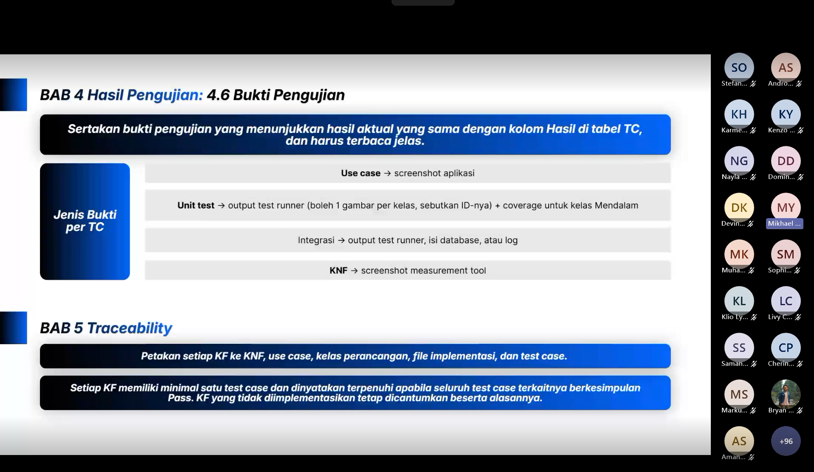

# Form Asistensi

## Tugas Besar IF2150 - Rekayasa Perangkat Lunak

| Informasi | Keterangan |
| --- | --- |
| **Hari** | *Senin* |
| **Tanggal** | *16/11/2026* |
| **Kelas** | *K02* |
| **Nomor Kelompok** | *G03*  |
| **Nama Kelompok** | *LockedIn*  |
| **Nama Perangkat Lunak** | *Silembur*  |
| **Dokumen** | *K02_G03_RG*  |

### Anggota Kelompok

| NIM | Nama |
| --- | --- |
| *13525059* | *Muhammad Pandu Pulunggana* |
| *13525128* | *Mochamad Fachri Alfaridzi* |
| *13525101* | *Kevin Lincoln Hutabarat* |
| *13525035* | *Muhammad Dhiya Rafi* |
| *13525098* | *Satya Radhityan Yahya* |

### Catatan

| Catatan |
| --- |
| 1. Software testing adalah suatu proses untuk mengevaluasi software berjalan sesuai dengan yang ditentukan sebelumnya, hal ini dilakukan untuk menemukan bug lebih awal. |
| 2. Ada 2 cara dalam software testing, secara manual dan secara automatis. |
| 3. TIdak semua kelas perlu untuk diuji dalam HIUPL, untuk menentukan kelas yang perlu diuji klasifikasikan kelas dengan tingkatan kedalaman mendalam, sedang, dan tidak perlu. Kelas "tidak perlu" tidak diuji dalam unit testing, tetapi tetap teruji dalam TC use case. |
| 4. Pengujian unit black box berarti menguji dari luar tanpa mengetahui kode sumber, sedangkan white box merarti menguji dengan memeriksa struktur internal kode. |
| 5. Untuk database seharusnya dibuat 2, database utama dan testing. Sehingga jika ingin menguji testcase yang mengakses database, bisa menggunakan database testing (dummy). |
| 6. Jika ada kelas yang dirombak (ditambahkan atau digabung), gunakan saja kelas yang ada di SKPL. Cantumkan juga justifikasi mengapa ada kelas yang dirombak. |

## Dokumentasi

<!--  -->

  

  <i>Gambar 1. Dokumentasi kegiatan asistensi.</i>

