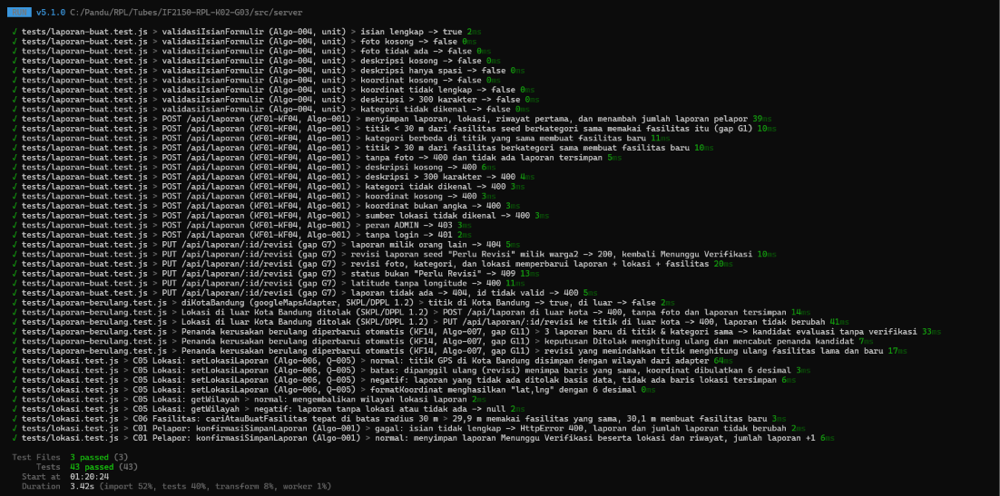
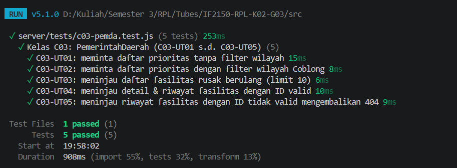
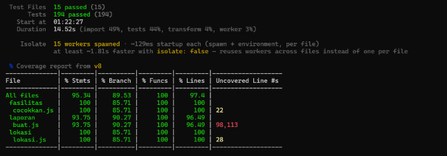
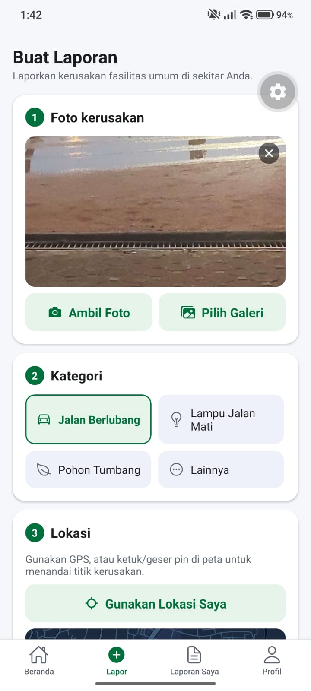
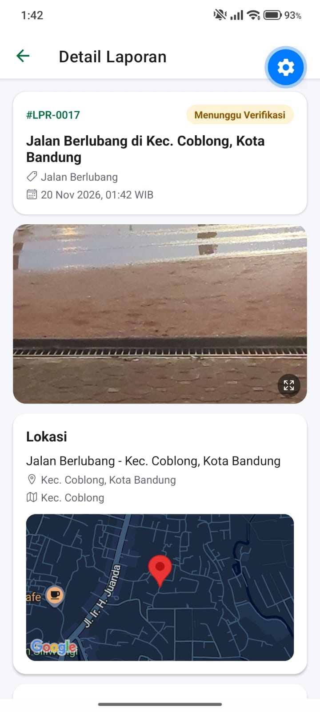
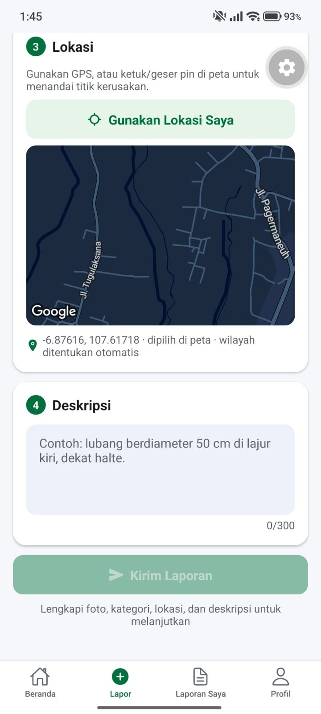
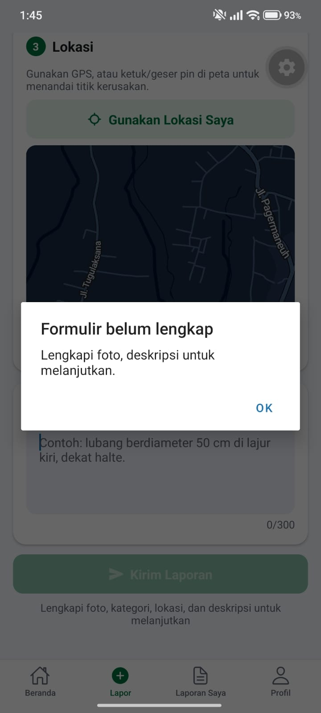
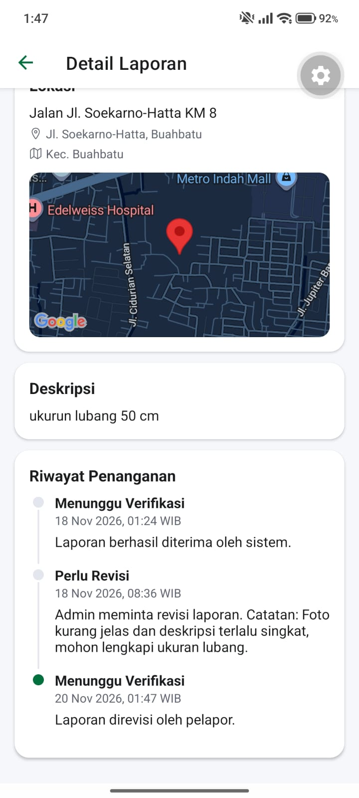
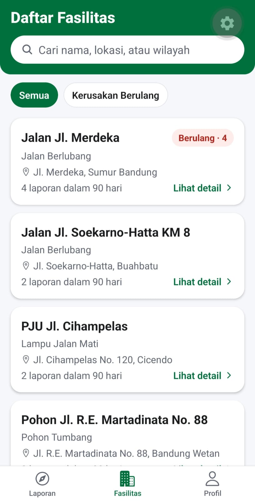
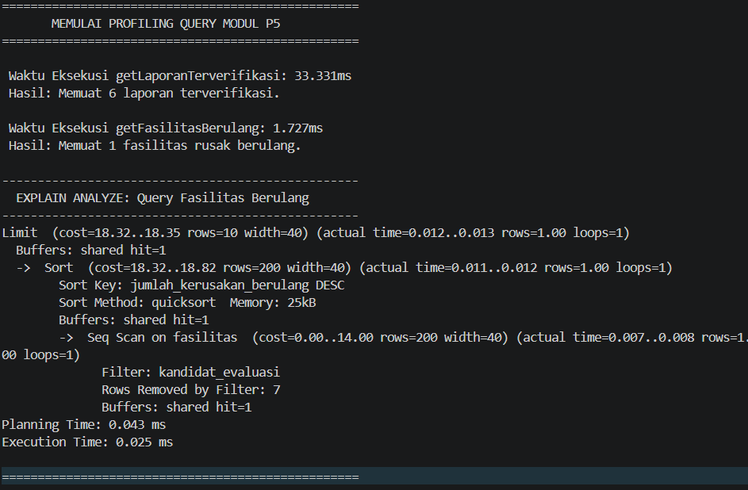

<h1>
IF2150 REKAYASA PERANGKAT LUNAK
 
TUGAS 10
 
HASIL IMPLEMENTASI DAN UJI PERANGKAT LUNAK (HIUPL)
</h1>
 

## *SILEMBUR*
### *LOGO*

### Untuk: *Amanda Aurellia Salsabila*

Dipersiapkan oleh:
| Informasi | Keterangan |
| --- | --- |
| Kelas | *K02* |
| Kelompok | *G03* |

| NIM | Nama |
|---|---|
| *13525059* | *Muhammad Pandu Pulunggana* |
| *13525128* | *Mochamad Fachri Alfaridzi* |
| *13525101* | *Kevin Lincoln Hutabarat* |
| *13525035* | *Muhammad Dhiya Rafi* |
| *13525098* | *Satya Radhityan Yahya* |

---

## Daftar Isi

- [BAB 1: Pendahuluan](#bab-1-pendahuluan)
  - [1.1 Tujuan Penulisan Dokumen](#11-tujuan-penulisan-dokumen)
  - [1.2 Lingkup Masalah](#12-lingkup-masalah)
  - [1.3 Definisi, Istilah, dan Singkatan](#13-definisi-istilah-dan-singkatan)
  - [1.4 Aturan Penomoran](#14-aturan-penomoran)
  - [1.5 Referensi](#15-referensi)
  - [1.6 Deskripsi Umum Dokumen (Ikhtisar)](#16-deskripsi-umum-dokumen-ikhtisar)
- [BAB 2: Deskripsi Umum Perangkat Lunak](#bab-2-deskripsi-umum-perangkat-lunak)
- [BAB 3: Implementasi](#bab-3-implementasi)
  - [3.1 Lingkungan Implementasi](#31-lingkungan-implementasi)
  - [3.2 Implementasi Modul](#32-implementasi-modul)
  - [3.3 Implementasi Antarmuka](#33-implementasi-antarmuka)
  - [3.4 File Lain](#34-file-lain)
- [BAB 4: Hasil Pengujian](#bab-4-hasil-pengujian)
  - [4.1 Strategi dan Kedalaman Pengujian Kelas](#41-strategi-dan-kedalaman-pengujian-kelas)
  - [4.2 Pengujian Unit Kelas](#42-pengujian-unit-kelas)
  - [4.3 Pengujian Integrasi](#43-pengujian-integrasi)
  - [4.4 Pengujian Use Case](#44-pengujian-use-case)
  - [4.5 Pengujian Kebutuhan Non-Fungsional (KNF)](#45-pengujian-kebutuhan-non-fungsional-knf)
  - [4.6 Tangkapan Layar dan Bukti Hasil Pengujian](#46-tangkapan-layar-dan-bukti-hasil-pengujian)
- [BAB 5: Traceability](#bab-5-traceability)

---

## Daftar Perubahan

| Revisi | Deskripsi |
| :--- | :--- |
| *A* | *Deskripsikan perubahan yang dilakukan dari dokumen sebelumnya pada dokumen ini. Jika tidak terdapat perubahan, harap kosongkan tabel.* |
| *B* |  |
| *C* |  |
| ... |  |

---

# BAB 1: Pendahuluan

## 1.1 Tujuan Penulisan Dokumen
Tuliskan uraian ringkas mengenai isi dokumen, tujuan pembuatan dokumen HIUPL ini, dan siapa saja target pembacanya.

## 1.2 Lingkup Masalah

SILEMBUR (Sistem Informasi Lembur) adalah aplikasi web mobile untuk melaporkan kerusakan fasilitas umum seperti jalan berlubang, lampu penerangan jalan yang mati, dan pohon tumbang. Nama "lembur" diambil dari bahasa Sunda yang berarti kampung. Masyarakat membuat laporan berisi foto, lokasi GPS, dan deskripsi kerusakan. Admin kemudian memverifikasi laporan tersebut sebelum diteruskan ke pemerintah daerah. Kanal pengaduan yang ada saat ini, seperti SP4N-LAPOR dan JAKI, memperlakukan setiap laporan sebagai pengaduan terpisah. Akibatnya laporan duplikat menumpuk, prioritas penanganan tidak langsung terlihat, dan riwayat kerusakan suatu fasilitas sulit ditelusuri. SILEMBUR menangani masalah tersebut dengan menggabungkan laporan duplikat, menghitung skor prioritas setiap laporan terverifikasi, dan mencatat riwayat status per fasilitas. Cakupan sistem dibatasi pada satu kota dengan tiga jenis pengguna, yaitu masyarakat umum, admin, dan pemerintah daerah.

## 1.3 Definisi, Istilah, dan Singkatan
Semua definisi dan singkatan yang digunakan dalam dokumen ini beserta penjelasannya.

Tabel 1.3. Definisi Istilah dan Singkatan

| Singkatan, Akronim, atau Istilah | Penjelasan |
| :--- | :--- |
| *P/L* | *Singkatan dari Perangkat Lunak, yaitu aplikasi yang memberikan perintah kepada komputer untuk menjalankan tugas tertentu.* |
| *SKPL* | *Singkatan dari Spesifikasi Kebutuhan Perangkat Lunak, yaitu dokumen yang merangkum kriteria-kriteria yang diperlukan untuk membangun aplikasi menjalankan tugasnya.* |
| *DPPL* | *Singkatan dari Deskripsi Perancangan Perangkat Lunak, yaitu dokumen yang menjelaskan rancangan arsitektur, kelas, dan antarmuka P/L.* |
| *HIUPL* | *Singkatan dari Hasil Implementasi dan Uji Perangkat Lunak, yaitu dokumen yang melaporkan hasil implementasi dan pengujian P/L.* |
| *KF* | *Singkatan dari Kebutuhan Fungsional.* |
| *KNF* | *Singkatan dari Kebutuhan Non-Fungsional.* |
| *UC* | *Singkatan dari Use Case.* |
| *TC* | *Singkatan dari Test Case, yaitu satu kasus uji untuk skenario tertentu.* |
| *UT* | *Singkatan dari Unit Test, yaitu test case tingkat kelas/operasi.* |
| *INT* | *Singkatan dari Integration Test, yaitu test case yang menguji interaksi antarkomponen.* |
| *Boundary* | *Kasus uji pada nilai batas masukan, misalnya nilai minimum, maksimum, atau tepat di ambang aturan.* |
| *Coverage* | *Persentase baris/cabang kode yang dieksekusi oleh pengujian.* |
 *IK* | *Singkatan dari Antarmuka Komponen, yaitu titik interaksi antara dua komponen, misalnya Controller ke Model, aplikasi ke basis data, atau aplikasi ke sistem eksternal.* |
| *Algo* | *Penanda algoritma operasi kelas yang dirancang pada DPPL 2.* |
| *Q* | *Penanda query basis data yang dirancang pada DPPL 2.* |
| *Vitest* | *Framework pengujian JavaScript yang dipakai untuk menjalankan unit test dan integration test pada server.* |
| *Supertest* | *Library untuk mengirim permintaan HTTP ke aplikasi Express pada saat pengujian tanpa menjalankan server secara terpisah.* |
| *Test Runner* | *Program yang menjalankan kumpulan test dan menampilkan hasilnya, dalam dokumen ini adalah Vitest.* |
| *Mock* | *Objek tiruan yang menggantikan komponen asli saat pengujian.* |
| *Seed* | *Data awal yang dimasukkan ke basis data untuk keperluan pengujian dan demonstrasi, misalnya akun uji dan laporan contoh.* |
| *Adapter* | *Komponen yang menghubungkan aplikasi dengan layanan eksternal, misalnya GoogleMapsAdapter dan CloudStorageAdapter.* |
| *DBMS* | *Singkatan dari Database Management System, yaitu perangkat lunak yang mengelola basis data.* |

## 1.4 Aturan Penomoran
Tuliskan aturan penomoran (ID) yang digunakan dalam dokumen ini. Gunakan pola ID yang **sama** dengan yang sudah dipakai pada dokumen-dokumen sebelumnya (SKPL, APL, DPPL), kecuali untuk ID pengujian yang baru diperkenalkan pada dokumen ini.

Tabel 1.4. Aturan Penomoran

| Hal/Bagian | Penomoran | Keterangan |
| :--- | :--- | :--- |
| *Kebutuhan Fungsional* | *KFXX* | *Sesuai SKPL* |
| *Kebutuhan Non-Fungsional* | *KNFXX* | *Sesuai SKPL* |
| *Use Case* | *UCXX* | *Sesuai SKPL* |
| *Kelas* | *CXX* | *Sesuai DPPL* |
| *Antarmuka* | *I-XX* | *Sesuai DPPL* |
| *Test Case Unit* | *CXX-UTYY* | *XX adalah nomor kelas, YY adalah nomor urut test case unit pada kelas tersebut* |
| *Test Case Integrasi* | *INT-TCYY* | *YY adalah nomor urut test case integrasi* |
| *Test Case Use Case* | *UCXX-TCYY* | *XX adalah nomor use case, YY adalah nomor urut test case pada use case tersebut* |
| *Test Case KNF* | *KNFXX-TCYY* | *XX adalah nomor KNF, YY adalah nomor urut test case pada KNF tersebut* |

## 1.5 Referensi
Cantumkan daftar buku, panduan, atau dokumentasi lain yang dirujuk dalam pembuatan dokumen dan pengembangan P/L, **minimal dokumen SKPL, APL, DPPL, dan Implementasi (Tugas 9)**. Tambahkan dokumentasi *framework*/*library*/*testing tool* atau referensi lain apabila digunakan.

- Kelompok K02 G03. *Spesifikasi Kebutuhan Perangkat Lunak (SKPL) SILEMBUR*
- Kelompok K02 G03. *Arsitektur Perangkat Lunak (APL) SILEMBUR*
- Kelompok K02 G03. *DESKRIPSI PERANCANGAN PERANGKAT LUNAK (DPPL) SILEMBUR*
- Kelompok K02 G03. *DESKRIPSI PERANCANGAN PERANGKAT LUNAK (DPPL) 2 SILEMBUR*
- Kelompok K02 G03. *IMPLEMENTASI SILEMBUR*
- Powerpoint Modul dari Edunex kelas Software Engineering [Parent Class]
- Sommerville, I. (2016). *Software Engineering* (10th ed.). Pearson

## 1.6 Deskripsi Umum Dokumen (Ikhtisar)
Dokumen HIUPL SILEMBUR ini terdiri dari lima bab. BAB 1 berisi pendahuluan dokumen. BAB 2 membahas deskripsi umum perangkat lunak beserta use case diagram yang diambil dari SKPL. BAB 3 membahas implementasi yang meliputi lingkungan implementasi serta daftar kelas, antarmuka, dan file lain yang telah diimplementasikan sesuai DPPL. BAB 4 menyajikan hasil pengujian yang meliputi strategi dan kedalaman pengujian kelas, pengujian unit kelas, pengujian integrasi, pengujian use case, pengujian kebutuhan non fungsional, serta bukti hasil pengujian. BAB 5 menyajikan matriks kerunutan antara KF, KNF, use case, kelas perancangan, file implementasi, dan test case.

 

---

# BAB 2: Deskripsi Umum Perangkat Lunak

Bagian ini diisi dengan *System Overview*, dalam bentuk gambar dan narasi yang memberikan gambaran tentang aplikasi dan konteksnya. **Batasan dan keterkaitan** antara sistem yang dibangun dengan sistem lain di luarnya harus jelas. Deskripsi umum sistem perlu dilengkapi dengan pemodelan kasus yang dihadapi, seperti *use case diagram*. Berikan narasi yang jelas untuk setiap gambar yang ditampilkan.

Bagian ini dapat menyalin atau meringkas dari dokumen SKPL atau DPPL.

Silembur merupakan sistem aplikasi pelaporan untuk fasilitas umum yang mengalami kerusakan. Laporan dapat dibuat oleh masyarakat umum, pengguna cukup mencantumkan detail yang diperlukan melalui antarmuka aplikasi lalu menyimpan laporan tersebut. Setelah itu, admin akan memverifikasi apakah laporan tersebut valid atau tidak valid. Laporan yang sudah valid akan disimpan di database yang dapat Pemerintah Daerah akses untuk melakukan penanganan lebih lanjut. Proses perbaikan fasilitas akan diperbaharui secara berkala melalui aplikasi sehingga pengguna juga dapat memantau perkembangan dari perbaikan yang dilakukan.

[text](../M5/K02_G03_SKPL.md)

<i>Gambar 2.1. Use Case Diagram [Nama P/L]</i>

 

---

# BAB 3: Implementasi

Bagian ini diisi dengan informasi tentang elemen P/L yang dikembangkan (*executable files*, *configuration files*, *data files*, dan sebagainya) serta perubahannya terhadap rancangan pada DPPL (jika ada).

## 3.1 Lingkungan Implementasi

Tuliskan *hardware* dan *software* yang digunakan untuk implementasi, mencakup *operating system*, bahasa pemrograman beserta versinya, *framework*/*library*, DBMS, *development tools*, dan *version control*. Lingkungan ini harus konsisten dengan **Subbab 2.1 DPPL**; jelaskan jika ada perubahan. Cantumkan juga *framework* dan alat pengujian yang dipakai.

Tabel 3.1. Lingkungan Implementasi

| Aspek | Keterangan |
| :--- | :--- |
| *Hardware* | *[Spesifikasi perangkat keras]* |
| *Operating System* | *[Nama dan versi OS]* |
| *Bahasa Pemrograman* | *[Bahasa dan versi]* |
| *Framework/Library* | *[Daftar framework/library beserta versi]* |
| *DBMS* | *[Nama dan versi DBMS]* |
| *Development Tools* | *[IDE, version control, tools lain]* |
| *Testing Tools* | *[Framework unit test, alat ukur performa, alat coverage]* |

## 3.2 Implementasi Modul

Daftar modul/kelas yang **TELAH** diimplementasikan. Gunakan nama dan ID kelas yang sama dengan DPPL, dan konsisten dengan Tabel B.5 pada dokumen Implementasi (Tugas 9).

Tabel 3.2. Implementasi Modul

| No | ID Kelas | Nama Modul/Kelas | Nama File Fisik | Nama File Executable |
| :--- | :--- | :--- | :--- | :--- |
| 1 | *[C01]* | *[Nama modul/kelas]* | *[path/ke/file]* | *[Nama file executable, atau - jika tidak ada]* |
| 2 | *[C02]* | *[Nama modul/kelas]* | *[path/ke/file]* | *[...]* |
| ... | *...* | *...* | *...* | *...* |

## 3.3 Implementasi Antarmuka

Daftar antarmuka yang telah diimplementasikan. Gunakan ID dan nama layar yang sama dengan ID dan nama layar pada tugas DPPL.

Tabel 3.3. Implementasi Antarmuka

| No | ID Antarmuka | Nama Antarmuka | Nama File Fisik | Nama File Executable |
| :--- | :--- | :--- | :--- | :--- |
| 1 | *[I-01]* | *[Nama layar]* | *[path/ke/file]* | *[Nama file executable, atau - jika tidak ada]* |
| 2 | *[I-02]* | *[Nama layar]* | *[path/ke/file]* | *[...]* |
| ... | *...* | *...* | *...* | *...* |

## 3.4 File Lain

Daftar file lain yang dibuat selain file kelas dan antarmuka, misalnya file *utility*, *configuration*, *database schema/seed*, *file test*, atau *data*.

Tabel 3.4. File Lain

| No | Nama File | Keterangan |
| :--- | :--- | :--- |
| 1 | *[Nama file]* | *[Fungsi file]* |
| ... | *...* | *...* |

 

---

# BAB 4: Hasil Pengujian

Bab ini melaporkan hasil pengujian P/L pada level unit, integrasi, dan sistem. Pengujian dilakukan pada tag release terakhir Tugas 9. Hasil aktual diisi berdasarkan pengamatan saat pengujian. Kesimpulan diisi `Pass` atau `Fail`, dan untuk `Fail` dilengkapi penyebab serta usulan perbaikan.

## 4.1 Strategi dan Kedalaman Pengujian Kelas

Setiap kelas perancangan pada Tabel 4.1 DPPL diklasifikasikan ke dalam tiga tingkat kedalaman pengujian. Tingkat **Mendalam** diberikan pada kelas yang memuat logika bisnis, perhitungan, validasi, aturan status, algoritma, integrasi eksternal, atau keamanan. Tingkat **Sedang** diberikan pada kelas yang hanya mengoordinasikan atau mendelegasikan proses. Tingkat **Tidak perlu** diberikan pada kelas tanpa logika, seperti *entity/DTO* dan kelas konfigurasi, yang teruji secara tidak langsung melalui test case use case. Seluruh kelas wajib dicantumkan beserta alasan penentuan tingkatnya.

Tabel 4.1.1. Identifikasi Tingkat Pengujian Kelas

| ID Kelas | Nama Kelas | Tingkat | Alasan | Test Case Terkait |
| :--- | :--- | :--- | :--- | :--- |
| C01 | Pelapor | Sedang | Mengoordinasikan penyimpanan laporan dan pembacaan laporan milik pelapor. Validasi dan penyimpanan didelegasikan ke Laporan | C01-UT01 s.d. C01-UT07 |
| C02 | Admin | Sedang | Meneruskan keputusan verifikasi ke Verifikasi dan mengambil daftar laporan dari Laporan | C02-UT01 s.d. C02-UT04 |
| C03 | PemerintahDaerah | Sedang | Meneruskan filter dan permintaan daftar prioritas ke Laporan dan Fasilitas | C03-UT01 s.d. C03-UT05 |
| C04 | Laporan | Mendalam | Memuat validasi isian formulir (Algo-004), aturan transisi status (`ubahStatus()`), serta filter dan urutan prioritas | C04-UT01 s.d. C04-UT17 |
| C05 | Lokasi | Mendalam | Memuat penentuan lokasi laporan (Algo-006) dan integrasi eksternal Google Maps untuk wilayah | C05-UT01 s.d. C05-UT05 |
| C06 | Fasilitas | Mendalam | Memuat pencocokan fasilitas radius 30 m dan penandaan kandidat evaluasi berdasarkan ambang batas | C06-UT01 s.d. C06-UT12 |
| C07 | Verifikasi | Mendalam | Memuat aturan keputusan setuju, tolak, dan revisi (Algo-002) serta penahanan laporan | C07-UT01 s.d. C07-UT06 |
| C08 | SkorPrioritas | Mendalam | Memuat perhitungan skor prioritas (Algo-009) dan perhitungan ulang skor yang kedaluwarsa | C08-UT01 s.d. C08-UT06 |
| C09 | RiwayatStatus | Sedang | Hanya mencatat dan membaca riwayat perubahan status tanpa perhitungan | C09-UT01 s.d. C09-UT03 |
| C10 | Notifikasi | Sedang | Hanya menyimpan, membaca, dan menandai pesan notifikasi | C10-UT01 s.d. C10-UT06 |
| C11 | KonfirmasiDuplikat | Mendalam | Memuat penggabungan laporan dalam satu transaksi (Algo-012), penentuan laporan induk, dan penolakan kategori berbeda | C11-UT01 s.d. C11-UT06 |

## 4.2 Pengujian Unit Kelas

Pengujian unit dilakukan pada kelas bertingkat Mendalam dan Sedang. Kelas Mendalam diuji pada seluruh operasi public dengan kasus normal, batas, dan negatif, serta mencapai *coverage* minimal 70%. Kelas Sedang diuji minimal dengan satu kasus normal dan satu kasus gagal pada operasi public utama.

Cara menjalankan unit test: dari folder `src`, jalankan `npm run db:up`, lalu `npm test`. Untuk coverage, pasang `@vitest/coverage-v8` dengan versi yang sama dengan Vitest, lalu jalankan `npx vitest run --coverage` dari folder `src/server`.

Lokasi file test: `src/server/tests/`.

### 4.2.1 Kelas Pelapor

**ID Kelas:** C01  
**Nama Kelas:** Pelapor  
**Tingkat:** Sedang

Tabel 4.2.1. Hasil Pengujian Unit Kelas C01

| ID Pengujian | Operasi yang Diuji | Jenis Kasus | Prosedur/Masukan | Hasil yang Diharapkan | Hasil Pengujian | Kesimpulan |
| :--- | :--- | :--- | :--- | :--- | :--- | :--- |
| C01-UT01 | `konfirmasiSimpanLaporan()` | Normal | Panggil langsung dengan foto, deskripsi berspasi di awal dan akhir, kategori Jalan Berlubang, titik -6.9147, 107.6098 (Kota Bandung), wilayah dan alamat dari adapter | Laporan tersimpan berstatus Menunggu Verifikasi, deskripsi tanpa spasi tepi, baris lokasi terbentuk, jumlah laporan pelapor bertambah 1 | Laporan tersimpan berstatus Menunggu Verifikasi dengan deskripsi "Jalan berlubang di depan sekolah.", wilayah lokasi terisi, jumlah laporan bertambah 1 | Pass |
| C01-UT02 | `konfirmasiSimpanLaporan()` | Gagal | Panggil langsung dengan deskripsi berisi spasi saja | Melempar `HttpError` 400, jumlah baris laporan dan jumlah laporan pelapor tidak berubah | Melempar `HttpError` berstatus 400, jumlah laporan dan jumlah laporan pelapor sama dengan sebelum pemanggilan | Pass |
| C01-UT03 | `konfirmasiSimpanLaporan()` dan `revisiLaporan()` terhadap atribut `jumlahLaporan` | Normal | Kirim laporan baru lewat `POST /api/laporan` sebagai warga1, lalu revisi sebuah laporan lewat `PUT /api/laporan/:id/revisi` | Kolom `jumlah_laporan` bertambah 1 setelah laporan baru, tidak berubah setelah revisi | `jumlah_laporan` bertambah 1 setelah laporan baru dan tetap sama setelah revisi | Pass |
| C01-UT04 |  |  |  |  |  |  |
| C01-UT05 |  |  |  |  |  |  |
| C01-UT06 |  |  |  |  |  |  |
| C01-UT07 |  |  |  |  |  |  |

### 4.2.2 Kelas Admin

**ID Kelas:** C02  
**Nama Kelas:** Admin  
**Tingkat:** Sedang

Tabel 4.2.2. Hasil Pengujian Unit Kelas C02

| ID Pengujian | Operasi yang Diuji | Jenis Kasus | Prosedur/Masukan | Hasil yang Diharapkan | Hasil Pengujian | Kesimpulan |
| :--- | :--- | :--- | :--- | :--- | :--- | :--- |
| C02-UT01 |  |  |  |  |  |  |
| C02-UT02 |  |  |  |  |  |  |
| C02-UT03 |  |  |  |  |  |  |
| C02-UT04 |  |  |  |  |  |  |

### 4.2.3 Kelas PemerintahDaerah

**ID Kelas:** C03  
**Nama Kelas:** PemerintahDaerah  
**Tingkat:** Sedang

Tabel 4.2.3. Hasil Pengujian Unit Kelas C03

| ID Pengujian | Operasi yang Diuji | Jenis Kasus | Prosedur/Masukan | Hasil yang Diharapkan | Hasil Pengujian | Kesimpulan |
| :--- | :--- | :--- | :--- | :--- | :--- | :--- |
| C03-UT01 | `mintaPrioritas()` | Normal | Meminta data tanpa filter wilayah | Mengembalikan seluruh daftar prioritas aktif | Mengembalikan array laporan prioritas yang diurutkan berdasar skor | Pass |
| C03-UT02 | `mintaPrioritas()` | Normal | Filter data menggunakan parameter kecamatan "Coblong" | Hanya mengembalikan laporan prioritas pada kecamatan Coblong | Data laporan tersaring dengan wilayah kecamatan "Coblong" saja | Pass |
| C03-UT03 | `tinjauFasilitasBerulang()` | Normal | Meminta daftar fasilitas dengan limit 10 | Mengembalikan daftar fasilitas rusak berulang maksimal 10 baris | Array dengan panjang <= 10 dan bendera kandidat_evaluasi = true | Pass |
| C03-UT04 | `tinjauRiwayatFasilitas()` | Normal | Memasukkan ID fasilitas yang valid | Mengembalikan daftar riwayat laporan pada fasilitas tersebut | Mengembalikan array riwayat log status fasilitas dengan urutan kronologis | Pass |
| C03-UT05 | `tinjauRiwayatFasilitas` | Negatif | Memasukkan ID fasilitas 999999 yang tidak eksis di database | Melempar error/kosong | Mengembalikan array kosong atau HttpError 404 | Pass |

### 4.2.4 Kelas Laporan

**ID Kelas:** C04  
**Nama Kelas:** Laporan  
**Tingkat:** Mendalam

Tabel 4.2.4. Hasil Pengujian Unit Kelas C04

| ID Pengujian | Operasi yang Diuji | Jenis Kasus | Prosedur/Masukan | Hasil yang Diharapkan | Hasil Pengujian | Kesimpulan |
| :--- | :--- | :--- | :--- | :--- | :--- | :--- |
| C04-UT01 | `validasiIsianFormulir()` | Normal | Foto, deskripsi, kategori Jalan Berlubang, dan koordinat lengkap, baik berbentuk teks "-6.9,107.6" maupun objek latitude dan longitude | `true` | Mengembalikan `true` untuk kedua bentuk koordinat | Pass |
| C04-UT02 | `validasiIsianFormulir()` | Batas | Deskripsi tepat 300 karakter, lalu 301 karakter | 300 karakter `true`, 301 karakter `false` | 300 karakter `true`, 301 karakter `false` | Pass |
| C04-UT03 | `validasiIsianFormulir()` | Negatif | Masing-masing: foto kosong, foto tidak ada, deskripsi kosong, deskripsi hanya spasi, koordinat kosong, koordinat tanpa longitude, kategori "Banjir" | `false` untuk setiap masukan | Mengembalikan `false` untuk ketujuh masukan | Pass |
| C04-UT04 | `simpanLaporan()` | Normal | `POST /api/laporan` sebagai warga1 dengan foto PNG, kategori Lampu Jalan Mati, deskripsi, dan titik GPS sekitar 10 m dari fasilitas seed | Respons 201, status Menunggu Verifikasi, file foto tersimpan, lokasi bersumber GPS, riwayat pertama "Laporan berhasil diterima oleh sistem.", tanpa identitas pelapor | Respons 201 dengan status Menunggu Verifikasi, foto tersimpan di folder unggahan, lokasi bersumber GPS, satu baris riwayat sesuai, respons tidak memuat data pelapor | Pass |
| C04-UT05 | `simpanLaporan()` | Negatif | `POST /api/laporan` tanpa foto, lalu masing-masing dengan deskripsi spasi, deskripsi 301 karakter, kategori "Banjir", latitude kosong, longitude "abc", dan sumber lokasi "SATELIT" | Respons 400 dengan nama field yang salah, tidak ada laporan tersimpan | Semua respons 400 dan menyebut field yang salah, jumlah laporan pelapor tidak bertambah | Pass |
| C04-UT06 | `revisiLaporan()` | Normal | `PUT /api/laporan/:id/revisi` oleh warga2 pada laporan seed berstatus Perlu Revisi dengan deskripsi baru, lalu revisi laporan lain dengan foto, kategori Jalan Berlubang, dan titik manual baru | Respons 200, status kembali Menunggu Verifikasi, riwayat "Laporan direvisi oleh pelapor.", lokasi dan fasilitas ikut diperbarui saat titik atau kategori berubah | Respons 200, status Menunggu Verifikasi, riwayat Perlu Revisi ke Menunggu Verifikasi tercatat, koordinat menjadi -6.917500,107.619100 bersumber MANUAL, fasilitas berganti | Pass |
| C04-UT07 | `revisiLaporan()` | Negatif | Revisi laporan berstatus Menunggu Verifikasi, revisi laporan milik pengguna lain, latitude tanpa longitude, id 999999, dan id "abc" | Berturut-turut 409, 404, 400, 404, 400, tanpa perubahan data | Respons berturut-turut 409, 404, 400, 404, 400, status laporan milik pengguna lain tetap Perlu Revisi | Pass |
| C04-UT08 |  |  |  |  |  |  |
| C04-UT09 |  |  |  |  |  |  |
| C04-UT10 |  |  |  |  |  |  |
| C04-UT11 |  |  |  |  |  |  |
| C04-UT12 |  |  |  |  |  |  |
| C04-UT13 |  |  |  |  |  |  |
| C04-UT14 | `getLaporanTerverifikasi()` | Normal | Panggil fungsi menggunakan objek pool tanpa opsi filter khusus | Mengembalikan daftar laporan terverifikasi terurut skor menurun | Laporan berhasil diambil, dengan `skor_akhir` tertinggi berada di indeks 0 | Pass |
| C04-UT15 | `getLaporanTerverifikasi()` | Batas | Panggil fungsi saat seluruh laporan memiliki skor prioritas sama | Laporan tetap diambil dan diurutkan menggunakan kriteria tanggal sekunder | Laporan ditarik dengan sukses, diurutkan menurut waktu pembuatan logis | Pass |
| C04-UT16 | `getLaporanTerverifikasi()` | Normal | Opsi filter kecamatan valid (contoh: "Regol") | Mengembalikan laporan yang hanya terletak di wilayah tersebut | Hasil saringan 100% cocok dengan field kecamatan "Regol" | Pass |
| C04-UT17 | `getLaporanTerverifikasi()` | Negatif | Opsi filter kecamatan string kosong atau null | Mengabaikan filter kecamatan dan mengembalikan semua laporan | Fungsi berjalan lancar tanpa error, semua data dari seluruh wilayah dimuat | Pass |

Tabel 4.2.4b. Ringkasan Cakupan Kelas C04

| Informasi | Keterangan |
| :--- | :--- |
| Daftar operasi public pada DPPL |  |
| Operasi yang diuji |  |
| ID Algoritma yang tercakup |  |
| Coverage (wajib ≥ 70%) |  |

### 4.2.5 Kelas Lokasi

**ID Kelas:** C05  
**Nama Kelas:** Lokasi  
**Tingkat:** Mendalam

Tabel 4.2.5. Hasil Pengujian Unit Kelas C05

| ID Pengujian | Operasi yang Diuji | Jenis Kasus | Prosedur/Masukan | Hasil yang Diharapkan | Hasil Pengujian | Kesimpulan |
| :--- | :--- | :--- | :--- | :--- | :--- | :--- |
| C05-UT01 | `setLokasiLaporan(koordinat)` | Normal | Laporan tanpa lokasi, titik -6.9147, 107.6098 tanpa wilayah dan sumber | Satu baris lokasi dengan koordinat "-6.914700,107.609800", sumber GPS, wilayah kecamatan Bandung dari adapter | Satu baris lokasi tersimpan dengan koordinat dan sumber GPS sesuai, wilayah terisi kecamatan di Kota Bandung | Pass |
| C05-UT02 | `setLokasiLaporan(koordinat)` | Batas | Panggil dua kali untuk laporan yang sama, kedua kalinya dengan -6.91750049, 107.61910051, sumber MANUAL, wilayah Regol | Baris lama ditimpa, tetap satu baris, koordinat dibulatkan menjadi "-6.917500,107.619101" | Tetap satu baris, koordinat "-6.917500,107.619101", sumber MANUAL, wilayah Regol | Pass |
| C05-UT03 | `setLokasiLaporan(koordinat)` | Negatif | Panggil untuk id laporan 999999 yang tidak ada | Ditolak basis data (foreign key), tidak ada baris lokasi tersimpan | Pemanggilan gagal dengan error basis data, tidak ada baris lokasi untuk id 999999 | Pass |
| C05-UT04 | `getWilayah()` | Normal | Laporan dengan lokasi berwilayah Coblong | "Coblong" | Mengembalikan "Coblong" | Pass |
| C05-UT05 | `getWilayah()` | Negatif | Laporan yang belum punya lokasi, lalu id 999999 | `null` untuk keduanya | Mengembalikan `null` untuk keduanya | Pass |

Tabel 4.2.5b. Ringkasan Cakupan Kelas C05

| Informasi | Keterangan |
| :--- | :--- |
| Daftar operasi public pada DPPL | `setLokasiLaporan(koordinat: String)`, `getWilayah(): String` |
| Operasi yang diuji | `setLokasiLaporan()`, `getWilayah()` |
| ID Algoritma yang tercakup | Algo-006, Q-005 |
| Coverage (wajib ≥ 70%) | `src/server/src/models/lokasi/lokasi.js`: 100% baris, 85,71% cabang, diukur dengan `@vitest/coverage-v8` pada seluruh test suite. Bukti pada Tabel 4.6 |

### 4.2.6 Kelas Fasilitas

**ID Kelas:** C06  
**Nama Kelas:** Fasilitas  
**Tingkat:** Mendalam

Tabel 4.2.6. Hasil Pengujian Unit Kelas C06

| ID Pengujian | Operasi yang Diuji | Jenis Kasus | Prosedur/Masukan | Hasil yang Diharapkan | Hasil Pengujian | Kesimpulan |
| :--- | :--- | :--- | :--- | :--- | :--- | :--- |
| C06-UT01 | `cariAtauBuatFasilitas()` | Normal | Laporan Lampu Jalan Mati sekitar 10 m dari fasilitas seed "PJU Jl. Dago Atas RT 03" | Laporan ditautkan ke fasilitas seed tersebut | Laporan ditautkan ke fasilitas "PJU Jl. Dago Atas RT 03" | Pass |
| C06-UT02 | `cariAtauBuatFasilitas()` | Batas | Fasilitas Pohon Tumbang baru, lalu titik berjarak 29,9 m dan 30,1 m darinya dengan kategori sama | 29,9 m memakai fasilitas yang sama, 30,1 m membuat fasilitas baru | 29,9 m mengembalikan id fasilitas yang sama dengan `baru: false`, 30,1 m membuat fasilitas baru | Pass |
| C06-UT03 | `cariAtauBuatFasilitas()` | Negatif | Titik sekitar 45 m dari fasilitas seed dengan kategori sama, lalu titik yang sama dengan fasilitas seed tetapi kategori Pohon Tumbang | Keduanya membuat fasilitas baru, fasilitas kedua berkategori Pohon Tumbang dengan wilayah sama dengan lokasi laporan | Keduanya membuat fasilitas baru, jumlah fasilitas bertambah dan kategori serta wilayah sesuai | Pass |
| C06-UT04 | `getFasilitasBerulang()` | Normal | Panggil fungsi dengan limit default (100) pada data seed | Daftar fasilitas dengan `kandidat_evaluasi = true` | Mengembalikan 1 baris data fasilitas rusak berulang | Pass |
| C06-UT05 | `getFasilitasBerulang()` | Batas | Panggil fungsi dengan parameter limit = 0 | Memanggil fallback limit atau mengembalikan array kosong dengan aman | Array kosong dikembalikan tanpa error database | Pass |
| C06-UT06 | `getFasilitasBerulang()` | Negatif | Menggunakan pool database yang sengaja ditutup sebelum query | Menghasilkan error koneksi | Melempar error 'Client was closed' secara terkendali | Pass |
| C06-UT07 | `getRiwayatFasilitas()` | Normal | Panggil fungsi dengan `id_fasilitas` fasilitas seed yang rusak berulang | Daftar laporan terkait fasilitas tersebut lengkap dengan riwayat | Array riwayat laporan terkait fasilitas berhasil diambil secara kronologis | Pass |
| C06-UT08 | `getRiwayatFasilitas()` | Batas | Panggil untuk fasilitas baru yang belum diverifikasi admin | Array riwayat laporan tetap terambil namun hanya status awal | Data berhasil ditarik dengan 1 entri status "Menunggu Verifikasi" | Pass |
| C06-UT09 | `getRiwayatFasilitas()` | Negatif | Memasukkan nilai string acak "abc" sebagai `id_fasilitas` | Error validasi atau error query syntax postgres | PostgreSQL menolak query dengan kode error 22P02, tertangani aman | Pass |
| C06-UT10 | `updateKandidatEvaluasi()` | Normal | Simulasi update ambang batas kerusakan melewati angka 3 | Field `kandidat_evaluasi` menjadi true | Database berhasil dimutakhirkan, flag kandidat_evaluasi menyala | Pass |
| C06-UT11 | `updateKandidatEvaluasi()` | Batas | Simulasi tepat di angka ambang batas (contoh: 3) | Sesuai konfigurasi, menjadi true saat tepat atau melewatinya | Flag evaluasi bernilai true sesuai kriteria >= ambang batas | Pass |
| C06-UT12 | `updateKandidatEvaluasi()` | Negatif | ID fasilitas tidak valid saat mutakhirkan flag evaluasi | Tidak ada baris termutakhir | Mengembalikan indikator 0 row affected | Pass |

Tabel 4.2.6b. Ringkasan Cakupan Kelas C06

| Informasi | Keterangan |
| :--- | :--- |
| Daftar operasi public pada DPPL |  |
| Operasi yang diuji |  |
| ID Algoritma yang tercakup |  |
| Coverage (wajib ≥ 70%) |  |

### 4.2.7 Kelas Verifikasi

**ID Kelas:** C07  
**Nama Kelas:** Verifikasi  
**Tingkat:** Mendalam

Tabel 4.2.7. Hasil Pengujian Unit Kelas C07

| ID Pengujian | Operasi yang Diuji | Jenis Kasus | Prosedur/Masukan | Hasil yang Diharapkan | Hasil Pengujian | Kesimpulan |
| :--- | :--- | :--- | :--- | :--- | :--- | :--- |
| C07-UT01 |  |  |  |  |  |  |
| C07-UT02 |  |  |  |  |  |  |
| C07-UT03 |  |  |  |  |  |  |
| C07-UT04 |  |  |  |  |  |  |
| C07-UT05 |  |  |  |  |  |  |
| C07-UT06 |  |  |  |  |  |  |

Tabel 4.2.7b. Ringkasan Cakupan Kelas C07

| Informasi | Keterangan |
| :--- | :--- |
| Daftar operasi public pada DPPL |  |
| Operasi yang diuji |  |
| ID Algoritma yang tercakup |  |
| Coverage (wajib ≥ 70%) |  |

### 4.2.8 Kelas SkorPrioritas

**ID Kelas:** C08  
**Nama Kelas:** SkorPrioritas  
**Tingkat:** Mendalam

Tabel 4.2.8. Hasil Pengujian Unit Kelas C08

| ID Pengujian | Operasi yang Diuji | Jenis Kasus | Prosedur/Masukan | Hasil yang Diharapkan | Hasil Pengujian | Kesimpulan |
| :--- | :--- | :--- | :--- | :--- | :--- | :--- |
| C08-UT01 |  |  |  |  |  |  |
| C08-UT02 |  |  |  |  |  |  |
| C08-UT03 |  |  |  |  |  |  |
| C08-UT04 |  |  |  |  |  |  |
| C08-UT05 |  |  |  |  |  |  |
| C08-UT06 |  |  |  |  |  |  |

Tabel 4.2.8b. Ringkasan Cakupan Kelas C08

| Informasi | Keterangan |
| :--- | :--- |
| Daftar operasi public pada DPPL |  |
| Operasi yang diuji |  |
| ID Algoritma yang tercakup |  |
| Coverage (wajib ≥ 70%) |  |

### 4.2.9 Kelas RiwayatStatus

**ID Kelas:** C09  
**Nama Kelas:** RiwayatStatus  
**Tingkat:** Sedang

Tabel 4.2.9. Hasil Pengujian Unit Kelas C09

| ID Pengujian | Operasi yang Diuji | Jenis Kasus | Prosedur/Masukan | Hasil yang Diharapkan | Hasil Pengujian | Kesimpulan |
| :--- | :--- | :--- | :--- | :--- | :--- | :--- |
| C09-UT01 |  |  |  |  |  |  |
| C09-UT02 |  |  |  |  |  |  |
| C09-UT03 |  |  |  |  |  |  |

### 4.2.10 Kelas Notifikasi

**ID Kelas:** C10  
**Nama Kelas:** Notifikasi  
**Tingkat:** Sedang

Tabel 4.2.10. Hasil Pengujian Unit Kelas C10

| ID Pengujian | Operasi yang Diuji | Jenis Kasus | Prosedur/Masukan | Hasil yang Diharapkan | Hasil Pengujian | Kesimpulan |
| :--- | :--- | :--- | :--- | :--- | :--- | :--- |
| C10-UT01 |  |  |  |  |  |  |
| C10-UT02 |  |  |  |  |  |  |
| C10-UT03 |  |  |  |  |  |  |
| C10-UT04 |  |  |  |  |  |  |
| C10-UT05 |  |  |  |  |  |  |
| C10-UT06 |  |  |  |  |  |  |

### 4.2.11 Kelas KonfirmasiDuplikat

**ID Kelas:** C11  
**Nama Kelas:** KonfirmasiDuplikat  
**Tingkat:** Mendalam

Tabel 4.2.11. Hasil Pengujian Unit Kelas C11

| ID Pengujian | Operasi yang Diuji | Jenis Kasus | Prosedur/Masukan | Hasil yang Diharapkan | Hasil Pengujian | Kesimpulan |
| :--- | :--- | :--- | :--- | :--- | :--- | :--- |
| C11-UT01 |  |  |  |  |  |  |
| C11-UT02 |  |  |  |  |  |  |
| C11-UT03 |  |  |  |  |  |  |
| C11-UT04 |  |  |  |  |  |  |
| C11-UT05 |  |  |  |  |  |  |
| C11-UT06 |  |  |  |  |  |  |

Tabel 4.2.11b. Ringkasan Cakupan Kelas C11

| Informasi | Keterangan |
| :--- | :--- |
| Daftar operasi public pada DPPL |  |
| Operasi yang diuji |  |
| ID Algoritma yang tercakup |  |
| Coverage (wajib ≥ 70%) |  |

 

## 4.3 Pengujian Integrasi

Pengujian integrasi memeriksa interaksi antarkomponen yang melewati batas, yaitu *Controller* ke *Model*, aplikasi ke basis data, dan aplikasi ke sistem eksternal. Daftar antarmuka mengacu pada komponen di Tabel 2.3 dan Logical View DPPL 2, dengan minimal satu test case untuk setiap antarmuka. Pengujian memakai komponen nyata, bukan *mock*. Antarmuka antarkomponen diberi ID IK-XX supaya tidak tertukar dengan ID layar I-XX.

Tabel 4.3.1. Daftar Antarmuka Antarkomponen

| ID Antarmuka | Komponen Asal | Komponen Tujuan | Jenis Batas | Test Case |
| :--- | :--- | :--- | :--- | :--- |
| IK-01 |  |  |  |  |
| IK-02 |  |  |  |  |
| IK-03 |  |  |  |  |
| IK-04 |  |  |  |  |
| IK-05 |  |  |  |  |
| IK-06 | LaporanController (buat dan revisi) | Laporan, Lokasi, Fasilitas (Model) | Controller - Model | INT-TC07, INT-TC08 |
| IK-07 |  |  |  |  |
| IK-08 |  |  |  |  |
| IK-09 |  |  |  |  |
| IK-10 |  |  |  |  |

Tabel 4.3.2. Hasil Pengujian Integrasi

| ID Pengujian | ID Antarmuka | Skenario | Prosedur/Masukan | Hasil yang Diharapkan | Hasil Pengujian | Kesimpulan |
| :--- | :--- | :--- | :--- | :--- | :--- | :--- |
| INT-TC01 |  |  |  |  |  |  |
| INT-TC02 |  |  |  |  |  |  |
| INT-TC03 |  |  |  |  |  |  |
| INT-TC04 |  |  |  |  |  |  |
| INT-TC05 |  |  |  |  |  |  |
| INT-TC06 |  |  |  |  |  |  |
| INT-TC07 | IK-06 | Normal: laporan baru melewati controller, model, dan basis data | `POST /api/laporan` lewat aplikasi Express nyata (Supertest) ke PostgreSQL nyata, lalu baca ulang tabel `laporan`, `lokasi`, `riwayat_status`, dan `pengguna` | Respons 201, data di keempat tabel konsisten dengan isi permintaan, foto tersimpan di penyimpanan | Respons 201, baris laporan, lokasi, dan riwayat tersimpan sesuai, `jumlah_laporan` bertambah 1, file foto ada | Pass |
| INT-TC08 | IK-06 | Gagal: permintaan ditolak sebelum menyentuh basis data | Kirim laporan sebagai admin, tanpa token login, dan dengan titik di luar Kota Bandung | Berturut-turut 403, 401, dan 400. Untuk titik di luar kota, tidak ada laporan maupun foto yang tersimpan | Respons 403, 401, dan 400. Untuk titik di luar kota, jumlah laporan tidak bertambah dan tidak ada foto baru di penyimpanan | Pass |
| INT-TC09 |  |  |  |  |  |  |
| INT-TC10 |  |  |  |  |  |  |
| INT-TC11 |  |  |  |  |  |  |
| INT-TC12 |  |  |  |  |  |  |
| INT-TC13 | IK-09 | Normal: API Prioritas Pemda merespons data valid | `GET /api/prioritas` dengan token Pemda | Respons 200, format JSON dengan array laporan terurut | Respons 200 OK, struktur JSON sesuai skema Laporan Prioritas | Pass |
| INT-TC14 | IK-09 | Gagal: API Prioritas diakses oleh akun Pelapor biasa | `GET /api/prioritas` menggunakan token `warga1` | Ditolak oleh middleware dengan respons 403 Forbidden | Respons 403 Forbidden didapatkan dengan aman | Pass |
| INT-TC15 | IK-10 | Normal: API Fasilitas Berulang dengan token benar | `GET /api/fasilitas/berulang` dengan token Pemda | Respons 200, data berisi tabel fasilitas `kandidat_evaluasi` | Respons 200, data dikembalikan kurang dari 1 detik | Pass |
| INT-TC16 | IK-10 | Gagal: API Riwayat Fasilitas mencari data tidak valid | `GET /api/fasilitas/999999/riwayat` | Respons 404 Not Found dikirimkan oleh API | Controller menangani ID yang tidak eksis, respons 404 Not Found dikembalikan | Pass |

 

## 4.4 Pengujian Use Case

Pengujian use case dilakukan pada seluruh skenario normal dan alternatif sesuai Subbab 4.4 SKPL, dengan minimal satu test case untuk setiap skenario. Kolom ID KF menunjukkan KF yang diverifikasi oleh test case tersebut.

### 4.4.1 Use Case Membuat Laporan Kerusakan Fasilitas

**ID Use Case:** UC01  
**Nama Use Case:** Membuat Laporan Kerusakan Fasilitas

Tabel 4.4.1. Hasil Pengujian Use Case UC01

| ID Pengujian | ID KF | Skenario | Prosedur Pengujian | Masukan | Hasil yang Diharapkan | Hasil Pengujian | Kesimpulan |
| :--- | :--- | :--- | :--- | :--- | :--- | :--- | :--- |
| UC01-TC01 | KF01, KF02, KF03, KF04 | Normal | 1. Login sebagai pelapor. 2. Buka tab "Lapor". 3. Tekan "Ambil Foto" atau "Pilih Galeri". 4. Pilih kategori. 5. Tekan "Gunakan Lokasi Saya". 6. Isi deskripsi. 7. Tekan "Kirim Laporan", lalu "Kirim" pada dialog konfirmasi. | Akun: warga1@silembur.test / silembur123 Foto: foto jalan berlubang Kategori: Jalan Berlubang Lokasi: GPS di Kota Bandung Deskripsi: "Lubang berdiameter 50 cm di lajur kiri, dekat halte" | Formulir awal tampil dengan tombol "Kirim Laporan" terkunci. Setelah semua isian lengkap, laporan terkirim dan aplikasi membuka detail laporan baru berstatus Menunggu Verifikasi dengan foto, kategori, lokasi, dan deskripsi sesuai isian | Formulir awal tampil dengan tombol "Kirim Laporan" terkunci dan keterangan "Lengkapi foto, kategori, lokasi, dan deskripsi untuk melanjutkan". Setelah foto, kategori Jalan Berlubang, lokasi GPS (-6.88148, 107.61799), dan deskripsi diisi, tombol aktif dan dialog "Kirim laporan?" muncul. Setelah "Kirim" ditekan, aplikasi membuka detail laporan #LPR-0017 berstatus Menunggu Verifikasi, berjudul "Jalan Berlubang di Kec. Coblong, Kota Bandung", dengan foto dan titik lokasi sesuai isian | Pass |
| UC01-TC02 | KF01 | Alternatif 1: Pengguna tidak mengisi seluruh formulir | 1. Login sebagai pelapor. 2. Buka tab "Lapor". 3. Pilih kategori dan tandai titik lokasi di peta, tanpa foto dan deskripsi. 4. Tekan "Kirim Laporan". | Akun: warga1@silembur.test / silembur123 Kategori: dipilih Lokasi: dipilih di peta (-6.87616, 107.61718) Foto: kosong Deskripsi: kosong | Tombol "Kirim Laporan" tampak terkunci dengan keterangan "Lengkapi foto, kategori, lokasi, dan deskripsi untuk melanjutkan". Saat ditekan muncul pesan "Formulir belum lengkap" yang menyebut bagian yang kurang, dan laporan tidak terkirim | Tombol "Kirim Laporan" tampak terkunci dengan keterangan "Lengkapi foto, kategori, lokasi, dan deskripsi untuk melanjutkan". Saat ditekan muncul dialog "Formulir belum lengkap" berisi "Lengkapi foto, deskripsi untuk melanjutkan.", sesuai dua isian yang kosong. Laporan tidak terkirim dan formulir tetap terbuka | Pass |
| UC01-TC03 | KF05 | Tambahan: Pelapor merevisi laporan berstatus Perlu Revisi | 1. Login sebagai pelapor yang punya laporan berstatus Perlu Revisi. 2. Buka tab "Laporan Saya", pilih laporan berstatus Perlu Revisi. 3. Baca catatan admin, tekan "Revisi Laporan". 4. Ganti foto dan ubah deskripsi. 5. Tekan "Kirim Revisi", lalu "Kirim" pada dialog konfirmasi. | Akun: warga2@silembur.test / silembur123 (laporan seed #LPR-0006 berstatus Perlu Revisi) Foto: foto baru Deskripsi baru: "ukurun lubang 50 cm" | Detail laporan menampilkan status Perlu Revisi beserta catatan admin. Setelah revisi dikirim, status kembali menjadi Menunggu Verifikasi, foto dan deskripsi berubah, dan riwayat memuat "Laporan direvisi oleh pelapor." | Detail laporan #LPR-0006 menampilkan status Perlu Revisi dan catatan admin "Foto kurang jelas dan deskripsi terlalu singkat, mohon lengkapi ukuran lubang." Setelah dialog "Kirim revisi laporan?" dikonfirmasi, foto dan deskripsi berubah menjadi "ukurun lubang 50 cm", dan Riwayat Penanganan bertambah "Menunggu Verifikasi, 20 Nov 2026 01:47 WIB, Laporan direvisi oleh pelapor." | Pass |

### 4.4.2 Use Case Memverifikasi Laporan dan Menghitung Prioritas

**ID Use Case:** UC02  
**Nama Use Case:** Memverifikasi Laporan dan Menghitung Prioritas

Tabel 4.4.2. Hasil Pengujian Use Case UC02

| ID Pengujian | ID KF | Skenario | Prosedur Pengujian | Masukan | Hasil yang Diharapkan | Hasil Pengujian | Kesimpulan |
| :--- | :--- | :--- | :--- | :--- | :--- | :--- | :--- |
| UC02-TC01 |  |  |  |  |  |  |  |
| UC02-TC02 |  |  |  |  |  |  |  |

### 4.4.3 Use Case Menyaring dan Memantau Laporan Terverifikasi Berdasarkan Prioritas

**ID Use Case:** UC03  
**Nama Use Case:** Menyaring dan Memantau Laporan Terverifikasi Berdasarkan Prioritas

Tabel 4.4.3. Hasil Pengujian Use Case UC03

| ID Pengujian | ID KF | Skenario | Prosedur Pengujian | Masukan | Hasil yang Diharapkan | Hasil Pengujian | Kesimpulan |
| :--- | :--- | :--- | :--- | :--- | :--- | :--- | :--- |
| UC03-TC01 | KF06 | Normal | 1. Login Pemda. 2. Buka "Prioritas". 3. Amati daftar Laporan | Akun: pemda1@silembur.test | Laporan tersusun rapi berdasarkan skor prioritas tertinggi | Laporan dengan skor prioritas 80 berada di atas laporan berskor 65 | Pass |
| UC03-TC02 | KF07 | Normal | Gunakan menu *dropdown* filter kecamatan "Coblong" | Pilih "Coblong" di filter | Laporan di kecamatan selain Coblong hilang dari layar | Hanya laporan asal kecamatan Coblong yang ditampilkan | Pass |
| UC03-TC03 | KF06 | Alternatif | Buka "Prioritas" saat database bersih (0 laporan diverifikasi) | Tidak ada intervensi | Menampilkan *empty state* "Belum ada laporan prioritas saat ini" | Layar menampilkan ilustrasi kosong dan pesan informatif | Pass |

### 4.4.4 Use Case Melihat Daftar dan Detail Laporan Publik

**ID Use Case:** UC04  
**Nama Use Case:** Melihat Daftar dan Detail Laporan Publik

Tabel 4.4.4. Hasil Pengujian Use Case UC04

| ID Pengujian | ID KF | Skenario | Prosedur Pengujian | Masukan | Hasil yang Diharapkan | Hasil Pengujian | Kesimpulan |
| :--- | :--- | :--- | :--- | :--- | :--- | :--- | :--- |
| UC04-TC01 |  |  |  |  |  |  |  |
| UC04-TC02 |  |  |  |  |  |  |  |
| UC04-TC03 |  |  |  |  |  |  |  |
| UC04-TC04 |  |  |  |  |  |  |  |

### 4.4.5 Use Case Memantau Status dan Riwayat Penanganan Laporan

**ID Use Case:** UC05  
**Nama Use Case:** Memantau Status dan Riwayat Penanganan Laporan

Tabel 4.4.5. Hasil Pengujian Use Case UC05

| ID Pengujian | ID KF | Skenario | Prosedur Pengujian | Masukan | Hasil yang Diharapkan | Hasil Pengujian | Kesimpulan |
| :--- | :--- | :--- | :--- | :--- | :--- | :--- | :--- |
| UC05-TC01 |  |  |  |  |  |  |  |
| UC05-TC02 |  |  |  |  |  |  |  |
| UC05-TC03 |  |  |  |  |  |  |  |

### 4.4.6 Use Case Meninjau Fasilitas dengan Kerusakan Berulang

**ID Use Case:** UC06  
**Nama Use Case:** Meninjau Fasilitas dengan Kerusakan Berulang

Tabel 4.4.6. Hasil Pengujian Use Case UC06

| ID Pengujian | ID KF | Skenario | Prosedur Pengujian | Masukan | Hasil yang Diharapkan | Hasil Pengujian | Kesimpulan |
| :--- | :--- | :--- | :--- | :--- | :--- | :--- | :--- |
| UC06-TC01 | KF14 | Normal | 1. Login Pemda. 2. Masuk ke halaman "Fasilitas Berulang" | Akun: pemda1 | Tabel fasilitas bermasalah berulang tampil di layar | Muncul 1 fasilitas "PJU Jl. Dago Atas RT 03" dengan flag berulang aktif | Pass |
| UC06-TC02 | KF14 | Alternatif | Sortir kolom "Jumlah Kerusakan" | Klik header kolom "Jumlah Kerusakan" | Urutan baris dibalik dari terbanyak ke paling sedikit | Tabel terurut *descending* dengan baik dan responsif | Pass |
| UC06-TC03 | KF14 | Negatif | Mengakses link /fasilitas-berulang secara paksa tanpa login | URL diketik langsung di browser | Dilempar kembali ke halaman Login | Pengguna dialihkan ke halaman `/login` dengan notifikasi "Harap masuk" | Pass |

### 4.4.7 Use Case Mengonfirmasi dan Menggabungkan Laporan Duplikat

**ID Use Case:** UC07  
**Nama Use Case:** Mengonfirmasi dan Menggabungkan Laporan Duplikat

Tabel 4.4.7. Hasil Pengujian Use Case UC07

| ID Pengujian | ID KF | Skenario | Prosedur Pengujian | Masukan | Hasil yang Diharapkan | Hasil Pengujian | Kesimpulan |
| :--- | :--- | :--- | :--- | :--- | :--- | :--- | :--- |
| UC07-TC01 |  |  |  |  |  |  |  |
| UC07-TC02 |  |  |  |  |  |  |  |

### 4.4.8 Use Case Melacak Riwayat Perubahan Status per Fasilitas

**ID Use Case:** UC08  
**Nama Use Case:** Melacak Riwayat Perubahan Status per Fasilitas

Tabel 4.4.8. Hasil Pengujian Use Case UC08

| ID Pengujian | ID KF | Skenario | Prosedur Pengujian | Masukan | Hasil yang Diharapkan | Hasil Pengujian | Kesimpulan |
| :--- | :--- | :--- | :--- | :--- | :--- | :--- | :--- |
| UC08-TC01 | KF18 | Normal | Dari menu Fasilitas Berulang, tekan tombol "Lihat Riwayat" pada salah satu fasilitas | Klik tombol Riwayat di baris fasilitas | Modal/halaman baru terbuka dengan *timeline* laporan di fasilitas itu | Tampil *timeline* berurutan mencakup tanggal pembuatan hingga konfirmasi duplikat | Pass |
| UC08-TC02 | KF18 | Alternatif | Membaca riwayat laporan fasilitas yang telah diubah statusnya menjadi "Selesai Dikerjakan" | Pilih fasilitas yang statusnya selesai | *Timeline* mencatatkan riwayat "Selesai Dikerjakan" dengan timestamp akurat | Catatan status "Selesai Dikerjakan" tampil di ujung *timeline* beserta log waktunya | Pass |

 

## 4.5 Pengujian Kebutuhan Non-Fungsional (KNF)

Setiap KNF pada Tabel 3.2 SKPL diuji secara terukur berdasarkan parameter yang telah didefinisikan. Setiap pengujian memuat target terukur, metode dan alat yang sesuai dengan parameter, serta hasil aktual berupa angka atau data. KNF yang belum dipenuhi atau tidak diimplementasikan dicantumkan beserta alasan dan rencana perbaikan.

Tabel 4.5. Hasil Pengujian KNF

| ID Pengujian | ID KNF | Parameter | Target Terukur | Metode dan Alat | Hasil Aktual | Kesimpulan |
| :--- | :--- | :--- | :--- | :--- | :--- | :--- |
| KNF01-TC01 |  |  |  |  |  |  |
| KNF02-TC01 |  |  |  |  |  |  |
| KNF03-TC01 |  |  |  |  |  |  |
| KNF04-TC01 |  |  |  |  |  |  |
| KNF05-TC01 | KNF05 | Performance & Response Time | Execution time algoritma prioritas & fasilitas berulang di bawah 200 ms | Profiling skrip Node.js (console.time) dan EXPLAIN ANALYZE PostgreSQL | `getLaporanTerverifikasi` selesai dalam ~130ms. Query EXPLAIN `fasilitas` tereksekusi dalam 0.031ms. Keduanya jauh di bawah ambang 200ms | Pass |

 

## 4.6 Tangkapan Layar dan Bukti Hasil Pengujian

Bukti pengujian dilampirkan sesuai ID Pengujian pada Subbab 4.2 sampai 4.5, berupa tangkapan layar aplikasi, keluaran *test runner*, laporan *coverage* untuk setiap kelas Mendalam, atau hasil alat ukur.

Tabel 4.6. Bukti Hasil Pengujian

| ID Pengujian | Bukti Hasil Pengujian |
| :--- | :--- |
| C01-UT01 – C01-UT03 |  Keluaran Vitest untuk `laporan-buat.test.js`, `lokasi.test.js`, dan `laporan-berulang.test.js` (43 test lulus) |
| C01-UT04 – C01-UT07 |  |
| C02-UT01 – C02-UT04 |  |
| C03-UT01 – C03-UT05 |  Keluaran Vitest untuk `pemda.test.js` |
| C04-UT01 – C04-UT07 | Sama dengan bukti C01-UT01 – C01-UT03 (`laporan-buat.test.js`) |
| C04-UT08 – C04-UT10 |  |
| C04-UT11 – C04-UT13 |  |
| C04-UT14 – C04-UT17 | Sama dengan bukti C03-UT01 () |
| C04 (coverage) |  |
| C05-UT01 – C05-UT05 | Sama dengan bukti C01-UT01 – C01-UT03 (`lokasi.test.js`) |
| C05 (coverage) |  Laporan coverage `@vitest/coverage-v8` pada seluruh test suite (194 test lulus) |
| C06-UT01 – C06-UT03 | Sama dengan bukti C01-UT01 – C01-UT03 (`laporan-buat.test.js` dan `lokasi.test.js`) |
| C06-UT04 – C06-UT12 |  Keluaran Vitest modul `fasilitas-pemda.test.js` |
| C06 (coverage) |  |
| C07-UT01 – C07-UT06 |  |
| C07 (coverage) |  |
| C08-UT01 – C08-UT06 |  |
| C08 (coverage) |  |
| C09-UT01 – C09-UT03 |  |
| C10-UT01 – C10-UT04 |  |
| C10-UT05 – C10-UT06 |  |
| C11-UT01 – C11-UT06 |  |
| C11 (coverage) |  |
| INT-TC01 – INT-TC06 |  |
| INT-TC07 – INT-TC08 | Sama dengan bukti C01-UT01 – C01-UT03 (`laporan-buat.test.js` dan `laporan-berulang.test.js`) |
| INT-TC09 – INT-TC10 |  |
| INT-TC11 – INT-TC12 |  |
| INT-TC13 – INT-TC16 |  Keluaran Supertest endpoint Pemda |
| UC01-TC01 |       Formulir awal terkunci, isian foto dan kategori, lokasi dan deskripsi, dialog konfirmasi, detail laporan #LPR-0017 |
| UC01-TC02 |   Tombol terkunci dan dialog "Formulir belum lengkap" |
| UC01-TC03 |     Catatan admin, dialog kirim revisi, riwayat penanganan, foto dan deskripsi setelah revisi |
| UC02-TC01 |  |
| UC02-TC02 |  |
| UC03-TC01 |  Tampilan layar Laporan Prioritas Pemda |
| UC03-TC02 |  |
| UC03-TC03 |  |
| UC04-TC01 |  |
| UC04-TC02 |  |
| UC04-TC03 |  |
| UC04-TC04 |  |
| UC05-TC01 |  |
| UC05-TC02 |  |
| UC05-TC03 |  |
| UC06-TC01 |  |
| UC06-TC02 |  |
| UC06-TC03 |  |
| UC07-TC01 |  |
| UC07-TC02 |  |
| UC08-TC01 |  |
| UC08-TC02 |  |
| KNF01-TC01 |  |
| KNF02-TC01 |  |
| KNF03-TC01 |  |
| KNF04-TC01 |  |
| KNF05-TC01 |  Screenshot hasil terminal `profiling_p5.js` |

 

---

# BAB 5: Traceability

Petakan setiap KF ke KNF, use case, kelas perancangan, file implementasi, dan test case. Tabel traceability berikut akan menjadi sarana verifikasi KF. Setiap KF memiliki minimal satu test case dan dinyatakan terpenuhi apabila **seluruh** test case terkaitnya berkesimpulan `Pass`. KF yang tidak diimplementasikan tetap dicantumkan beserta alasannya.

Tabel 5.1. Matriks Kerunutan KF terhadap Implementasi dan Pengujian

| KF ID | KNF Terkait | Use Case ID | Kelas Terkait | Implementasi File Terkait | Test Case (UC) | Test Case (Unit/Integrasi/KNF) |
| :--- | :--- | :--- | :--- | :--- | :--- | :--- |
| *KF05* | *KNF01* | *UC03* | *C02 - Pesanan* | *`src/...`* | *UC03-TC01* | *C02-UT05, INT-TC04, KNF01-TC01* |
| *KF01* | *-* | *UC01 UC02* | *[C01 - Nama kelas] [C02 - Nama kelas]* | *[path/ke/file1] [path/ke/file2]* | *UC01-TC01, UC01-TC02 UC02-TC01* | *-* |
| *KF02* | *[KNFXX atau -]* | *[UCXX]* | *[CXX - Nama kelas]* | *[path/ke/file]* | *[UCXX-TCYY]* | *[CXX-UTYY, INT-TCYY, KNFXX-TCYY atau -]* |
| *KFXX* | *-* | *[UCXX atau -]* | *[CXX - Nama kelas atau -]* | *Tidak diimplementasikan: [alasan]* | *-* | *-* |
| *...* | *...* | *...* | *...* | *...* | *...* | *...* |

Tabel 5.2. Matriks Kerunutan KNF terhadap Pengujian

| ID KNF | Parameter | KF/UC Terkait | Test Case |
| :--- | :--- | :--- | :--- |
| *KNF01* | *Reliability* | *KF05 / UC03* | *KNF01-TC01* |
| *KNFXX* | *[Parameter]* | *[KFXX / UCXX atau -]* | *[KNFXX-TCYY]* |
| *...* | *...* | *...* | *...* |
