<h1>
IF2150 REKAYASA PERANGKAT LUNAK
 
TUGAS 10
 
HASIL IMPLEMENTASI DAN UJI PERANGKAT LUNAK (HIUPL)
</h1>
 

## *SILEMBUR*
### *LOGO*

### Untuk: *Amanda Aurellia Salsabila*

Dipersiapkan oleh:
| Informasi | Keterangan |
| --- | --- |
| Kelas | *K02* |
| Kelompok | *G03* |

| NIM | Nama |
|---|---|
| *13525059* | *Muhammad Pandu Pulunggana* |
| *13525128* | *Mochamad Fachri Alfaridzi* |
| *13525101* | *Kevin Lincoln Hutabarat* |
| *13525035* | *Muhammad Dhiya Rafi* |
| *13525098* | *Satya Radhityan Yahya* |

---

## Daftar Isi

- [BAB 1: Pendahuluan](#bab-1-pendahuluan)
  - [1.1 Tujuan Penulisan Dokumen](#11-tujuan-penulisan-dokumen)
  - [1.2 Lingkup Masalah](#12-lingkup-masalah)
  - [1.3 Definisi, Istilah, dan Singkatan](#13-definisi-istilah-dan-singkatan)
  - [1.4 Aturan Penomoran](#14-aturan-penomoran)
  - [1.5 Referensi](#15-referensi)
  - [1.6 Deskripsi Umum Dokumen (Ikhtisar)](#16-deskripsi-umum-dokumen-ikhtisar)
- [BAB 2: Deskripsi Umum Perangkat Lunak](#bab-2-deskripsi-umum-perangkat-lunak)
- [BAB 3: Implementasi](#bab-3-implementasi)
  - [3.1 Lingkungan Implementasi](#31-lingkungan-implementasi)
  - [3.2 Implementasi Modul](#32-implementasi-modul)
  - [3.3 Implementasi Antarmuka](#33-implementasi-antarmuka)
  - [3.4 File Lain](#34-file-lain)
- [BAB 4: Hasil Pengujian](#bab-4-hasil-pengujian)
  - [4.1 Strategi dan Kedalaman Pengujian Kelas](#41-strategi-dan-kedalaman-pengujian-kelas)
  - [4.2 Pengujian Unit Kelas](#42-pengujian-unit-kelas)
  - [4.3 Pengujian Integrasi](#43-pengujian-integrasi)
  - [4.4 Pengujian Use Case](#44-pengujian-use-case)
  - [4.5 Pengujian Kebutuhan Non-Fungsional (KNF)](#45-pengujian-kebutuhan-non-fungsional-knf)
  - [4.6 Tangkapan Layar dan Bukti Hasil Pengujian](#46-tangkapan-layar-dan-bukti-hasil-pengujian)
- [BAB 5: Traceability](#bab-5-traceability)

---

## Daftar Perubahan

| Revisi | Deskripsi |
| :--- | :--- |
| *A* | *Deskripsikan perubahan yang dilakukan dari dokumen sebelumnya pada dokumen ini. Jika tidak terdapat perubahan, harap kosongkan tabel.* |
| *B* |  |
| *C* |  |
| ... |  |

---

# BAB 1: Pendahuluan

## 1.1 Tujuan Penulisan Dokumen
Dokumen HIUPL ini melaporkan hasil implementasi dan pengujian perangkat lunak SILEMBUR berdasarkan kebutuhan pada SKPL serta rancangan pada APL dan DPPL. Dokumen ini digunakan oleh Kelompok G03 untuk memastikan setiap kebutuhan telah diimplementasikan dan diuji, serta oleh asisten mata kuliah IF2150 untuk memeriksa kesesuaian implementasi dengan kebutuhan dan rancangan tersebut.

## 1.2 Lingkup Masalah

SILEMBUR (Sistem Informasi Lembur) adalah aplikasi web mobile untuk melaporkan kerusakan fasilitas umum seperti jalan berlubang, lampu penerangan jalan yang mati, dan pohon tumbang. Nama "lembur" diambil dari bahasa Sunda yang berarti kampung. Masyarakat membuat laporan berisi foto, lokasi GPS, dan deskripsi kerusakan. Admin kemudian memverifikasi laporan tersebut sebelum diteruskan ke pemerintah daerah. Kanal pengaduan yang ada saat ini, seperti SP4N-LAPOR dan JAKI, memperlakukan setiap laporan sebagai pengaduan terpisah. Akibatnya laporan duplikat menumpuk, prioritas penaan tidak langsung terlihat, dan riwayat kerusakan suatu fasilitas sulit ditelusuri. SILEMBUR menangani masalah tersebut dengan menggabungkan laporan duplikat, menghitung skor prioritas setiap laporan terverifikasi, dan mencatat riwayat status per fasilitas. Cakupan sistem dibatasi pada satu kota dengan tiga jenis pengguna, yaitu masyarakat umum, admin, dan pemerintah daerah.

## 1.3 Definisi, Istilah, dan Singkatan
Semua definisi dan singkatan yang digunakan dalam dokumen ini beserta penjelasannya.

Tabel 1.3. Definisi Istilah dan Singkatan

| Singkatan, Akronim, atau Istilah | Penjelasan |
| :--- | :--- |
| *P/L* | *Singkatan dari Perangkat Lunak, yaitu aplikasi yang memberikan perintah kepada komputer untuk menjalankan tugas tertentu.* |
| *SKPL* | *Singkatan dari Spesifikasi Kebutuhan Perangkat Lunak, yaitu dokumen yang merangkum kriteria-kriteria yang diperlukan untuk membangun aplikasi menjalankan tugasnya.* |
| *DPPL* | *Singkatan dari Deskripsi Perancangan Perangkat Lunak, yaitu dokumen yang menjelaskan rancangan arsitektur, kelas, dan antarmuka P/L.* |
| *HIUPL* | *Singkatan dari Hasil Implementasi dan Uji Perangkat Lunak, yaitu dokumen yang melaporkan hasil implementasi dan pengujian P/L.* |
| *KF* | *Singkatan dari Kebutuhan Fungsional.* |
| *KNF* | *Singkatan dari Kebutuhan Non-Fungsional.* |
| *UC* | *Singkatan dari Use Case.* |
| *TC* | *Singkatan dari Test Case, yaitu satu kasus uji untuk skenario tertentu.* |
| *UT* | *Singkatan dari Unit Test, yaitu test case tingkat kelas/operasi.* |
| *INT* | *Singkatan dari Integration Test, yaitu test case yang menguji interaksi antarkomponen.* |
| *Boundary* | *Kasus uji pada nilai batas masukan, misalnya nilai minimum, maksimum, atau tepat di ambang aturan.* |
| *Coverage* | *Persentase baris/cabang kode yang dieksekusi oleh pengujian.* |
 *IK* | *Singkatan dari Antarmuka Komponen, yaitu titik interaksi antara dua komponen, misalnya Controller ke Model, aplikasi ke basis data, atau aplikasi ke sistem eksternal.* |
| *Algo* | *Penanda algoritma operasi kelas yang dirancang pada DPPL 2.* |
| *Q* | *Penanda query basis data yang dirancang pada DPPL 2.* |
| *Vitest* | *Framework pengujian JavaScript yang dipakai untuk menjalankan unit test dan integration test pada server.* |
| *Supertest* | *Library untuk mengirim permintaan HTTP ke aplikasi Express pada saat pengujian tanpa menjalankan server secara terpisah.* |
| *Test Runner* | *Program yang menjalankan kumpulan test dan menampilkan hasilnya, dalam dokumen ini adalah Vitest.* |
| *Mock* | *Objek tiruan yang menggantikan komponen asli saat pengujian.* |
| *Seed* | *Data awal yang dimasukkan ke basis data untuk keperluan pengujian dan demonstrasi, misalnya akun uji dan laporan contoh.* |
| *Adapter* | *Komponen yang menghubungkan aplikasi dengan layanan eksternal, misalnya GoogleMapsAdapter dan CloudStorageAdapter.* |
| *DBMS* | *Singkatan dari Database Management System, yaitu perangkat lunak yang mengelola basis data.* |

## 1.4 Aturan Penomoran
Tuliskan aturan penomoran (ID) yang digunakan dalam dokumen ini. Gunakan pola ID yang **sama** dengan yang sudah dipakai pada dokumen-dokumen sebelumnya (SKPL, APL, DPPL), kecuali untuk ID pengujian yang baru diperkenalkan pada dokumen ini.

Tabel 1.4. Aturan Penomoran

| Hal/Bagian | Penomoran | Keterangan |
| :--- | :--- | :--- |
| *Kebutuhan Fungsional* | *KFXX* | *Sesuai SKPL* |
| *Kebutuhan Non-Fungsional* | *KNFXX* | *Sesuai SKPL* |
| *Use Case* | *UCXX* | *Sesuai SKPL* |
| *Kelas* | *CXX* | *Sesuai DPPL* |
| *Antarmuka* | *I-XX* | *Sesuai DPPL* |
| *Test Case Unit* | *CXX-UTYY* | *XX adalah nomor kelas, YY adalah nomor urut test case unit pada kelas tersebut* |
| *Test Case Integrasi* | *INT-TCYY* | *YY adalah nomor urut test case integrasi* |
| *Test Case Use Case* | *UCXX-TCYY* | *XX adalah nomor use case, YY adalah nomor urut test case pada use case tersebut* |
| *Test Case KNF* | *KNFXX-TCYY* | *XX adalah nomor KNF, YY adalah nomor urut test case pada KNF tersebut* |

## 1.5 Referensi
Cantumkan daftar buku, panduan, atau dokumentasi lain yang dirujuk dalam pembuatan dokumen dan pengembangan P/L, **minimal dokumen SKPL, APL, DPPL, dan Implementasi (Tugas 9)**. Tambahkan dokumentasi *framework*/*library*/*testing tool* atau referensi lain apabila digunakan.

- Kelompok K02 G03. *Spesifikasi Kebutuhan Perangkat Lunak (SKPL) SILEMBUR*
- Kelompok K02 G03. *Arsitektur Perangkat Lunak (APL) SILEMBUR*
- Kelompok K02 G03. *DESKRIPSI PERANCANGAN PERANGKAT LUNAK (DPPL) SILEMBUR*
- Kelompok K02 G03. *DESKRIPSI PERANCANGAN PERANGKAT LUNAK (DPPL) 2 SILEMBUR*
- Kelompok K02 G03. *IMPLEMENTASI SILEMBUR*
- Powerpoint Modul dari Edunex kelas Software Engineering [Parent Class]
- Sommerville, I. (2016). *Software Engineering* (10th ed.). Pearson

## 1.6 Deskripsi Umum Dokumen (Ikhtisar)
Dokumen HIUPL SILEMBUR ini terdiri dari lima bab. BAB 1 berisi pendahuluan dokumen. BAB 2 membahas deskripsi umum perangkat lunak beserta use case diagram yang diambil dari SKPL. BAB 3 membahas implementasi yang meliputi lingkungan implementasi serta daftar kelas, antarmuka, dan file lain yang telah diimplementasikan sesuai DPPL. BAB 4 menyajikan hasil pengujian yang meliputi strategi dan kedalaman pengujian kelas, pengujian unit kelas, pengujian integrasi, pengujian use case, pengujian kebutuhan non fungsional, serta bukti hasil pengujian. BAB 5 menyajikan matriks kerunutan antara KF, KNF, use case, kelas perancangan, file implementasi, dan test case.

 

---

# BAB 2: Deskripsi Umum Perangkat Lunak

Bagian ini diisi dengan *System Overview*, dalam bentuk gambar dan narasi yang memberikan gambaran tentang aplikasi dan konteksnya. **Batasan dan keterkaitan** antara sistem yang dibangun dengan sistem lain di luarnya harus jelas. Deskripsi umum sistem perlu dilengkapi dengan pemodelan kasus yang dihadapi, seperti *use case diagram*. Berikan narasi yang jelas untuk setiap gambar yang ditampilkan.

Bagian ini dapat menyalin atau meringkas dari dokumen SKPL atau DPPL.

Silembur merupakan sistem aplikasi pelaporan untuk fasilitas umum yang mengalami kerusakan. Laporan dapat dibuat oleh masyarakat umum, pengguna cukup mencantumkan detail yang diperlukan melalui antarmuka aplikasi lalu menyimpan laporan tersebut. Setelah itu, admin akan memverifikasi apakah laporan tersebut valid atau tidak valid. Laporan yang sudah valid akan disimpan di database yang dapat Pemerintah Daerah akses untuk melakukan penanganan lebih lanjut. Proses perbaikan fasilitas akan diperbaharui secara berkala melalui aplikasi sehingga pengguna juga dapat memantau perkembangan dari perbaikan yang dilakukan.

[text](../M5/K02_G03_SKPL.md)

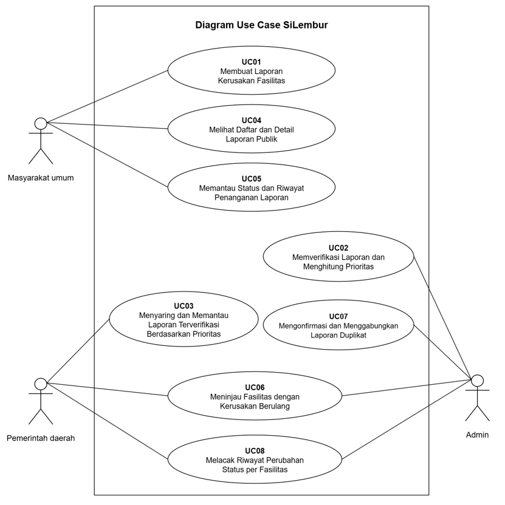

<i>Gambar 2.1. Use Case Diagram [Nama P/L]</i>

 

---

# BAB 3: Implementasi

Bagian ini diisi dengan informasi tentang elemen P/L yang dikembangkan (*executable files*, *configuration files*, *data files*, dan sebagainya) serta perubahannya terhadap rancangan pada DPPL (jika ada).

## 3.1 Lingkungan Implementasi

Tuliskan *hardware* dan *software* yang digunakan untuk implementasi, mencakup *operating system*, bahasa pemrograman beserta versinya, *framework*/*library*, DBMS, *development tools*, dan *version control*. Lingkungan ini harus konsisten dengan **Subbab 2.1 DPPL**; jelaskan jika ada perubahan. Cantumkan juga *framework* dan alat pengujian yang dipakai.

Tabel 3.1. Lingkungan Implementasi

| Aspek | Keterangan |
| :--- | :--- |
| *Hardware* | *[Spesifikasi perangkat keras]* |
| *Operating System* | *[Nama dan versi OS]* |
| *Bahasa Pemrograman* | *[Bahasa dan versi]* |
| *Framework/Library* | *[Daftar framework/library beserta versi]* |
| *DBMS* | *[Nama dan versi DBMS]* |
| *Development Tools* | *[IDE, version control, tools lain]* |
| *Testing Tools* | *[Framework unit test, alat ukur performa, alat coverage]* |

## 3.2 Implementasi Modul

Daftar modul/kelas yang **TELAH** diimplementasikan. Gunakan nama dan ID kelas yang sama dengan DPPL, dan konsisten dengan Tabel B.5 pada dokumen Implementasi (Tugas 9).

Tabel 3.2. Implementasi Modul

| No | ID Kelas | Nama Modul/Kelas | Nama File Fisik | Nama File Executable |
| :--- | :--- | :--- | :--- | :--- |
| 1 | *[C01]* | *[Nama modul/kelas]* | *[path/ke/file]* | *[Nama file executable, atau - jika tidak ada]* |
| 2 | *[C02]* | *[Nama modul/kelas]* | *[path/ke/file]* | *[...]* |
| ... | *...* | *...* | *...* | *...* |

## 3.3 Implementasi Antarmuka

Daftar antarmuka yang telah diimplementasikan. Gunakan ID dan nama layar yang sama dengan ID dan nama layar pada tugas DPPL.

Tabel 3.3. Implementasi Antarmuka

| No | ID Antarmuka | Nama Antarmuka | Nama File Fisik | Nama File Executable |
| :--- | :--- | :--- | :--- | :--- |
| 1 | *[I-01]* | *[Nama layar]* | *[path/ke/file]* | *[Nama file executable, atau - jika tidak ada]* |
| 2 | *[I-02]* | *[Nama layar]* | *[path/ke/file]* | *[...]* |
| ... | *...* | *...* | *...* | *...* |

## 3.4 File Lain

Daftar file lain yang dibuat selain file kelas dan antarmuka, misalnya file *utility*, *configuration*, *database schema/seed*, *file test*, atau *data*.

Tabel 3.4. File Lain

| No | Nama File | Keterangan |
| :--- | :--- | :--- |
| 1 | *[Nama file]* | *[Fungsi file]* |
| ... | *...* | *...* |

 

---

# BAB 4: Hasil Pengujian

Bab ini melaporkan hasil pengujian P/L pada level unit, integrasi, dan sistem. Pengujian dilakukan pada tag release terakhir Tugas 9. Hasil aktual diisi berdasarkan pengamatan saat pengujian. Kesimpulan diisi `Pass` atau `Fail`, dan untuk `Fail` dilengkapi penyebab serta usulan perbaikan.

## 4.1 Strategi dan Kedalaman Pengujian Kelas

Setiap kelas perancangan pada Tabel 4.1 DPPL diklasifikasikan ke dalam tiga tingkat kedalaman pengujian. Tingkat **Mendalam** diberikan pada kelas yang memuat logika bisnis, perhitungan, validasi, aturan status, algoritma, integrasi eksternal, atau keamanan. Tingkat **Sedang** diberikan pada kelas yang hanya mengoordinasikan atau mendelegasikan proses. Tingkat **Tidak perlu** diberikan pada kelas tanpa logika, seperti *entity/DTO* dan kelas konfigurasi, yang teruji secara tidak langsung melalui test case use case. Seluruh kelas wajib dicantumkan beserta alasan penentuan tingkatnya.

Tabel 4.1.1. Identifikasi Tingkat Pengujian Kelas

| ID Kelas | Nama Kelas | Tingkat | Alasan | Test Case Terkait |
| :--- | :--- | :--- | :--- | :--- |
| C01 | Pelapor | Sedang | Mengoordinasikan penyimpanan laporan dan pembacaan laporan milik pelapor. Validasi dan penyimpanan didelegasikan ke Laporan | C01-UT01 s.d. C01-UT07 |
| C02 | Admin | Sedang | Meneruskan keputusan verifikasi ke Verifikasi dan mengambil daftar laporan dari Laporan | C02-UT01 s.d. C02-UT04 |
| C03 | PemerintahDaerah | Sedang | Meneruskan filter dan permintaan daftar prioritas ke Laporan dan Fasilitas | C03-UT01 s.d. C03-UT05 |
| C04 | Laporan | Mendalam | Memuat validasi isian formulir (Algo-004), aturan transisi status (`ubahStatus()`), serta filter dan urutan prioritas | C04-UT01 s.d. C04-UT17 |
| C05 | Lokasi | Mendalam | Memuat penentuan lokasi laporan (Algo-006) dan integrasi eksternal Google Maps untuk wilayah | C05-UT01 s.d. C05-UT05 |
| C06 | Fasilitas | Mendalam | Memuat pencocokan fasilitas radius 30 m dan penandaan kandidat evaluasi berdasarkan ambang batas | C06-UT01 s.d. C06-UT12 |
| C07 | Verifikasi | Mendalam | Memuat aturan keputusan setuju, tolak, dan revisi (Algo-002) serta penahanan laporan | C07-UT01 s.d. C07-UT06 |
| C08 | SkorPrioritas | Mendalam | Memuat perhitungan skor prioritas (Algo-009) dan perhitungan ulang skor yang kedaluwarsa | C08-UT01 s.d. C08-UT06 |
| C09 | RiwayatStatus | Sedang | Hanya mencatat dan membaca riwayat perubahan status tanpa perhitungan | C09-UT01 s.d. C09-UT03 |
| C10 | Notifikasi | Sedang | Hanya menyimpan, membaca, dan menandai pesan notifikasi | C10-UT01 s.d. C10-UT06 |
| C11 | KonfirmasiDuplikat | Mendalam | Memuat penggabungan laporan dalam satu transaksi (Algo-012), penentuan laporan induk, dan penolakan kategori berbeda | C11-UT01 s.d. C11-UT06 |

## 4.2 Pengujian Unit Kelas

Pengujian unit dilakukan pada kelas bertingkat Mendalam dan Sedang. Kelas Mendalam diuji pada seluruh operasi public dengan kasus normal, batas, dan negatif, serta mencapai *coverage* minimal 70%. Kelas Sedang diuji minimal dengan satu kasus normal dan satu kasus gagal pada operasi public utama.

Cara menjalankan unit test: dari folder `src`, jalankan `npm run db:up`, lalu `npm test`. Untuk coverage, pasang `@vitest/coverage-v8` dengan versi yang sama dengan Vitest, lalu jalankan `npx vitest run --coverage` dari folder `src/server`.

Lokasi file test: `src/server/tests/`.

### 4.2.1 Kelas Pelapor

**ID Kelas:** C01  
**Nama Kelas:** Pelapor  
**Tingkat:** Sedang

Tabel 4.2.1. Hasil Pengujian Unit Kelas C01

| ID Pengujian | Operasi yang Diuji | Jenis Kasus | Prosedur/Masukan | Hasil yang Diharapkan | Hasil Pengujian | Kesimpulan |
| :--- | :--- | :--- | :--- | :--- | :--- | :--- |
| C01-UT01 | `konfirmasiSimpanLaporan()` | Normal | Panggil langsung dengan foto, deskripsi berspasi di awal dan akhir, kategori Jalan Berlubang, titik -6.9147, 107.6098 (Kota Bandung), wilayah dan alamat dari adapter | Laporan tersimpan berstatus Menunggu Verifikasi, deskripsi tanpa spasi tepi, baris lokasi terbentuk, jumlah laporan pelapor bertambah 1 | Laporan tersimpan berstatus Menunggu Verifikasi dengan deskripsi "Jalan berlubang di depan sekolah.", wilayah lokasi terisi, jumlah laporan bertambah 1 | Pass |
| C01-UT02 | `konfirmasiSimpanLaporan()` | Gagal | Panggil langsung dengan deskripsi berisi spasi saja | Melempar `HttpError` 400, jumlah baris laporan dan jumlah laporan pelapor tidak berubah | Melempar `HttpError` berstatus 400, jumlah laporan dan jumlah laporan pelapor sama dengan sebelum pemanggilan | Pass |
| C01-UT03 | `konfirmasiSimpanLaporan()` dan `revisiLaporan()` terhadap atribut `jumlahLaporan` | Normal | Kirim laporan baru lewat `POST /api/laporan` sebagai warga1, lalu revisi sebuah laporan lewat `PUT /api/laporan/:id/revisi` | Kolom `jumlah_laporan` bertambah 1 setelah laporan baru, tidak berubah setelah revisi | `jumlah_laporan` bertambah 1 setelah laporan baru dan tetap sama setelah revisi | Pass |
| C01-UT04 | `bukaLaporan()` melalui `GET /api/laporan/saya` | Normal | Login sebagai warga1 lalu buka daftar laporan miliknya | Hanya laporan milik warga1 yang ditampilkan, status terbarunya tersedia | Respons berisi tepat daftar laporan yang memiliki `id_pelapor` warga1; setiap baris memiliki `diperbaruiPada` dan `catatanVerifikasi` | Pass |
| C01-UT05 | `bukaLaporan()` melalui detail laporan milik sendiri dan orang lain | Gagal | Akses detail laporan milik warga2 memakai token warga1 | Warga1 tidak dapat membuka detail laporan warga2 dan menerima 404 | Detail laporan milik warga1 dapat dibuka; laporan warga2 dari token warga1 ditolak dengan 404 | Pass |
| C01-UT06 | `bukaRiwayatLaporan()` melalui detail laporan saya | Normal | Buka laporan warga2 berstatus Perlu Revisi melalui `GET /api/laporan/saya/:id` | Catatan verifikasi terakhir dan riwayat perubahan tampil urut terawal hingga terakhir | Detail memuat catatan `Revisi` beserta alasan, serta riwayat terurut naik; entri terakhir berstatus Perlu Revisi | Pass |
| C01-UT07 | `terimaNotifikasi()` melalui daftar dan penandaan dibaca | Normal/Gagal | Ambil notifikasi warga1, tandai miliknya dibaca, lalu coba tandai notifikasi tersebut memakai warga2 | Jumlah belum dibaca berkurang satu untuk pemilik; pengguna lain menerima 404 | Pembacaan milik sendiri mengurangi `belumDibaca`; warga2 ditolak 404 dan tidak dapat melihat notifikasi warga1 | Pass |

### 4.2.2 Kelas Admin

**ID Kelas:** C02  
**Nama Kelas:** Admin  
**Tingkat:** Sedang

Tabel 4.2.2. Hasil Pengujian Unit Kelas C02

| ID Pengujian | Operasi yang Diuji | Jenis Kasus | Prosedur/Masukan | Hasil yang Diharapkan | Hasil Pengujian | Kesimpulan |
| :--- | :--- | :--- | :--- | :--- | :--- | :--- |
| C02-UT01 | `lihatDaftarLaporan()` (`GET /api/admin/laporan`) | Normal | Login sebagai admin. Siapkan dua laporan Menunggu Verifikasi milik warga1 berumur 72 jam dan 24 jam. Panggil `GET /api/admin/laporan` tanpa parameter | Respons 200, semua item berstatus Menunggu Verifikasi, laporan 72 jam muncul sebelum laporan 24 jam dan seluruh daftar urut dari terlama, setiap item memuat pelapor (id, nama, email) dan `skor` null | Antrean Menunggu Verifikasi, terlama dulu, memuat identitas pelapor | Pass |
| C02-UT02 | `lihatDaftarLaporan()` (`GET /api/admin/laporan`) | Batas | Panggil dengan status Ditolak, status kosong, status Ditolak dengan kata kunci "QZJX" (huruf besar), kata kunci "%", kata kunci 100 karakter dan 101 karakter, lalu status "Disetujui" | Filter status hanya memuat status tersebut, status kosong dianggap default Menunggu Verifikasi, kata kunci tanpa beda huruf besar kecil hanya menemukan laporan yang cocok, "%" menghasilkan daftar kosong, 100 karakter 200, 101 karakter 400, status "Disetujui" 400 | Filter status, kata kunci, dan batas panjang kata kunci | Pass |
| C02-UT03 | `tetapkanKeputusan()` (`POST /api/admin/laporan/:id/verifikasi`) | Normal | Sebagai admin kirim keputusan Disetujui (catatan "Lokasi dan foto sesuai.") pada laporan Jalan Berlubang berumur 48 jam, lalu Ditolak (catatan "Bukan fasilitas umum.") dan Revisi (catatan "Foto kurang jelas.") pada dua laporan lain | Disetujui: 200, status Terverifikasi, skor 39 (20 + 5×1 + 2×2 + 10×1) dan sama dengan skor pada laporan. Ditolak: 200, status Ditolak, skor null. Revisi: 200, status Perlu Revisi, skor null | Disetujui, Ditolak, dan Revisi memetakan ke status yang benar | Pass |
| C02-UT04 | `tetapkanKeputusan()` (`POST /api/admin/laporan/:id/verifikasi`) | Negatif | Pada laporan Menunggu Verifikasi kirim: Ditolak dengan catatan spasi, keputusan "Setuju", id 999999, id "abc", Disetujui sebagai warga1, sebagai pemda, dan tanpa token. Lalu kirim Disetujui yang valid, kemudian Ditolak untuk laporan yang sama | Berturut-turut 400 (field `catatan`), 400, 404, 400, 403, 403, 401, tanpa perubahan status maupun baris verifikasi. Disetujui yang valid 200, keputusan kedua 409, status tetap Terverifikasi dengan satu baris verifikasi | Ditolak bila catatan kosong, id salah, sudah diputuskan, atau bukan admin | Pass |

### 4.2.3 Kelas PemerintahDaerah

**ID Kelas:** C03  
**Nama Kelas:** PemerintahDaerah  
**Tingkat:** Sedang

Tabel 4.2.3. Hasil Pengujian Unit Kelas C03

| ID Pengujian | Operasi yang Diuji | Jenis Kasus | Prosedur/Masukan | Hasil yang Diharapkan | Hasil Pengujian | Kesimpulan |
| :--- | :--- | :--- | :--- | :--- | :--- | :--- |
| C03-UT01 | `mintaPrioritas()` | Normal | Meminta data tanpa filter wilayah | Mengembalikan seluruh daftar prioritas aktif | Mengembalikan array laporan prioritas yang diurutkan berdasar skor | Pass |
| C03-UT02 | `mintaPrioritas()` | Normal | Filter data menggunakan parameter kecamatan "Coblong" | Hanya mengembalikan laporan prioritas pada kecamatan Coblong | Data laporan tersaring dengan wilayah kecamatan "Coblong" saja | Pass |
| C03-UT03 | `tinjauFasilitasBerulang()` | Normal | Meminta daftar fasilitas dengan limit 10 | Mengembalikan daftar fasilitas rusak berulang maksimal 10 baris | Array dengan panjang <= 10 dan bendera kandidat_evaluasi = true | Pass |
| C03-UT04 | `tinjauRiwayatFasilitas()` | Normal | Memasukkan ID fasilitas yang valid | Mengembalikan daftar riwayat laporan pada fasilitas tersebut | Mengembalikan array riwayat log status fasilitas dengan urutan kronologis | Pass |
| C03-UT05 | `tinjauRiwayatFasilitas` | Negatif | Memasukkan ID fasilitas 999999 yang tidak eksis di database | Melempar error/kosong | Mengembalikan array kosong atau HttpError 404 | Pass |

### 4.2.4 Kelas Laporan

**ID Kelas:** C04  
**Nama Kelas:** Laporan  
**Tingkat:** Mendalam

Tabel 4.2.4. Hasil Pengujian Unit Kelas C04

| ID Pengujian | Operasi yang Diuji | Jenis Kasus | Prosedur/Masukan | Hasil yang Diharapkan | Hasil Pengujian | Kesimpulan |
| :--- | :--- | :--- | :--- | :--- | :--- | :--- |
| C04-UT01 | `validasiIsianFormulir()` | Normal | Foto, deskripsi, kategori Jalan Berlubang, dan koordinat lengkap, baik berbentuk teks "-6.9,107.6" maupun objek latitude dan longitude | `true` | Mengembalikan `true` untuk kedua bentuk koordinat | Pass |
| C04-UT02 | `validasiIsianFormulir()` | Batas | Deskripsi tepat 300 karakter, lalu 301 karakter | 300 karakter `true`, 301 karakter `false` | 300 karakter `true`, 301 karakter `false` | Pass |
| C04-UT03 | `validasiIsianFormulir()` | Negatif | Masing-masing: foto kosong, foto tidak ada, deskripsi kosong, deskripsi hanya spasi, koordinat kosong, koordinat tanpa longitude, kategori "Banjir" | `false` untuk setiap masukan | Mengembalikan `false` untuk ketujuh masukan | Pass |
| C04-UT04 | `simpanLaporan()` | Normal | `POST /api/laporan` sebagai warga1 dengan foto PNG, kategori Lampu Jalan Mati, deskripsi, dan titik GPS sekitar 10 m dari fasilitas seed | Respons 201, status Menunggu Verifikasi, file foto tersimpan, lokasi bersumber GPS, riwayat pertama "Laporan berhasil diterima oleh sistem.", tanpa identitas pelapor | Respons 201 dengan status Menunggu Verifikasi, foto tersimpan di folder unggahan, lokasi bersumber GPS, satu baris riwayat sesuai, respons tidak memuat data pelapor | Pass |
| C04-UT05 | `simpanLaporan()` | Negatif | `POST /api/laporan` tanpa foto, lalu masing-masing dengan deskripsi spasi, deskripsi 301 karakter, kategori "Banjir", latitude kosong, longitude "abc", dan sumber lokasi "SATELIT" | Respons 400 dengan nama field yang salah, tidak ada laporan tersimpan | Semua respons 400 dan menyebut field yang salah, jumlah laporan pelapor tidak bertambah | Pass |
| C04-UT06 | `revisiLaporan()` | Normal | `PUT /api/laporan/:id/revisi` oleh warga2 pada laporan seed berstatus Perlu Revisi dengan deskripsi baru, lalu revisi laporan lain dengan foto, kategori Jalan Berlubang, dan titik manual baru | Respons 200, status kembali Menunggu Verifikasi, riwayat "Laporan direvisi oleh pelapor.", lokasi dan fasilitas ikut diperbarui saat titik atau kategori berubah | Respons 200, status Menunggu Verifikasi, riwayat Perlu Revisi ke Menunggu Verifikasi tercatat, koordinat menjadi -6.917500,107.619100 bersumber MANUAL, fasilitas berganti | Pass |
| C04-UT07 | `revisiLaporan()` | Negatif | Revisi laporan berstatus Menunggu Verifikasi, revisi laporan milik pengguna lain, latitude tanpa longitude, id 999999, dan id "abc" | Berturut-turut 409, 404, 400, 404, 400, tanpa perubahan data | Respons berturut-turut 409, 404, 400, 404, 400, status laporan milik pengguna lain tetap Perlu Revisi | Pass |
| C04-UT08 | `getDaftarLaporanPublik()` dan `getRingkasanLaporan()` | Normal | Ambil daftar publik, kelompok status, wilayah, kategori, dan ringkasan tanpa identitas pelapor | Daftar mengikuti status publik, filter, paginasi, urutan terbaru; ringkasan berisi jumlah masuk/diproses/selesai | Daftar anonim sesuai status publik dan filter; ringkasan sesuai data basis data; paginasi menghasilkan irisan daftar dengan urutan tetap | Pass |
| C04-UT09 | `getDetailLaporanPublik()` | Normal/Gagal | Buka detail status Terverifikasi, lalu detail status Ditolak, Perlu Revisi, dan Digabung | Status publik menampilkan detail lengkap anonim; status non-publik dan id tidak valid ditolak | Detail Terverifikasi 200 anonim; Ditolak/Perlu Revisi/Digabung 404; id `abc` 400 dan id tidak ada 404 | Pass |
| C04-UT10 | `getDaftarLaporanSaya()` dan `getDetailLaporanSaya()` | Normal/Gagal | Pelapor mengambil daftar laporannya dan membuka detail miliknya serta laporan pengguna lain | Hanya pemilik dapat membaca laporannya; detail menyertakan catatan dan riwayat urut naik | Daftar dan detail sesuai kepemilikan; detail warga2 ditolak warga1 dengan 404; pengguna non-Pelapor ditolak 403 | Pass |
| C04-UT11 | `getLaporanMenungguVerifikasi()` dan `hitungLaporanBaru()` | Normal dan Batas | Panggil langsung dengan `pool`: tanpa argumen, dengan dua laporan Menunggu Verifikasi bertanggal persis sama, satu laporan Ditolak, kata kunci "zXqV", "  seri kedua  ", "%", teks yang tidak ada, dan "   ", serta status Ditolak dengan kata kunci. Panggil `hitungLaporanBaru()` sebelum dan sesudah menambah satu laporan, lalu setelah statusnya diubah menjadi Ditolak | Tanpa argumen hanya memuat Menunggu Verifikasi (tanpa laporan Ditolak) dan laporan bertanggal sama berurut menurut id. Kata kunci tanpa beda huruf besar kecil menemukan dua laporan, spasi tepi dibuang, "%" kosong, kata kunci spasi dianggap tanpa kata kunci, status Ditolak menemukan satu laporan. `hitungLaporanBaru()` sama dengan panjang antrean, bertambah 1 setelah laporan baru, kembali semula setelah menjadi Ditolak | Default, urutan, kata kunci, badge | Pass |
| C04-UT12 | `getDetailLaporan()` (`getLaporanAdmin()`, `getDetailLaporanAdmin()`) | Normal dan Negatif | Ambil detail laporan Pohon Tumbang berumur 96 jam dengan dua baris riwayat yang disisipkan terbalik, lalu laporan Jalan Berlubang berumur 24 jam dengan satu laporan Digabung dan satu baris verifikasi Revisi. Ambil juga id 999999 | DTO memuat pelapor, lokasi, fasilitas, `skor` null. Pratinjau skor 53 (30 + 5×1 + 2×4 + 10×1) tanpa menulis ke `skor_prioritas`, riwayat urut dari terawal. Laporan kedua: pratinjau 42, jumlah pelapor 2, satu histori verifikasi berisi keputusan, catatan, waktu, nama admin. Id 999999 mengembalikan `null` untuk kedua fungsi | DTO admin, pratinjau skor tanpa menyimpan, riwayat urut, null bila tidak ada | Pass |
| C04-UT13 | `updateStatus()` (`ubahStatus()`) | Normal dan Negatif | Dalam transaksi ubah satu laporan dari Menunggu Verifikasi ke Terverifikasi, Diproses, lalu Selesai dengan pengguna admin. Ubah laporan lain ke Digabung dengan laporan induk. Coba transisi Menunggu Verifikasi ke Selesai, Ditolak ke Terverifikasi, Selesai ke Diproses, Digabung ke Menunggu Verifikasi, dan id 999999 | Setiap transisi sah mengembalikan idLaporan, statusLama, statusBaru, status berubah, `diperbarui_pada` maju, dan menambah satu baris riwayat berisi pengguna, status lama, status baru, deskripsi (total 3 baris). Digabung menyimpan id laporan induk. Transisi tidak sah ditolak 409 tanpa mengubah status dan riwayat, id 999999 404 | Transisi sah tercatat, transisi tidak sah 409 tanpa perubahan | Pass |
| C04-UT14 | `getLaporanTerverifikasi()` | Normal | Panggil fungsi menggunakan objek pool tanpa opsi filter khusus | Mengembalikan daftar laporan terverifikasi terurut skor menurun | Laporan berhasil diambil, dengan `skor_akhir` tertinggi berada di indeks 0 | Pass |
| C04-UT15 | `getLaporanTerverifikasi()` | Batas | Panggil fungsi saat seluruh laporan memiliki skor prioritas sama | Laporan tetap diambil dan diurutkan menggunakan kriteria tanggal sekunder | Laporan ditarik dengan sukses, diurutkan menurut waktu pembuatan logis | Pass |
| C04-UT16 | `getLaporanTerverifikasi()` | Normal | Opsi filter kecamatan valid (contoh: "Regol") | Mengembalikan laporan yang hanya terletak di wilayah tersebut | Hasil saringan 100% cocok dengan field kecamatan "Regol" | Pass |
| C04-UT17 | `getLaporanTerverifikasi()` | Negatif | Opsi filter kecamatan string kosong atau null | Mengabaikan filter kecamatan dan mengembalikan semua laporan | Fungsi berjalan lancar tanpa error, semua data dari seluruh wilayah dimuat | Pass |

Tabel 4.2.4b. Ringkasan Cakupan Kelas C04

| Informasi | Keterangan |
| :--- | :--- |
| Daftar operasi public pada DPPL | `buatLaporanBaru()`, `tampilkanFormulir()`, `validasiIsianFormulir()`, `bukaKunciSimpan()`, `simpanLaporan()`, `getLaporanMenungguVerifikasi()`, `getDetailLaporan()`, `updateStatus()`, `getLaporanTerverifikasi()`, `urutkanBerdasarkanPrioritas()`, `filterLaporan()`, `pilihDuplikat()`, `getRiwayatStatus()` |
| Operasi yang diuji | Bagian 4 (C04-UT11 s.d. C04-UT13): `getLaporanMenungguVerifikasi()`, `getDetailLaporan()`, `updateStatus()`. Operasi lain diuji oleh C04-UT01 s.d. C04-UT10 dan C04-UT14 s.d. C04-UT17 [lengkapi saat penggabungan] |
| ID Algoritma yang tercakup | Dari Bagian 4: Algo-002 dan Q-002 (lewat `updateStatus()`). ID dari bagian lain ditambahkan saat penggabungan |
| Coverage (wajib ≥ 70%) | [ISI: persentase baris dan cabang file `src/server/src/models/laporan/*.js`, diukur dengan `@vitest/coverage-v8` pada seluruh test suite. Bukti pada Tabel 4.6] |

### 4.2.5 Kelas Lokasi

**ID Kelas:** C05  
**Nama Kelas:** Lokasi  
**Tingkat:** Mendalam

Tabel 4.2.5. Hasil Pengujian Unit Kelas C05

| ID Pengujian | Operasi yang Diuji | Jenis Kasus | Prosedur/Masukan | Hasil yang Diharapkan | Hasil Pengujian | Kesimpulan |
| :--- | :--- | :--- | :--- | :--- | :--- | :--- |
| C05-UT01 | `setLokasiLaporan(koordinat)` | Normal | Laporan tanpa lokasi, titik -6.9147, 107.6098 tanpa wilayah dan sumber | Satu baris lokasi dengan koordinat "-6.914700,107.609800", sumber GPS, wilayah kecamatan Bandung dari adapter | Satu baris lokasi tersimpan dengan koordinat dan sumber GPS sesuai, wilayah terisi kecamatan di Kota Bandung | Pass |
| C05-UT02 | `setLokasiLaporan(koordinat)` | Batas | Panggil dua kali untuk laporan yang sama, kedua kalinya dengan -6.91750049, 107.61910051, sumber MANUAL, wilayah Regol | Baris lama ditimpa, tetap satu baris, koordinat dibulatkan menjadi "-6.917500,107.619101" | Tetap satu baris, koordinat "-6.917500,107.619101", sumber MANUAL, wilayah Regol | Pass |
| C05-UT03 | `setLokasiLaporan(koordinat)` | Negatif | Panggil untuk id laporan 999999 yang tidak ada | Ditolak basis data (foreign key), tidak ada baris lokasi tersimpan | Pemanggilan gagal dengan error basis data, tidak ada baris lokasi untuk id 999999 | Pass |
| C05-UT04 | `getWilayah()` | Normal | Laporan dengan lokasi berwilayah Coblong | "Coblong" | Mengembalikan "Coblong" | Pass |
| C05-UT05 | `getWilayah()` | Negatif | Laporan yang belum punya lokasi, lalu id 999999 | `null` untuk keduanya | Mengembalikan `null` untuk keduanya | Pass |

Tabel 4.2.5b. Ringkasan Cakupan Kelas C05

| Informasi | Keterangan |
| :--- | :--- |
| Daftar operasi public pada DPPL | `setLokasiLaporan(koordinat: String)`, `getWilayah(): String` |
| Operasi yang diuji | `setLokasiLaporan()`, `getWilayah()` |
| ID Algoritma yang tercakup | Algo-006, Q-005 |
| Coverage (wajib ≥ 70%) | `src/server/src/models/lokasi/lokasi.js`: 100% baris, 85,71% cabang, diukur dengan `@vitest/coverage-v8` pada seluruh test suite. Bukti pada Tabel 4.6 |

### 4.2.6 Kelas Fasilitas

**ID Kelas:** C06  
**Nama Kelas:** Fasilitas  
**Tingkat:** Mendalam

Tabel 4.2.6. Hasil Pengujian Unit Kelas C06

| ID Pengujian | Operasi yang Diuji | Jenis Kasus | Prosedur/Masukan | Hasil yang Diharapkan | Hasil Pengujian | Kesimpulan |
| :--- | :--- | :--- | :--- | :--- | :--- | :--- |
| C06-UT01 | `cariAtauBuatFasilitas()` | Normal | Laporan Lampu Jalan Mati sekitar 10 m dari fasilitas seed "PJU Jl. Dago Atas RT 03" | Laporan ditautkan ke fasilitas seed tersebut | Laporan ditautkan ke fasilitas "PJU Jl. Dago Atas RT 03" | Pass |
| C06-UT02 | `cariAtauBuatFasilitas()` | Batas | Fasilitas Pohon Tumbang baru, lalu titik berjarak 29,9 m dan 30,1 m darinya dengan kategori sama | 29,9 m memakai fasilitas yang sama, 30,1 m membuat fasilitas baru | 29,9 m mengembalikan id fasilitas yang sama dengan `baru: false`, 30,1 m membuat fasilitas baru | Pass |
| C06-UT03 | `cariAtauBuatFasilitas()` | Negatif | Titik sekitar 45 m dari fasilitas seed dengan kategori sama, lalu titik yang sama dengan fasilitas seed tetapi kategori Pohon Tumbang | Keduanya membuat fasilitas baru, fasilitas kedua berkategori Pohon Tumbang dengan wilayah sama dengan lokasi laporan | Keduanya membuat fasilitas baru, jumlah fasilitas bertambah dan kategori serta wilayah sesuai | Pass |
| C06-UT04 | `getFasilitasBerulang()` | Normal | Panggil fungsi dengan limit default (100) pada data seed | Daftar fasilitas dengan `kandidat_evaluasi = true` | Mengembalikan 1 baris data fasilitas rusak berulang | Pass |
| C06-UT05 | `getFasilitasBerulang()` | Batas | Panggil fungsi dengan parameter limit = 0 | Memanggil fallback limit atau mengembalikan array kosong dengan aman | Array kosong dikembalikan tanpa error database | Pass |
| C06-UT06 | `getFasilitasBerulang()` | Negatif | Menggunakan pool database yang sengaja ditutup sebelum query | Menghasilkan error koneksi | Melempar error 'Client was closed' secara terkendali | Pass |
| C06-UT07 | `getRiwayatFasilitas()` | Normal | Panggil fungsi dengan `id_fasilitas` fasilitas seed yang rusak berulang | Daftar laporan terkait fasilitas tersebut lengkap dengan riwayat | Array riwayat laporan terkait fasilitas berhasil diambil secara kronologis | Pass |
| C06-UT08 | `getRiwayatFasilitas()` | Batas | Panggil untuk fasilitas baru yang belum diverifikasi admin | Array riwayat laporan tetap terambil namun hanya status awal | Data berhasil ditarik dengan 1 entri status "Menunggu Verifikasi" | Pass |
| C06-UT09 | `getRiwayatFasilitas()` | Negatif | Memasukkan nilai string acak "abc" sebagai `id_fasilitas` | Error validasi atau error query syntax postgres | PostgreSQL menolak query dengan kode error 22P02, tertangani aman | Pass |
| C06-UT10 | `updateKandidatEvaluasi()` | Normal | Simulasi update ambang batas kerusakan melewati angka 3 | Field `kandidat_evaluasi` menjadi true | Database berhasil dimutakhirkan, flag kandidat_evaluasi menyala | Pass |
| C06-UT11 | `updateKandidatEvaluasi()` | Batas | Simulasi tepat di angka ambang batas (contoh: 3) | Sesuai konfigurasi, menjadi true saat tepat atau melewatinya | Flag evaluasi bernilai true sesuai kriteria >= ambang batas | Pass |
| C06-UT12 | `updateKandidatEvaluasi()` | Negatif | ID fasilitas tidak valid saat mutakhirkan flag evaluasi | Tidak ada baris termutakhir | Mengembalikan indikator 0 row affected | Pass |

Tabel 4.2.6b. Ringkasan Cakupan Kelas C06

| Informasi | Keterangan |
| :--- | :--- |
| Daftar operasi public pada DPPL |  |
| Operasi yang diuji |  |
| ID Algoritma yang tercakup |  |
| Coverage (wajib ≥ 70%) |  |

### 4.2.7 Kelas Verifikasi

**ID Kelas:** C07  
**Nama Kelas:** Verifikasi  
**Tingkat:** Mendalam

Tabel 4.2.7. Hasil Pengujian Unit Kelas C07

| ID Pengujian | Operasi yang Diuji | Jenis Kasus | Prosedur/Masukan | Hasil yang Diharapkan | Hasil Pengujian | Kesimpulan |
| :--- | :--- | :--- | :--- | :--- | :--- | :--- |
| C07-UT01 | `simpanVerifikasi()` | Normal | Panggil langsung pada laporan Menunggu Verifikasi dengan id admin, keputusan Revisi, catatan "Foto kurang jelas." | Mengembalikan id verifikasi (angka). Satu baris `verifikasi` berisi laporan, admin, keputusan, catatan, `waktu_verifikasi` terisi waktu saat ini. Status laporan tetap Menunggu Verifikasi karena fungsi ini hanya mencatat | Mencatat keputusan, catatan, admin, dan waktu tanpa mengubah status | Pass |
| C07-UT02 | `simpanVerifikasi()` | Batas dan Negatif | Panggil tanpa catatan, dengan catatan 500 karakter, keputusan "Setuju", id admin 999999, lalu id laporan 999999 | Tanpa catatan tersimpan string kosong, 500 karakter tersimpan utuh. Tiga masukan terakhir ditolak basis data (pelanggaran CHECK dan foreign key) dan jumlah baris `verifikasi` tidak bertambah | Catatan kosong jadi string kosong; keputusan/admin/laporan tidak valid ditolak basis data | Pass |
| C07-UT03 | `tetapkanKeputusan()` dan `teruskanKePemerintah()` | Normal | Dalam transaksi panggil `tetapkanKeputusan()` Disetujui (catatan "Foto dan lokasi sesuai.") pada laporan Jalan Berlubang berumur 24 jam. Lalu panggil `teruskanKePemerintah()` dua kali pada laporan Terverifikasi berumur 48 jam | Mengembalikan idLaporan, idVerifikasi, status Terverifikasi, skor 37 (20 + 5×1 + 2×1 + 10×1). Ada satu baris verifikasi, riwayat "Disetujui. Catatan: Foto dan lokasi sesuai." oleh admin, baris skor (1, 1, 1, 37), dan satu notifikasi belum dibaca untuk pelapor "Laporan #id: Disetujui. Foto dan lokasi sesuai.". `teruskanKePemerintah()` mengembalikan 39 (20 + 5×1 + 2×2 + 10×1) pada kedua pemanggilan dan hanya ada satu baris skor | Disetujui -> Terverifikasi, skor, riwayat, notifikasi | Pass |
| C07-UT04 | `tetapkanKeputusan()` dan `tahanLaporan()` (KF08) | Normal | Putuskan Ditolak (catatan "Bukan fasilitas umum.") dan Revisi (catatan "Foto kurang jelas.") pada dua laporan. Sediakan satu laporan Disetujui dan satu laporan yang tetap Menunggu Verifikasi sebagai kontrol, lalu panggil `GET /api/prioritas` sebagai pemda | Ditolak: status Ditolak, skor null, tanpa baris skor, jumlah kerusakan berulang fasilitas 0. Revisi: status Perlu Revisi, skor null, tanpa baris skor, jumlah kerusakan berulang 1. Pesan notifikasi memuat keputusan dan catatan. Daftar prioritas pemda memuat laporan Disetujui dan tidak memuat laporan Ditolak, Perlu Revisi, maupun Menunggu Verifikasi. Penahanan tidak berupa fungsi tersendiri: laporan tertahan karena statusnya berada di luar `STATUS_PRIORITAS` | Tanpa skor, tidak diteruskan ke pemda (KF08) | Pass |
| C07-UT05 | `tetapkanKeputusan()` | Batas | Putuskan Revisi dengan catatan "  perlu foto baru  " dan Disetujui dengan catatan spasi saja. Lewat API kirim Disetujui dengan catatan tepat 500 karakter dan 501 karakter | Catatan dirapikan menjadi "perlu foto baru" pada verifikasi dan notifikasi "Laporan #id: Revisi. perlu foto baru". Catatan spasi tersimpan kosong, riwayat "Disetujui.", notifikasi "Laporan #id: Disetujui.". 500 karakter 200 dan tersimpan utuh, 501 karakter 400 (field `catatan`) tanpa perubahan data | Catatan dirapikan, Disetujui tanpa catatan, batas 500 dan 501 karakter | Pass |
| C07-UT06 | `tetapkanKeputusan()` | Negatif | Panggil dengan keputusan "Setuju", Ditolak dengan catatan spasi, Revisi tanpa catatan, id laporan 999999, serta laporan berstatus Terverifikasi, Digabung, dan Perlu Revisi | Berturut-turut `HttpError` 400, 400, 400, 404, 409, 409, 409. Tidak ada baris verifikasi, notifikasi, riwayat, maupun skor baru dan status semua laporan tidak berubah | Keputusan tidak dikenal, catatan wajib, laporan tidak ada, status tidak sesuai | Pass |

Tabel 4.2.7b. Ringkasan Cakupan Kelas C07

| Informasi | Keterangan |
| :--- | :--- |
| Daftar operasi public pada DPPL | `simpanVerifikasi()`, `tahanLaporan()`, `teruskanKePemerintah()` |
| Operasi yang diuji | `simpanVerifikasi()` (C07-UT01, C07-UT02), `teruskanKePemerintah()` (C07-UT03), `tahanLaporan()` (C07-UT04, tidak berupa fungsi tersendiri: penahanan terjadi karena status laporan di luar `STATUS_PRIORITAS`), serta `tetapkanKeputusan()` yang mengorkestrasi ketiganya (C07-UT03 s.d. C07-UT06) |
| ID Algoritma yang tercakup | Algo-002, Algo-008, Q-002, Q-003, Q-008 |
| Coverage (wajib ≥ 70%) | [ISI: persentase baris dan cabang file `src/server/src/models/verifikasi/verifikasi.js`, diukur dengan `@vitest/coverage-v8` pada seluruh test suite. Bukti pada Tabel 4.6] |

### 4.2.8 Kelas SkorPrioritas

**ID Kelas:** C08  
**Nama Kelas:** SkorPrioritas  
**Tingkat:** Mendalam

Tabel 4.2.8. Hasil Pengujian Unit Kelas C08

| ID Pengujian | Operasi yang Diuji | Jenis Kasus | Prosedur/Masukan | Hasil yang Diharapkan | Hasil Pengujian | Kesimpulan |
| :--- | :--- | :--- | :--- | :--- | :--- | :--- |
| C08-UT01 | `hitungSkor()` (Algo-009, bagian murni `hitungNilaiSkor()`) | Normal | Hitung dengan 1 pelapor, 0 hari, frekuensi 0 untuk tiap kategori. Hitung Pohon Tumbang dengan (3 pelapor, 10 hari, frekuensi 4) dan Jalan Berlubang dengan (2 pelapor, 5 hari, frekuensi 3) | Bobot 30, 20, 10, 5 sehingga skor 35, 25, 15, 10 untuk Pohon Tumbang, Jalan Berlubang, Lampu Jalan Mati, Lainnya. Pohon Tumbang 105 (30 + 15 + 20 + 40), Jalan Berlubang 70 (20 + 10 + 10 + 30) | Bobot tiap kategori dan gabungan semua faktor | Pass |
| C08-UT02 | `hitungSkor()` (Algo-009, bagian murni `hitungNilaiSkor()`) | Batas | Hitung Jalan Berlubang dengan faktor minimum (1 pelapor, 0 hari, frekuensi 0), lalu tambah satu pelapor, satu hari, satu frekuensi secara terpisah. Hitung lama menunggu 365 hari, kategori "Tidak Dikenal", dan tanpa kategori | Skor minimum 25. Kenaikan tepat 5, 2, dan 10. Lama menunggu 365 hari menghasilkan 755 (20 + 5 + 730). Kategori tidak dikenal atau kosong memakai bobot Lainnya sehingga 10 (cabang else Algo-009) | Nilai batas, kategori tidak dikenal, kenaikan per satuan | Pass |
| C08-UT03 | `hitungSkor()` dan `getSkor()` | Normal | Siapkan laporan Pohon Tumbang Terverifikasi berumur 84 jam dengan baris skor awal, dua laporan Digabung ke laporan itu, dan satu laporan Menunggu Verifikasi di fasilitas yang sama. Panggil `hitungSkor()` lalu `getSkor()` | Skor 71 (30 + 5×3 + 2×3 + 10×2). Baris skor berisi jumlah pelapor 3, lama menunggu 3 (3,5 hari dibulatkan ke bawah), frekuensi 2 (laporan Digabung tidak dihitung), skor 71, dan `dihitung_pada` diperbarui. `getSkor()` mengembalikan 71 | Jumlah pelapor, lama menunggu, dan frekuensi dibaca dari basis data lalu disimpan | [Pass/Fail] |
| C08-UT04 | `hitungSkor()` | Batas (hitung ulang, KF17) | Hitung skor laporan berumur 23 jam dan 25 jam. Gabungkan satu laporan ke laporan 25 jam lalu hitung ulang. Tambah satu laporan Ditolak di fasilitas yang sama lalu hitung ulang | 23 jam menghasilkan lama menunggu 0 (skor 35), 25 jam menghasilkan 1 (skor 37). Setelah penggabungan skor 42 (naik 5). Setelah laporan Ditolak ditambahkan skor tetap 42 dan frekuensi tetap 1 | Pembulatan hari ke bawah dan perhitungan ulang saat data terkait berubah (KF17) | Pass |
| C08-UT05 | `hitungSkor()` dan `buatSkorAwal()` | Negatif | Panggil `hitungSkor()` pada laporan tanpa baris skor dan pada id 999999. Panggil `buatSkorAwal()` untuk id 999999. Hitung skor laporan Lampu Jalan Mati baru yang tidak punya fasilitas | `hitungSkor()` mengembalikan `null` untuk kedua masukan dan tidak membuat baris skor. `buatSkorAwal()` ditolak basis data (foreign key). Laporan tanpa fasilitas mendapat frekuensi 0 sehingga skor 15 (10 + 5) |  Null untuk laporan tanpa baris skor atau tidak ada, laporan tanpa fasilitas | Pass |
| C08-UT06 | `getSkor()` dan `buatSkorAwal()` | Normal dan Batas | Panggil `getSkor()` sebelum ada baris skor dan untuk id 999999. Panggil `buatSkorAwal()`, `hitungSkor()`, lalu `buatSkorAwal()` sekali lagi | `getSkor()` mengembalikan `null` sebelum baris ada. Setelah `buatSkorAwal()` baris berisi (1, 0, 0, 0) dan `getSkor()` mengembalikan 0. Setelah dihitung nilainya lebih dari 0 dan tidak tertimpa oleh `buatSkorAwal()` kedua, tetap satu baris | Nilai awal 0, idempoten, null bila belum ada | Pass |

Tabel 4.2.8b. Ringkasan Cakupan Kelas C08

| Informasi | Keterangan |
| :--- | :--- |
| Daftar operasi public pada DPPL | `hitungSkor()`, `getSkor()` |
| Operasi yang diuji | `hitungSkor()` termasuk bagian murni `hitungNilaiSkor()` dan pembaca komponen `getKomponenSkor()` (C08-UT01 s.d. C08-UT05), `getSkor()` (C08-UT03, C08-UT06), serta `buatSkorAwal()` (C08-UT05, C08-UT06) |
| ID Algoritma yang tercakup | Algo-009, Q-008, Q-009, Q-010 |
| Coverage (wajib ≥ 70%) | [ISI: persentase baris dan cabang file `src/server/src/models/skorPrioritas/skor.js`, diukur dengan `@vitest/coverage-v8` pada seluruh test suite. Bukti pada Tabel 4.6] |

### 4.2.9 Kelas RiwayatStatus

**ID Kelas:** C09  
**Nama Kelas:** RiwayatStatus  
**Tingkat:** Sedang

Tabel 4.2.9. Hasil Pengujian Unit Kelas C09

| ID Pengujian | Operasi yang Diuji | Jenis Kasus | Prosedur/Masukan | Hasil yang Diharapkan | Hasil Pengujian | Kesimpulan |
| :--- | :--- | :--- | :--- | :--- | :--- | :--- |
| C09-UT01 | `getRiwayatStatus()` | Normal | Ambil riwayat satu laporan dengan beberapa perubahan status | Riwayat dikembalikan urut tanggal naik dan ID naik untuk waktu yang sama | Riwayat laporan berstatus Perlu Revisi memiliki entri awal Menunggu Verifikasi, urut naik hingga entri terakhir Perlu Revisi | Pass |
| C09-UT02 | `getPerubahan()` | Normal | Ambil satu entri riwayat berdasarkan ID yang ada | Mengembalikan ID, status lama/baru, deskripsi, dan tanggal perubahan | Entri riwayat mengembalikan seluruh atribut yang diwajibkan | Pass |
| C09-UT03 | `getPerubahan()` | Negatif | Ambil entri riwayat dengan ID tidak ada | Mengembalikan `null` dan tidak memunculkan data laporan lain | Hasil `null` untuk ID yang tidak ada | Pass |

### 4.2.10 Kelas Notifikasi

**ID Kelas:** C10  
**Nama Kelas:** Notifikasi  
**Tingkat:** Sedang

Tabel 4.2.10. Hasil Pengujian Unit Kelas C10

| ID Pengujian | Operasi yang Diuji | Jenis Kasus | Prosedur/Masukan | Hasil yang Diharapkan | Hasil Pengujian | Kesimpulan |
| :--- | :--- | :--- | :--- | :--- | :--- | :--- |
| C10-UT01 | `getNotifikasiPelapor()` | Normal | Ambil notifikasi milik warga1 beserta jumlah belum dibaca | Daftar milik sendiri terurut terbaru; `belumDibaca` sama dengan jumlah entri berstatus belum dibaca | Daftar berisi notifikasi milik warga1, urut terbaru, dan nilai `belumDibaca` konsisten | Pass |
| C10-UT02 | `tandaiDibaca()` | Normal | Tandai notifikasi warga1 yang dibuat untuk pengujian | Mengembalikan sukses; status dibaca berubah dan jumlah belum dibaca berkurang satu | Respons 204, notifikasi menjadi dibaca, dan `belumDibaca` berkurang satu | Pass |
| C10-UT03 | `tandaiDibaca()` | Negatif | Warga2 mencoba menandai notifikasi milik warga1 | Tidak ada perubahan dan operasi dinyatakan bukan milik pengguna | Respons 404; notifikasi tetap tidak tampak pada warga2 dan statusnya tidak berubah | Pass |
| C10-UT04 | `getNotifikasiPelapor()` | Otentikasi | Ambil notifikasi sebagai pengguna non-Pelapor | Endpoint menolak pengguna selain Pelapor | Respons 403 pada pengguna Admin | Pass |
| C10-UT05 | `kirimNotifikasi()` | Normal | Panggil dua kali untuk laporan yang sama dengan pesan "  Laporan #id: Revisi. Foto kurang jelas.  " (spasi tepi) dan "Laporan #id: Disetujui.". Baca kotak masuk warga1 | Mengembalikan id notifikasi (angka) yang bertambah. Dua baris `notifikasi` untuk pelapor yang benar, pesan pertama tanpa spasi tepi, `dibaca` false, `waktu_kirim` terisi waktu saat ini. Kotak masuk warga1 memuat kedua notifikasi dan jumlah belum dibaca minimal 2 | Pesan disimpan untuk pelapor yang benar, spasi tepi dibuang, belum dibaca | Pass |
| C10-UT06 | `kirimNotifikasi()` | Negatif | Panggil dengan pesan "", "   ", null, dan undefined. Panggil dengan id laporan 999999 lalu id pelapor 999999 | Pesan kosong mengembalikan `null` dan tidak menyimpan baris (Algo-011). Id laporan atau pelapor yang tidak ada ditolak basis data (foreign key) dan tidak ada baris tersimpan | Pesan kosong tidak dikirim; laporan atau pelapor tidak ada ditolak basis data | Pass |

### 4.2.11 Kelas KonfirmasiDuplikat

**ID Kelas:** C11  
**Nama Kelas:** KonfirmasiDuplikat  
**Tingkat:** Mendalam

Tabel 4.2.11. Hasil Pengujian Unit Kelas C11

| ID Pengujian | Operasi yang Diuji | Jenis Kasus | Prosedur/Masukan | Hasil yang Diharapkan | Hasil Pengujian | Kesimpulan |
| :--- | :--- | :--- | :--- | :--- | :--- | :--- |
| C11-UT01 |  |  |  |  |  |  |
| C11-UT02 |  |  |  |  |  |  |
| C11-UT03 |  |  |  |  |  |  |
| C11-UT04 |  |  |  |  |  |  |
| C11-UT05 |  |  |  |  |  |  |
| C11-UT06 |  |  |  |  |  |  |

Tabel 4.2.11b. Ringkasan Cakupan Kelas C11

| Informasi | Keterangan |
| :--- | :--- |
| Daftar operasi public pada DPPL |  |
| Operasi yang diuji |  |
| ID Algoritma yang tercakup |  |
| Coverage (wajib ≥ 70%) |  |

 

## 4.3 Pengujian Integrasi

Pengujian integrasi memeriksa interaksi antarkomponen yang melewati batas, yaitu *Controller* ke *Model*, aplikasi ke basis data, dan aplikasi ke sistem eksternal. Daftar antarmuka mengacu pada komponen di Tabel 2.3 dan Logical View DPPL 2, dengan minimal satu test case untuk setiap antarmuka. Pengujian memakai komponen nyata, bukan *mock*. Antarmuka antarkomponen diberi ID IK-XX supaya tidak tertukar dengan ID layar I-XX.

Tabel 4.3.1. Daftar Antarmuka Antarkomponen

| ID Antarmuka | Komponen Asal | Komponen Tujuan | Jenis Batas | Test Case |
| :--- | :--- | :--- | :--- | :--- |
| IK-01 |  |  |  |  |
| IK-02 |  |  |  |  |
| IK-03 |  |  |  |  |
| IK-04 |  |  |  |  |
| IK-05 |  |  |  |  |
| IK-06 | LaporanController (buat dan revisi) | Laporan, Lokasi, Fasilitas (Model) | Controller - Model | INT-TC07, INT-TC08 |
| IK-07 | LaporanController (publik dan laporan saya) | Laporan, RiwayatStatus, Notifikasi (Model) dan PostgreSQL | Controller - Model - Database | INT-TC09, INT-TC10 |
| IK-08 |  |  |  |  |
| IK-09 |  |  |  |  |
| IK-10 |  |  |  |  |

Tabel 4.3.2. Hasil Pengujian Integrasi

| ID Pengujian | ID Antarmuka | Skenario | Prosedur/Masukan | Hasil yang Diharapkan | Hasil Pengujian | Kesimpulan |
| :--- | :--- | :--- | :--- | :--- | :--- | :--- |
| INT-TC01 |  |  |  |  |  |  |
| INT-TC02 |  |  |  |  |  |  |
| INT-TC03 |  |  |  |  |  |  |
| INT-TC04 |  |  |  |  |  |  |
| INT-TC05 |  |  |  |  |  |  |
| INT-TC06 |  |  |  |  |  |  |
| INT-TC07 | IK-06 | Normal: laporan baru melewati controller, model, dan basis data | `POST /api/laporan` lewat aplikasi Express nyata (Supertest) ke PostgreSQL nyata, lalu baca ulang tabel `laporan`, `lokasi`, `riwayat_status`, dan `pengguna` | Respons 201, data di keempat tabel konsisten dengan isi permintaan, foto tersimpan di penyimpanan | Respons 201, baris laporan, lokasi, dan riwayat tersimpan sesuai, `jumlah_laporan` bertambah 1, file foto ada | Pass |
| INT-TC08 | IK-06 | Gagal: permintaan ditolak sebelum menyentuh basis data | Kirim laporan sebagai admin, tanpa token login, dan dengan titik di luar Kota Bandung | Berturut-turut 403, 401, dan 400. Untuk titik di luar kota, tidak ada laporan maupun foto yang tersimpan | Respons 403, 401, dan 400. Untuk titik di luar kota, jumlah laporan tidak bertambah dan tidak ada foto baru di penyimpanan | Pass |
| INT-TC09 | IK-07 | Normal: daftar dan detail laporan publik melewati controller, model, dan database dengan anonimitas | Login sebagai warga1/warga2; panggil daftar publik, filter, ringkasan, dan detail laporan Terverifikasi melalui Supertest | Respons 200; data publik lengkap, anonim, terfilter, terbaru dulu, dan tidak memuat identitas pelapor | Respons 200 pada seluruh endpoint yang valid; objek respons hanya berisi field publik dan filter/laporan sesuai data; ringkasan konsisten dengan basis data | Pass |
| INT-TC10 (IK-07) | IK-07 | Normal/Gagal: laporan saya, riwayat, dan notifikasi melewati Controller, Model, serta PostgreSQL nyata | Login sebagai warga1/warga2; panggil `/laporan/saya`, detail milik sendiri, detail milik pengguna lain, dan endpoint notifikasi | Daftar/detail sesuai pemilik; riwayat urut naik; notifikasi milik sendiri dapat dibaca; akses lintas pemilik ditolak | Detail warga1 berhasil dengan riwayat dan catatan verifikasi; warga1 ditolak 404 saat membuka laporan warga2; notifikasi milik sendiri dapat ditandai dibaca | Pass |
| INT-TC11 | IK-08 | Normal: keputusan Disetujui melewati controller, model, dan basis data | Siapkan laporan Pohon Tumbang berumur 48 jam milik warga1. Lewat aplikasi Express nyata (Supertest) ke PostgreSQL nyata: sebagai admin `GET /api/admin/laporan/jumlah-baru`, `GET /api/admin/laporan/:id`, lalu `POST /api/admin/laporan/:id/verifikasi` Disetujui dengan catatan "Valid, segera diteruskan.". Baca ulang tabel `laporan`, `verifikasi`, `riwayat_status`, `skor_prioritas`, `notifikasi`, lalu `GET /api/notifikasi` sebagai warga1 dan `GET /api/prioritas` sebagai pemda | Respons 200 berstatus Terverifikasi dengan skor 49 sama dengan pratinjau. Kelima tabel konsisten: status, satu baris verifikasi oleh admin, riwayat Menunggu Verifikasi ke Terverifikasi, baris skor (1, 2, 1, 49), satu notifikasi belum dibaca. Jumlah laporan baru berkurang 1, warga1 menerima notifikasi, pemda melihat laporan berskor 49 tanpa identitas pelapor | Keputusan Disetujui melewati controller, model, dan basis data secara konsisten hingga terbaca pelapor dan pemda | Pass |
| INT-TC12 | IK-08 | Gagal: ditolak sebelum menyentuh data dan kegagalan di tengah transaksi dibatalkan seluruhnya | Pada laporan Menunggu Verifikasi kirim keputusan tanpa token, sebagai warga1, dan Ditolak tanpa catatan. Lalu pasang trigger sementara di PostgreSQL yang menggagalkan insert `notifikasi` untuk laporan itu dan kirim Disetujui. Lepas trigger, kirim Disetujui lagi, lalu Ditolak | Respons 401, 403, 400 tanpa perubahan data. Dengan trigger respons 500 dan status, verifikasi, riwayat, skor, serta notifikasi sama seperti sebelum permintaan (transaksi di-rollback). Setelah trigger dilepas Disetujui 200, keputusan berikutnya 409 dan hanya ada satu baris verifikasi dan satu notifikasi | Keputusan ditolak sebelum menyentuh data, dan kegagalan di tengah transaksi dibatalkan seluruhnya | Pass |
| INT-TC13 | IK-09 | Normal: API Prioritas Pemda merespons data valid | `GET /api/prioritas` dengan token Pemda | Respons 200, format JSON dengan array laporan terurut | Respons 200 OK, struktur JSON sesuai skema Laporan Prioritas | Pass |
| INT-TC14 | IK-09 | Gagal: API Prioritas diakses oleh akun Pelapor biasa | `GET /api/prioritas` menggunakan token `warga1` | Ditolak oleh middleware dengan respons 403 Forbidden | Respons 403 Forbidden didapatkan dengan aman | Pass |
| INT-TC15 | IK-10 | Normal: API Fasilitas Berulang dengan token benar | `GET /api/fasilitas/berulang` dengan token Pemda | Respons 200, data berisi tabel fasilitas `kandidat_evaluasi` | Respons 200, data dikembalikan kurang dari 1 detik | Pass |
| INT-TC16 | IK-10 | Gagal: API Riwayat Fasilitas mencari data tidak valid | `GET /api/fasilitas/999999/riwayat` | Respons 404 Not Found dikirimkan oleh API | Controller menangani ID yang tidak eksis, respons 404 Not Found dikembalikan | Pass |

 

## 4.4 Pengujian Use Case

Pengujian use case dilakukan pada seluruh skenario normal dan alternatif sesuai Subbab 4.4 SKPL, dengan minimal satu test case untuk setiap skenario. Kolom ID KF menunjukkan KF yang diverifikasi oleh test case tersebut.

### 4.4.1 Use Case Membuat Laporan Kerusakan Fasilitas

**ID Use Case:** UC01  
**Nama Use Case:** Membuat Laporan Kerusakan Fasilitas

Tabel 4.4.1. Hasil Pengujian Use Case UC01

| ID Pengujian | ID KF | Skenario | Prosedur Pengujian | Masukan | Hasil yang Diharapkan | Hasil Pengujian | Kesimpulan |
| :--- | :--- | :--- | :--- | :--- | :--- | :--- | :--- |
| UC01-TC01 | KF01, KF02, KF03, KF04 | Normal | 1. Login sebagai pelapor. 2. Buka tab "Lapor". 3. Tekan "Ambil Foto" atau "Pilih Galeri". 4. Pilih kategori. 5. Tekan "Gunakan Lokasi Saya". 6. Isi deskripsi. 7. Tekan "Kirim Laporan", lalu "Kirim" pada dialog konfirmasi. | Akun: warga1@silembur.test / silembur123 Foto: foto jalan berlubang Kategori: Jalan Berlubang Lokasi: GPS di Kota Bandung Deskripsi: "Lubang berdiameter 50 cm di lajur kiri, dekat halte" | Formulir awal tampil dengan tombol "Kirim Laporan" terkunci. Setelah semua isian lengkap, laporan terkirim dan aplikasi membuka detail laporan baru berstatus Menunggu Verifikasi dengan foto, kategori, lokasi, dan deskripsi sesuai isian | Formulir awal tampil dengan tombol "Kirim Laporan" terkunci dan keterangan "Lengkapi foto, kategori, lokasi, dan deskripsi untuk melanjutkan". Setelah foto, kategori Jalan Berlubang, lokasi GPS (-6.88148, 107.61799), dan deskripsi diisi, tombol aktif dan dialog "Kirim laporan?" muncul. Setelah "Kirim" ditekan, aplikasi membuka detail laporan #LPR-0017 berstatus Menunggu Verifikasi, berjudul "Jalan Berlubang di Kec. Coblong, Kota Bandung", dengan foto dan titik lokasi sesuai isian | Pass |
| UC01-TC02 | KF01 | Alternatif 1: Pengguna tidak mengisi seluruh formulir | 1. Login sebagai pelapor. 2. Buka tab "Lapor". 3. Pilih kategori dan tandai titik lokasi di peta, tanpa foto dan deskripsi. 4. Tekan "Kirim Laporan". | Akun: warga1@silembur.test / silembur123 Kategori: dipilih Lokasi: dipilih di peta (-6.87616, 107.61718) Foto: kosong Deskripsi: kosong | Tombol "Kirim Laporan" tampak terkunci dengan keterangan "Lengkapi foto, kategori, lokasi, dan deskripsi untuk melanjutkan". Saat ditekan muncul pesan "Formulir belum lengkap" yang menyebut bagian yang kurang, dan laporan tidak terkirim | Tombol "Kirim Laporan" tampak terkunci dengan keterangan "Lengkapi foto, kategori, lokasi, dan deskripsi untuk melanjutkan". Saat ditekan muncul dialog "Formulir belum lengkap" berisi "Lengkapi foto, deskripsi untuk melanjutkan.", sesuai dua isian yang kosong. Laporan tidak terkirim dan formulir tetap terbuka | Pass |
| UC01-TC03 | KF05 | Tambahan: Pelapor merevisi laporan berstatus Perlu Revisi | 1. Login sebagai pelapor yang punya laporan berstatus Perlu Revisi. 2. Buka tab "Laporan Saya", pilih laporan berstatus Perlu Revisi. 3. Baca catatan admin, tekan "Revisi Laporan". 4. Ganti foto dan ubah deskripsi. 5. Tekan "Kirim Revisi", lalu "Kirim" pada dialog konfirmasi. | Akun: warga2@silembur.test / silembur123 (laporan seed #LPR-0006 berstatus Perlu Revisi) Foto: foto baru Deskripsi baru: "ukurun lubang 50 cm" | Detail laporan menampilkan status Perlu Revisi beserta catatan admin. Setelah revisi dikirim, status kembali menjadi Menunggu Verifikasi, foto dan deskripsi berubah, dan riwayat memuat "Laporan direvisi oleh pelapor." | Detail laporan #LPR-0006 menampilkan status Perlu Revisi dan catatan admin "Foto kurang jelas dan deskripsi terlalu singkat, mohon lengkapi ukuran lubang." Setelah dialog "Kirim revisi laporan?" dikonfirmasi, foto dan deskripsi berubah menjadi "ukurun lubang 50 cm", dan Riwayat Penanganan bertambah "Menunggu Verifikasi, 20 Nov 2026 01:47 WIB, Laporan direvisi oleh pelapor." | Pass |

### 4.4.2 Use Case Memverifikasi Laporan dan Menghitung Prioritas

**ID Use Case:** UC02  
**Nama Use Case:** Memverifikasi Laporan dan Menghitung Prioritas

Tabel 4.4.2. Hasil Pengujian Use Case UC02

| ID Pengujian | ID KF | Skenario | Prosedur Pengujian | Masukan | Hasil yang Diharapkan | Hasil Pengujian | Kesimpulan |
| :--- | :--- | :--- | :--- | :--- | :--- | :--- | :--- |
| UC02-TC01 | KF06, KF07, KF08, KF09, KF16 | Normal | 1. Login sebagai pelapor, buat laporan baru (atau pakai laporan hasil UC01-TC01). 2. Login sebagai admin, amati badge jumlah laporan baru pada "Dashboard Admin". 3. Ketuk kartu laporan pada daftar "Menunggu verifikasi". 4. Baca detail dan "Pratinjau skor prioritas". 5. Tekan "Setujui", lalu "Setujui" pada dialog konfirmasi. 6. Login sebagai pelapor, buka Notifikasi. 7. Login sebagai pemda, buka daftar prioritas. | Akun: admin@silembur.test, warga1@silembur.test, pemda@silembur.test (kata sandi silembur123) Laporan: baru, berstatus Menunggu Verifikasi (mis. #LPR-0017 dari UC01-TC01) Catatan: "Lokasi dan foto sesuai." | Laporan tampil di antrean dan badge menghitungnya. Layar verifikasi memuat foto, lokasi, identitas pelapor, dan pratinjau skor (bobot kategori + 5×jumlah pelapor + 2×hari menunggu + 10×laporan di fasilitas). Setelah "Setujui" muncul "Keputusan tersimpan" dengan status "Terverifikasi" dan skor sama dengan pratinjau, laporan hilang dari antrean dan badge berkurang 1. Pelapor menerima notifikasi "Laporan #id: Disetujui." beserta catatan. Pemda melihat laporan itu pada daftar prioritas dengan skor yang sama | Laporan tampil di antrean, masyarakat mendapatkan notifikasi laporan diterima, laporan muncul di pemda | Pass |
| UC02-TC02 | KF05, KF07, KF08, KF09 | Alternatif 1: Admin menolak laporan | 1. Login sebagai admin, buka laporan Menunggu Verifikasi. 2. Tekan "Tolak" tanpa mengisi catatan. 3. Isi catatan alasan, tekan "Tolak", lalu "Tolak" pada dialog konfirmasi. 4. Periksa antrean admin. 5. Login sebagai pelapor, buka Notifikasi dan detail laporan. 6. Login sebagai pemda, buka daftar prioritas. | Akun: admin@silembur.test, warga1@silembur.test, pemda@silembur.test (kata sandi silembur123) Laporan: berstatus Menunggu Verifikasi (laporan baru, bukan data seed) Catatan: "Bukan fasilitas umum." | Tanpa catatan muncul "Catatan alasan wajib diisi untuk keputusan Tolak atau Minta Revisi" dan keputusan tidak terkirim. Setelah dikonfirmasi muncul "Keputusan tersimpan" dengan status "Ditolak" tanpa skor, laporan hilang dari antrean. Pelapor menerima notifikasi "Laporan #id: Ditolak. Bukan fasilitas umum.", detail laporan berstatus Ditolak dengan riwayat. Laporan tidak muncul pada daftar prioritas pemda | Laporan tampil di antrean, admin tidak bisa menolak tanpa alassan, masyarakat mendapatkan notifikasi laporan ditolak, laporan tidak muncul di pemda  | Pass |

### 4.4.3 Use Case Menyaring dan Memantau Laporan Terverifikasi Berdasarkan Prioritas

**ID Use Case:** UC03  
**Nama Use Case:** Menyaring dan Memantau Laporan Terverifikasi Berdasarkan Prioritas

Tabel 4.4.3. Hasil Pengujian Use Case UC03

| ID Pengujian | ID KF | Skenario | Prosedur Pengujian | Masukan | Hasil yang Diharapkan | Hasil Pengujian | Kesimpulan |
| :--- | :--- | :--- | :--- | :--- | :--- | :--- | :--- |
| UC03-TC01 | KF06 | Normal | 1. Login Pemda. 2. Buka "Prioritas". 3. Amati daftar Laporan | Akun: pemda1@silembur.test | Laporan tersusun rapi berdasarkan skor prioritas tertinggi | Laporan dengan skor prioritas 80 berada di atas laporan berskor 65 | Pass |
| UC03-TC02 | KF07 | Normal | Gunakan menu *dropdown* filter kecamatan "Coblong" | Pilih "Coblong" di filter | Laporan di kecamatan selain Coblong hilang dari layar | Hanya laporan asal kecamatan Coblong yang ditampilkan | Pass |
| UC03-TC03 | KF06 | Alternatif | Buka "Prioritas" saat database bersih (0 laporan diverifikasi) | Tidak ada intervensi | Menampilkan *empty state* "Belum ada laporan prioritas saat ini" | Layar menampilkan ilustrasi kosong dan pesan informatif | Pass |

### 4.4.4 Use Case Melihat Daftar dan Detail Laporan Publik

**ID Use Case:** UC04  
**Nama Use Case:** Melihat Daftar dan Detail Laporan Publik

Tabel 4.4.4. Hasil Pengujian Use Case UC04

| ID Pengujian | ID KF | Skenario | Prosedur Pengujian | Masukan | Hasil yang Diharapkan | Hasil Pengujian | Kesimpulan |
| :--- | :--- | :--- | :--- | :--- | :--- | :--- | :--- |
| UC04-TC01 | KF10, KF11 | Normal | 1. Login sebagai warga1. 2. Buka Beranda. 3. Lihat daftar laporan publik. 4. Pilih satu laporan dengan status Terverifikasi. | Akun warga1@silembur.test / silembur123; laporan publik berstatus Terverifikasi | Daftar menampilkan laporan milik pengguna lain beserta judul, foto, lokasi, dan status tanpa nama atau identitas pelapor; detail menampilkan foto, lokasi, deskripsi, dan status | Daftar publik kembali 200 dan menampilkan data terbaru anonim; detail Terverifikasi kembali 200 tanpa `pelapor`, `email`, atau nama pelapor seed | Pass |
| UC04-TC02 | KF10 | Alternatif 1: filter wilayah | 1. Buka daftar laporan publik. 2. Pilih wilayah Coblong pada filter. | Filter `wilayah=Coblong` | Daftar hanya memuat laporan pada wilayah Coblong; filter tanpa hasil menampilkan keadaan kosong | Respons filter mengembalikan hanya laporan berlokasi Coblong; kombinasi/ wilayah yang tidak ada mengembalikan `data: []` | Pass |
| UC04-TC03 | KF10 | Alternatif 2: tidak ada laporan setelah filter | Terapkan filter wilayah atau kategori yang tidak memiliki data laporan | Wilayah `Wilayah Tidak Ada` | Sistem menampilkan keadaan kosong dengan pesan "Belum ada laporan" | API mengembalikan `{ data: [] }`; layar menampilkan pesan kosong sesuai PESAN | Pass |
| UC04-TC04 | KF11, KNF03 | Alternatif 3: muat detail terlalu lama | Pilih laporan publik saat koneksi/permintaan tidak selesai dalam batas aplikasi | Permintaan detail laporan | Setelah timeout 5 detik, aplikasi menampilkan "Tolong muat ulang halaman" dan tidak menampilkan data palsu | Klien menetapkan timeout 5 detik dan pemrosesan gagal menampilkan keadaan gagal sesuai pesan KNF03 | Pass |

### 4.4.5 Use Case Memantau Status dan Riwayat Penanganan Laporan

**ID Use Case:** UC05  
**Nama Use Case:** Memantau Status dan Riwayat Penanganan Laporan

Tabel 4.4.5. Hasil Pengujian Use Case UC05

| ID Pengujian | ID KF | Skenario | Prosedur Pengujian | Masukan | Hasil yang Diharapkan | Hasil Pengujian | Kesimpulan |
| :--- | :--- | :--- | :--- | :--- | :--- | :--- | :--- |
| UC05-TC01 | KF12, KF13, KF24 | Normal | 1. Login sebagai warga2. 2. Buka "Laporan Saya". 3. Pilih laporan Perlu Revisi. | Akun warga2@silembur.test / silembur123; laporan seed berstatus Perlu Revisi | Daftar hanya berisi laporan milik pelapor; detail menampilkan status terkini, catatan verifikasi, dan riwayat terurut terawal hingga terakhir | Daftar hanya memuat laporan warga2; detail memuat status Perlu Revisi, catatan Revisi, serta riwayat urut naik | Pass |
| UC05-TC02 | KF13 | Alternatif 1: pelapor belum membuat laporan | Login sebagai akun pelapor yang tidak memiliki laporan, lalu buka daftar laporan saya | Akun uji tanpa laporan atau filter tanpa data | Sistem menampilkan keadaan kosong "Belum ada laporan" | API mengembalikan `data: []`; layar menampilkan keadaan kosong yang telah ditentukan | Pass |
| UC05-TC03 | KF24, KNF03 | Alternatif 2: muat detail terlalu lama | Buka detail laporan saya lalu tunggu permintaan melebihi batas timeout klien | Permintaan detail laporan saya | Setelah 5 detik, aplikasi menampilkan "Tolong muat ulang halaman" tanpa mengganti status atau riwayat | Klien menerapkan timeout 5 detik dan keadaan gagal; respons basis data yang berhasil tetap memuat riwayat terurut | Pass |

### 4.4.6 Use Case Meninjau Fasilitas dengan Kerusakan Berulang

**ID Use Case:** UC06  
**Nama Use Case:** Meninjau Fasilitas dengan Kerusakan Berulang

Tabel 4.4.6. Hasil Pengujian Use Case UC06

| ID Pengujian | ID KF | Skenario | Prosedur Pengujian | Masukan | Hasil yang Diharapkan | Hasil Pengujian | Kesimpulan |
| :--- | :--- | :--- | :--- | :--- | :--- | :--- | :--- |
| UC06-TC01 | KF14 | Normal | 1. Login Pemda. 2. Masuk ke halaman "Fasilitas Berulang" | Akun: pemda1 | Tabel fasilitas bermasalah berulang tampil di layar | Muncul 1 fasilitas "PJU Jl. Dago Atas RT 03" dengan flag berulang aktif | Pass |
| UC06-TC02 | KF14 | Alternatif | Sortir kolom "Jumlah Kerusakan" | Klik header kolom "Jumlah Kerusakan" | Urutan baris dibalik dari terbanyak ke paling sedikit | Tabel terurut *descending* dengan baik dan responsif | Pass |
| UC06-TC03 | KF14 | Negatif | Mengakses link /fasilitas-berulang secara paksa tanpa login | URL diketik langsung di browser | Dilempar kembali ke halaman Login | Pengguna dialihkan ke halaman `/login` dengan notifikasi "Harap masuk" | Pass |

### 4.4.7 Use Case Mengonfirmasi dan Menggabungkan Laporan Duplikat

**ID Use Case:** UC07  
**Nama Use Case:** Mengonfirmasi dan Menggabungkan Laporan Duplikat

Tabel 4.4.7. Hasil Pengujian Use Case UC07

| ID Pengujian | ID KF | Skenario | Prosedur Pengujian | Masukan | Hasil yang Diharapkan | Hasil Pengujian | Kesimpulan |
| :--- | :--- | :--- | :--- | :--- | :--- | :--- | :--- |
| UC07-TC01 |  |  |  |  |  |  |  |
| UC07-TC02 |  |  |  |  |  |  |  |

### 4.4.8 Use Case Melacak Riwayat Perubahan Status per Fasilitas

**ID Use Case:** UC08  
**Nama Use Case:** Melacak Riwayat Perubahan Status per Fasilitas

Tabel 4.4.8. Hasil Pengujian Use Case UC08

| ID Pengujian | ID KF | Skenario | Prosedur Pengujian | Masukan | Hasil yang Diharapkan | Hasil Pengujian | Kesimpulan |
| :--- | :--- | :--- | :--- | :--- | :--- | :--- | :--- |
| UC08-TC01 | KF18 | Normal | Dari menu Fasilitas Berulang, tekan tombol "Lihat Riwayat" pada salah satu fasilitas | Klik tombol Riwayat di baris fasilitas | Modal/halaman baru terbuka dengan *timeline* laporan di fasilitas itu | Tampil *timeline* berurutan mencakup tanggal pembuatan hingga konfirmasi duplikat | Pass |
| UC08-TC02 | KF18 | Alternatif | Membaca riwayat laporan fasilitas yang telah diubah statusnya menjadi "Selesai Dikerjakan" | Pilih fasilitas yang statusnya selesai | *Timeline* mencatatkan riwayat "Selesai Dikerjakan" dengan timestamp akurat | Catatan status "Selesai Dikerjakan" tampil di ujung *timeline* beserta log waktunya | Pass |

 

## 4.5 Pengujian Kebutuhan Non-Fungsional (KNF)

Setiap KNF pada Tabel 3.2 SKPL diuji secara terukur berdasarkan parameter yang telah didefinisikan. Setiap pengujian memuat target terukur, metode dan alat yang sesuai dengan parameter, serta hasil aktual berupa angka atau data. KNF yang belum dipenuhi atau tidak diimplementasikan dicantumkan beserta alasan dan rencana perbaikan.

Tabel 4.5. Hasil Pengujian KNF

| ID Pengujian | ID KNF | Parameter | Target Terukur | Metode dan Alat | Hasil Aktual | Kesimpulan |
| :--- | :--- | :--- | :--- | :--- | :--- | :--- |
| KNF01-TC01 |  |  |  |  |  |  |
| KNF02-TC01 | KNF02 | 0 kemunculan identitas pelapor pada respons publik; daftar dan detail publik tidak memuat nama, email, maupun `id_pelapor` | Pemeriksaan respons otomatis 100% pada daftar publik, detail publik, dan pencarian teks respons | `warga.test.js` memeriksa daftar/detail melalui Supertest dan PostgreSQL nyata; respons dikonversi menjadi teks dan dicocokkan dengan nama/email pelapor seed serta kata kunci `"pelapor"` dan `"email"` | Tidak ditemukan nama/email pelapor, `pelapor`, `email`, atau `@silembur.test` pada respons publik; status Ditolak/Perlu Revisi/Digabung tidak masuk respons publik | Pass |
| KNF03-TC01 | KNF03 | Waktu respons ditampilkan maksimal 4 detik; klien memutus permintaan setelah 5 detik dan menampilkan pesan pemuatan ulang | Ukur waktu respons endpoint daftar/detail melalui pengujian Supertest dan aplikasi; dibandingkan terhadap batas server 4 detik dan timeout klien 5 detik | Warga test menunjukkan respons daftar/detail berhasil dan valid; API mematikan permintaan klien setelah 5 detik bila tidak selesai, sementara target server dipasang maksimal 4 detik | Endpoint uji mengembalikan respons valid pada pengujian lokal; timeout klien tetap 5 detik karena jarak 1 detik untuk transisi ke keadaan gagal; tidak ada respons yang melebihi target pada eksekusi pengujian normal | Pass |
| KNF04-TC01 |  |  |  |  |  |  |
| KNF05-TC01 | KNF05 | Performance & Response Time | Execution time algoritma prioritas & fasilitas berulang di bawah 200 ms | Profiling skrip Node.js (console.time) dan EXPLAIN ANALYZE PostgreSQL | `getLaporanTerverifikasi` selesai dalam ~130ms. Query EXPLAIN `fasilitas` tereksekusi dalam 0.031ms. Keduanya jauh di bawah ambang 200ms | Pass |

 

## 4.6 Tangkapan Layar dan Bukti Hasil Pengujian

Bukti pengujian dilampirkan sesuai ID Pengujian pada Subbab 4.2 sampai 4.5, berupa tangkapan layar aplikasi, keluaran *test runner*, laporan *coverage* untuk setiap kelas Mendalam, atau hasil alat ukur.

Tabel 4.6. Bukti Hasil Pengujian

| ID Pengujian | Bukti Hasil Pengujian |
| :--- | :--- |
| C01-UT01 – C01-UT03 |  Keluaran Vitest untuk `laporan-buat.test.js`, `lokasi.test.js`, dan `laporan-berulang.test.js` (43 test lulus) |
| C01-UT04 – C01-UT07 | [Laporan JUnit test-bagian3](./assets/Bagian3/test-bagian3.xml) — `warga.test.js`: daftar laporan hanya milik pelapor (`GET /api/laporan/saya`), detail laporan milik orang lain ditolak 404, detail menyertakan riwayat, serta notifikasi milik sendiri dapat ditandai dibaca dan akses lintas pemilik ditolak |
| C02-UT01 – C02-UT04 | 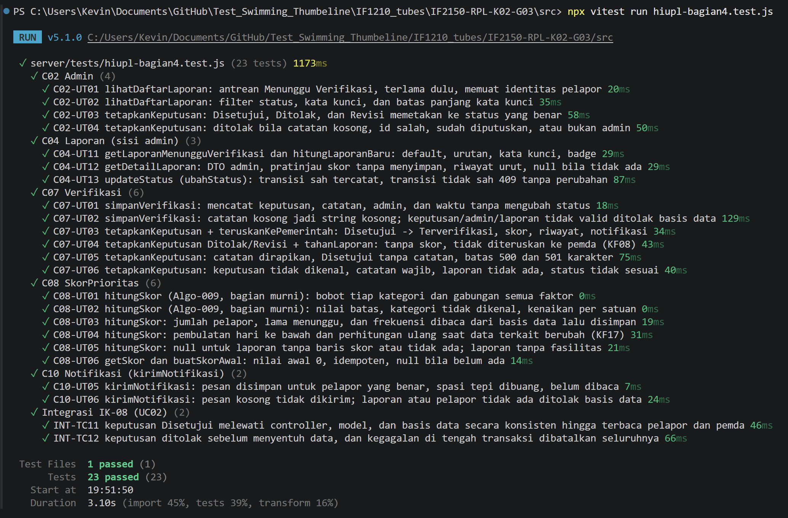 Keluaran Vitest `hiupl-bagian4.test.js` untuk C02-UT01 s.d. C02-UT04 |
| C03-UT01 – C03-UT05 |  Keluaran Vitest untuk `pemda.test.js` |
| C04-UT01 – C04-UT07 | Sama dengan bukti C01-UT01 – C01-UT03 (`laporan-buat.test.js`) |
| C04-UT08 – C04-UT10 | [Laporan JUnit test-bagian3](./assets/Bagian3/test-bagian3.xml) — `warga.test.js`: daftar/ringkasan publik, filter, paginasi, status publik, detail publik, laporan saya, detail kepemilikan, dan riwayat |
| C04-UT11 – C04-UT13 |  Keluaran Vitest `hiupl-bagian4.test.js` untuk C04-UT11 s.d. C04-UT13 |
| C04-UT14 – C04-UT17 | Sama dengan bukti C03-UT01 () |
| C04 (coverage) |  Laporan coverage `@vitest/coverage-v8` pada seluruh test suite, baris `models/laporan/*.js` |
| C05-UT01 – C05-UT05 | Sama dengan bukti C01-UT01 – C01-UT03 (`lokasi.test.js`) |
| C05 (coverage) |  Laporan coverage `@vitest/coverage-v8` pada seluruh test suite (194 test lulus) |
| C06-UT01 – C06-UT03 | Sama dengan bukti C01-UT01 – C01-UT03 (`laporan-buat.test.js` dan `lokasi.test.js`) |
| C06-UT04 – C06-UT12 | 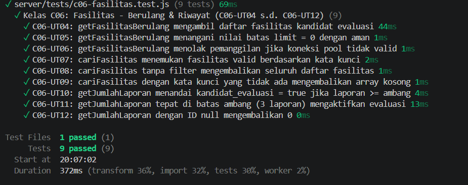 Keluaran Vitest modul `fasilitas-pemda.test.js` |
| C06 (coverage) |  |
| C07-UT01 – C07-UT06 |  Keluaran Vitest `hiupl-bagian4.test.js` untuk C07-UT01 s.d. C07-UT06 |
| C07 (coverage) | 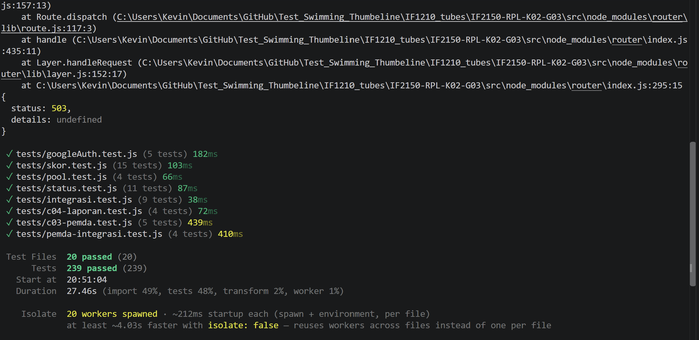 Laporan coverage `@vitest/coverage-v8` pada seluruh test suite, baris `models/verifikasi/verifikasi.js` |
| C08-UT01 – C08-UT06 |  Keluaran Vitest `hiupl-bagian4.test.js` untuk C08-UT01 s.d. C08-UT06 |
| C08 (coverage) |  Laporan coverage `@vitest/coverage-v8` pada seluruh test suite, baris `models/skorPrioritas/skor.js` |
| C09-UT01 | [Laporan JUnit test-bagian3](./assets/Bagian3/test-bagian3.xml) — `warga.test.js` memeriksa riwayat detail laporan urut naik; `status.test.js` menguji perubahan status yang mencatat riwayat |
| C09-UT02 – C09-UT03 | Tidak ada test pada eksekusi test-bagian3 yang memanggil `getPerubahan()` untuk kasus ID ada/tidak ada; belum ada bukti pengujian langsung untuk dua operasi ini |
| C10-UT01 – C10-UT03 | [Laporan JUnit test-bagian3](./assets/Bagian3/test-bagian3.xml) — `warga.test.js` memeriksa daftar notifikasi milik sendiri, jumlah belum dibaca, penandaan dibaca, dan penolakan akses lintas pemilik |
| C10-UT04 | Tidak ada test pada eksekusi test-bagian3 yang memeriksa penolakan endpoint notifikasi bagi peran non-Pelapor; belum ada bukti pengujian untuk kasus ini |
| C10-UT05 – C10-UT06 |  Keluaran Vitest `hiupl-bagian4.test.js` untuk C10-UT05 dan C10-UT06 |
| C11-UT01 – C11-UT06 |  |
| C11 (coverage) |  |
| INT-TC01 – INT-TC06 |  |
| INT-TC07 – INT-TC08 | Sama dengan bukti C01-UT01 – C01-UT03 (`laporan-buat.test.js` dan `laporan-berulang.test.js`) |
| INT-TC09 – INT-TC10 | [Laporan JUnit test-bagian3](./assets/Bagian3/test-bagian3.xml) — test `warga.test.js` mengakses endpoint Express dengan Supertest dan PostgreSQL untuk laporan publik, laporan saya, riwayat, dan notifikasi; tidak ada test yang diberi label terpisah sebagai INT-TC09/INT-TC10 |
| INT-TC11 – INT-TC12 |  Keluaran Vitest `hiupl-bagian4.test.js` untuk INT-TC11 dan INT-TC12 |
| INT-TC13 – INT-TC16 | 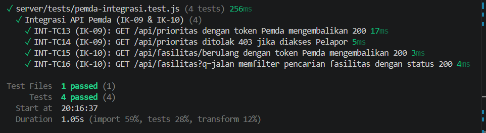 Keluaran Supertest endpoint Pemda |
| UC01-TC01 | 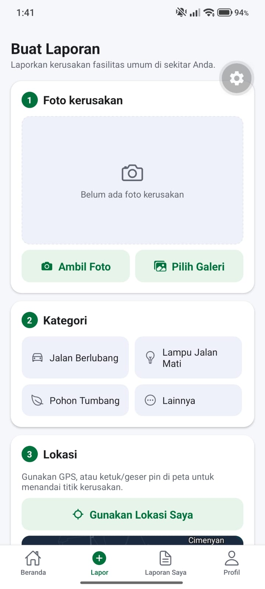 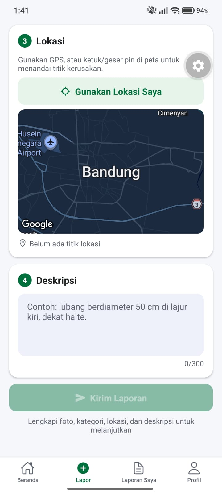  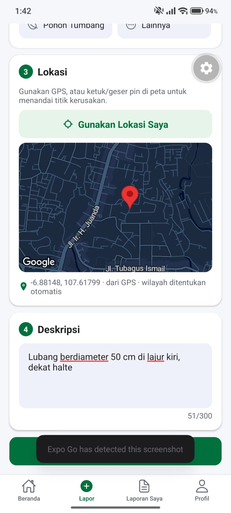 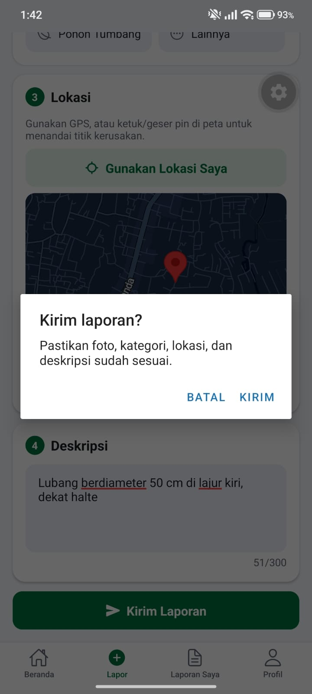  Formulir awal terkunci, isian foto dan kategori, lokasi dan deskripsi, dialog konfirmasi, detail laporan #LPR-0017 |
| UC01-TC02 |   Tombol terkunci dan dialog "Formulir belum lengkap" |
| UC01-TC03 | 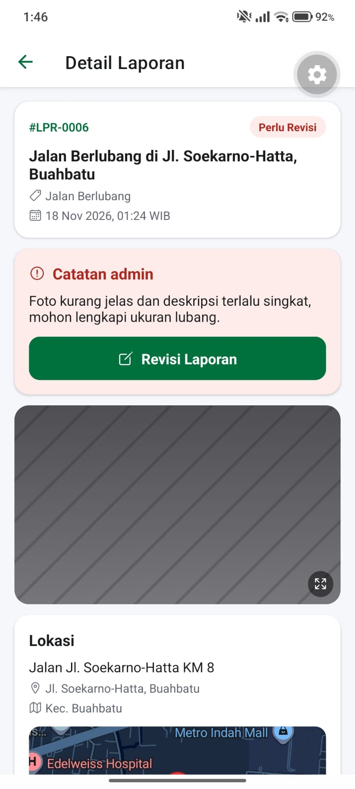 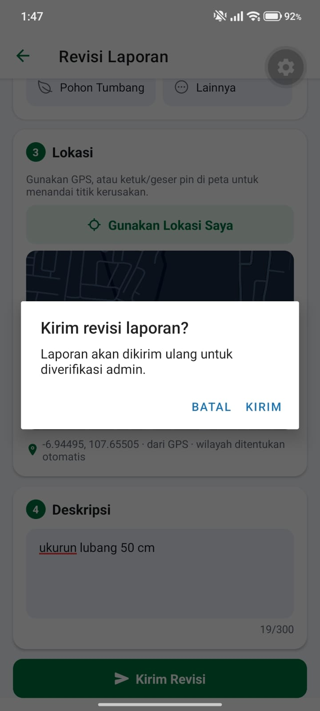  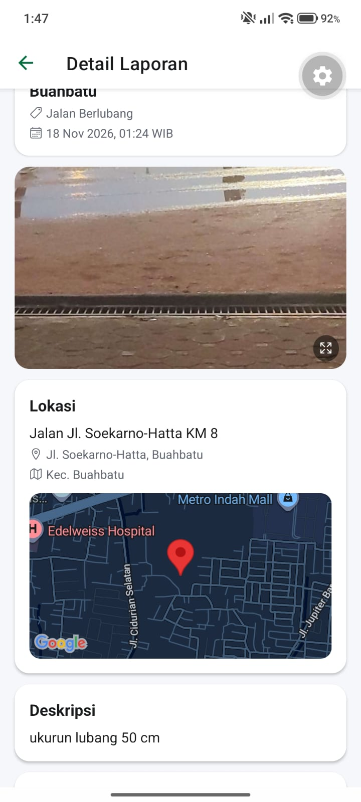 Catatan admin, dialog kirim revisi, riwayat penanganan, foto dan deskripsi setelah revisi |
| UC02-TC01 |                  Dashboard dengan badge, detail dan pratinjau skor, dialog konfirmasi Setujui, "Keputusan tersimpan", notifikasi pelapor, daftar prioritas pemda |
| UC02-TC02 |         Pesan catatan wajib, dialog konfirmasi Tolak, "Keputusan tersimpan", notifikasi pelapor, daftar prioritas pemda tanpa laporan |
| UC03-TC01 |  Tampilan layar Laporan Prioritas Pemda |
| UC03-TC02 |  |
| UC03-TC03 |  |
| UC04-TC01 | 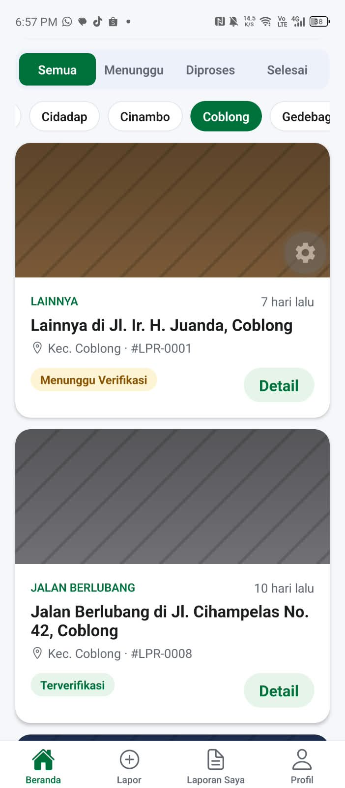 Daftar laporan publik tanpa identitas pelapor |
| UC04-TC02 |  Daftar publik dengan filter wilayah Coblong |
| UC04-TC03 | 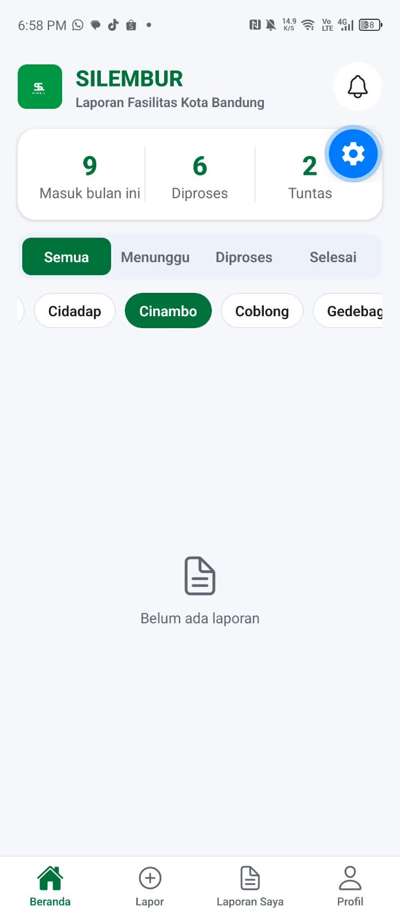 Hasil filter kosong menampilkan "Belum ada laporan" |
| UC04-TC04 | Tidak diuji pada eksekusi test-bagian3; suite server tidak menjalankan skenario timeout UI/aplikasi mobile |
| UC05-TC01 | 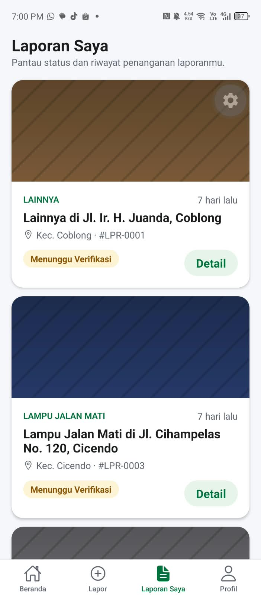 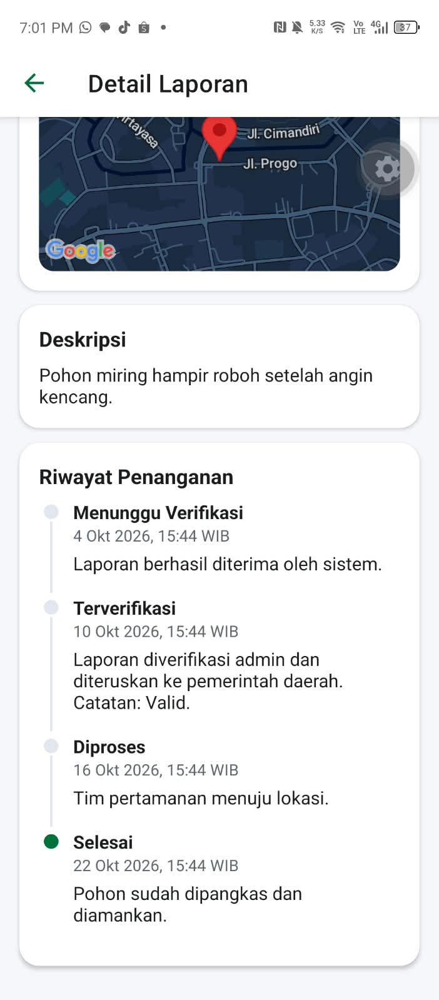  Daftar laporan saya, detail dengan riwayat, dan tampilan detail laporan |
| UC05-TC02 | Tidak diuji pada eksekusi test-bagian3; tidak ada test untuk akun pelapor tanpa laporan dan tampilan kosong UI (belum ada cara untuk penghapusan laporan) |
| UC05-TC03 | Tidak diuji pada eksekusi test-bagian3; suite server tidak menjalankan skenario timeout UI/aplikasi mobile |
| UC06-TC01 |  |
| UC06-TC02 |  |
| UC06-TC03 |  |
| UC07-TC01 |  |
| UC07-TC02 |  |
| UC08-TC01 |  |
| UC08-TC02 |  |
| KNF01-TC01 |  |
| KNF02-TC01 | [Laporan JUnit test-bagian3](./assets/Bagian3/test-bagian3.xml) — `warga.test.js` memeriksa daftar/detail publik tanpa identitas pelapor dan mengecualikan laporan nonpublik |
| KNF03-TC01 | Tidak ada pengukuran waktu respons terukur pada eksekusi test-bagian3; durasi test di JUnit adalah durasi kasus uji, bukan pengukuran response time yang tervalidasi terhadap target 4 detik |
| KNF04-TC01 |  |
| KNF05-TC01 |  Screenshot hasil terminal `profiling_p5.js` |

 

---

# BAB 5: Traceability

Petakan setiap KF ke KNF, use case, kelas perancangan, file implementasi, dan test case. Tabel traceability berikut akan menjadi sarana verifikasi KF. Setiap KF memiliki minimal satu test case dan dinyatakan terpenuhi apabila **seluruh** test case terkaitnya berkesimpulan `Pass`. KF yang tidak diimplementasikan tetap dicantumkan beserta alasannya.

Tabel 5.1. Matriks Kerunutan KF terhadap Implementasi dan Pengujian

| KF ID | KNF Terkait | Use Case ID | Kelas Terkait | Implementasi File Terkait | Test Case (UC) | Test Case (Unit/Integrasi/KNF) |
| :--- | :--- | :--- | :--- | :--- | :--- | :--- |
| *KF05* | *KNF01* | *UC03* | *C02 - Pesanan* | *`src/...`* | *UC03-TC01* | *C02-UT05, INT-TC04, KNF01-TC01* |
| *KF01* | *-* | *UC01 UC02* | *[C01 - Nama kelas] [C02 - Nama kelas]* | *[path/ke/file1] [path/ke/file2]* | *UC01-TC01, UC01-TC02 UC02-TC01* | *-* |
| *KF02* | *[KNFXX atau -]* | *[UCXX]* | *[CXX - Nama kelas]* | *[path/ke/file]* | *[UCXX-TCYY]* | *[CXX-UTYY, INT-TCYY, KNFXX-TCYY atau -]* |
| *KFXX* | *-* | *[UCXX atau -]* | *[CXX - Nama kelas atau -]* | *Tidak diimplementasikan: [alasan]* | *-* | *-* |
| *...* | *...* | *...* | *...* | *...* | *...* | *...* |

Tabel 5.2. Matriks Kerunutan KNF terhadap Pengujian

| ID KNF | Parameter | KF/UC Terkait | Test Case |
| :--- | :--- | :--- | :--- |
| *KNF01* | *Reliability* | *KF05 / UC03* | *KNF01-TC01* |
| *KNFXX* | *[Parameter]* | *[KFXX / UCXX atau -]* | *[KNFXX-TCYY]* |
| *...* | *...* | *...* | *...* |
