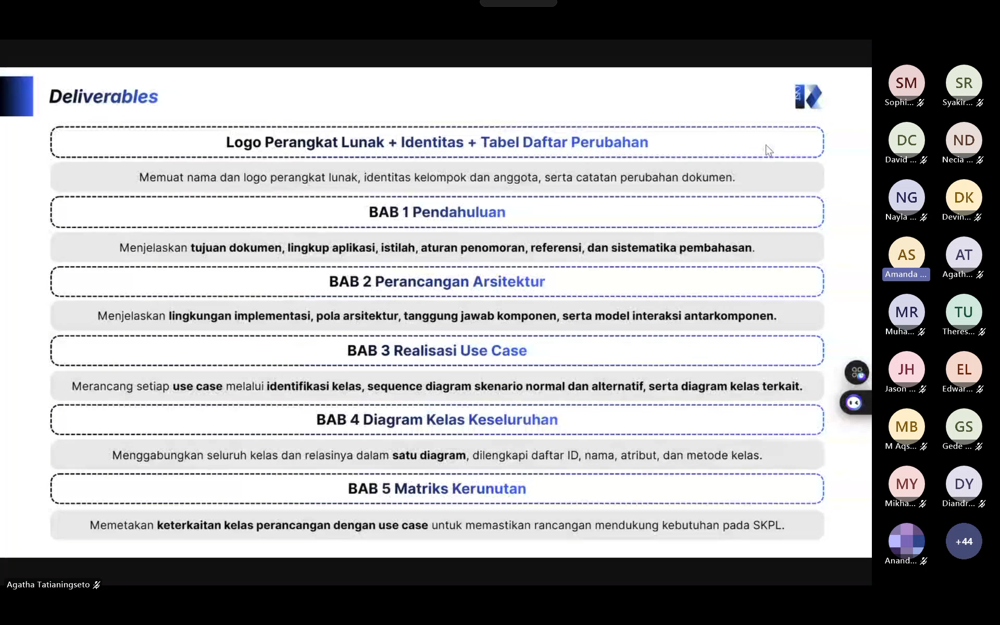

# Form Asistensi

## Tugas Besar IF2150 - Rekayasa Perangkat Lunak

| Informasi | Keterangan |
| --- | --- |
| **Hari** | *Jumat* |
| **Tanggal** | *09/10/2026* |
| **Kelas** | *K02* |
| **Nomor Kelompok** | *G03*  |
| **Nama Kelompok** | *LockedIn*  |
| **Nama Perangkat Lunak** | *Silembur*  |
| **Dokumen** | *K02_G03_RG*  |

### Anggota Kelompok

| NIM | Nama |
| --- | --- |
| *13525059* | *Muhammad Pandu Pulunggana* |
| *13525128* | *Mochamad Fachri Alfaridzi* |
| *13525101* | *Kevin Lincoln Hutabarat* |
| *13525035* | *Muhammad Dhiya Rafi* |
| *13525098* | *Satya Radhityan Yahya* |

### Catatan

| Catatan |
| --- |
| 1. Tugas 7 kurang lebih seperti gabungan dari SKPL, APL dan ada tambahan identitas perangkat lunak. |
| 2. Referensi pada BAB 1 minimal mencantumkan dokumen SKPL dan APL yang telah dibuat sebelumnya. |
| 3. Pada bab 3, kelas perancangan merupakan kelas yang benar-benar akan dipakai saat implementasi dan kelas analisis adalah kelas yang dibuat di SKPL. kelas perancangan dan kelas analisis boleh sama dan boleh berbeda. |
| 4. Diagram kelas perlu ditambahkan atribut dan method, sehingga tidak perlu dituliskan ulang atribut dan method pada masing-masing use case. |
| 5. Dalam satu diagram sekuens dapat memiliki banyak fragmen. |

## Dokumentasi

<!--  -->

  

  <i>Gambar 1. Dokumentasi kegiatan asistensi.</i>

