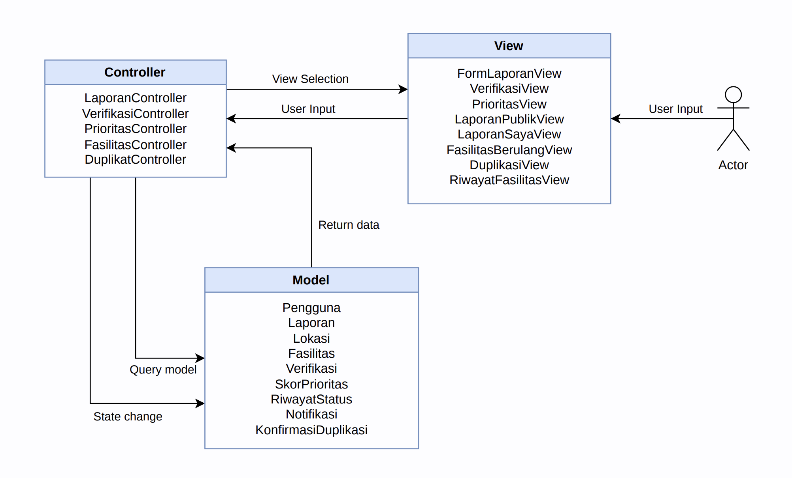
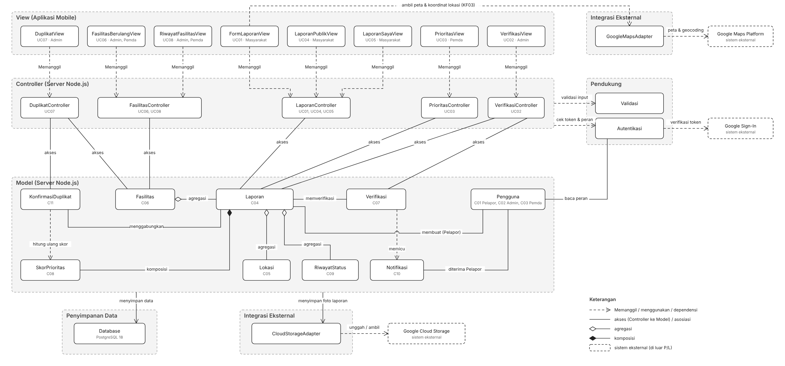
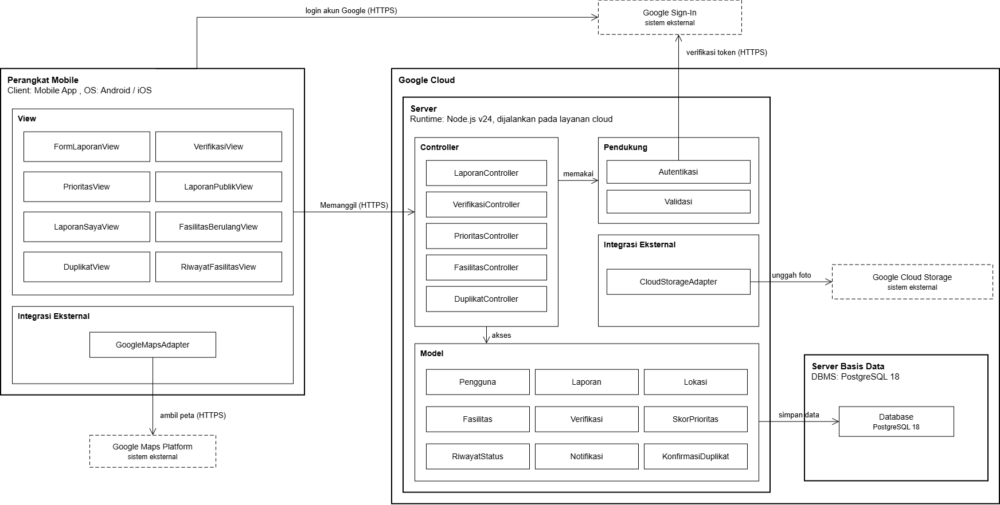
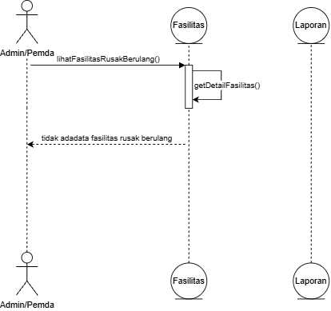
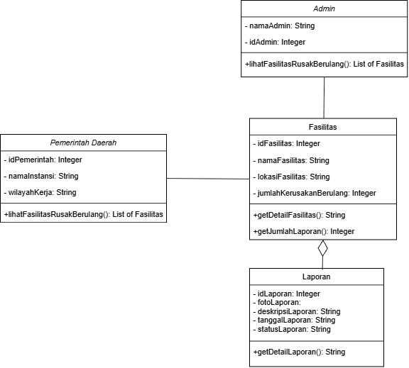
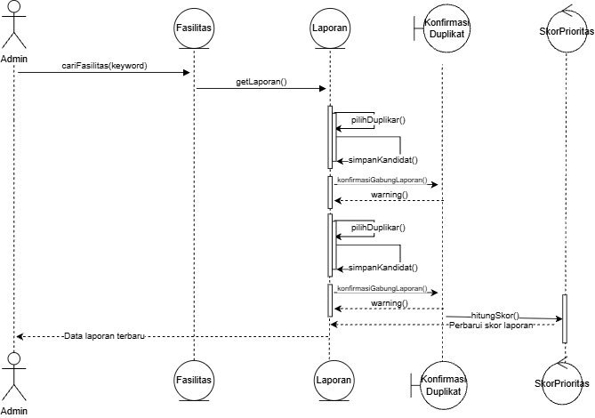
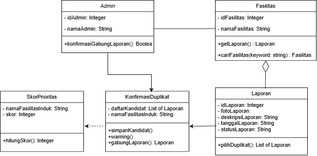

<h1>
IF2150 REKAYASA PERANGKAT LUNAK
 
TUGAS 5
 
DESKRIPSI PERANCANGAN PERANGKAT LUNAK (DPPL)
</h1>
 

## *Nama Perangkat Lunak*
### *[Logo Perangkat Lunak]*

### Untuk: *[Nama Asisten]*

Dipersiapkan oleh:
| Informasi | Keterangan |
| --- | --- |
| Kelas | *K02* |
| Kelompok | *G03* |

| NIM | Nama |
|---|---|
| *13525059* | *Muhammad Pandu Pulunggana* |
| *13525128* | *Mochamad Fachri Alfaridzi* |
| *13525101* | *Kevin Lincoln Hutabarat* |
| *13525035* | *Muhammad Dhiya Rafi* |
| *13525098* | *Satya Radhityan Yahya* |
---

## Daftar Perubahan

| Revisi | Deskripsi |
| :--- | :--- |
| *A* | *Deskripsikan perubahan yang dilakukan dari dokumen sebelumnya pada dokumen ini. Jika tidak terdapat perubahan, harap kosongkan tabel.* |
| *B* |  |
| *C* |  |
| ... |  |

---

 

> **Petunjuk pengerjaan:** *[Silahkan hapus bagian ini setelah selesai mengerjakan]*
>
> Dokumen ini melanjutkan **Spesifikasi Kebutuhan Perangkat Lunak (SKPL)** dan **Arsitektur Perangkat Lunak (APL)**. Gunakan nama, ID, kebutuhan, dan use case yang konsisten dengan kedua dokumen tersebut. Contoh pola ID baru di bawah dapat disesuaikan dengan kesepakatan kelompok, ID yang sudah ada tetap dipertahankan.

 

---

# BAB 1: Pendahuluan

## 1.1 Tujuan Penulisan Dokumen
Tuliskan dengan ringkas tujuan dokumen DPPL ini dibuat dan siapa saja yang akan menggunakan dokumen ini.

## 1.2 Lingkup Masalah
Tuliskan dengan ringkas nama aplikasi dan deskripsi singkatnya. Bagian ini maksimal berisi satu paragraf, dapat diambil dari SKPL.

## 1.3 Definisi, Istilah, dan Singkatan
Semua definisi dan singkatan yang digunakan dalam dokumen ini beserta penjelasannya.

Tabel 1.3. Definisi Istilah dan Singkatan

| Singkatan, Akronim, atau Istilah | Penjelasan |
| :--- | :--- |
| *P/L* | *Singkatan dari Perangkat Lunak, yaitu aplikasi yang memberikan perintah kepada komputer untuk menjalankan tugas tertentu.* |
| *DPPL* | *Singkatan dari Spesifikasi Kebutuhan Perangkat Lunak, yaitu dokumen yang merangkum kriteria-kriteria yang diperlukan untuk membangun aplikasi menjalankan tugasnya.* |
| *UC* | *Singkatan dari Use Case.* |
| *...* | *...* |

## 1.4 Aturan Penomoran
Tuliskan aturan penomoran (ID) yang digunakan dalam dokumen ini. Gunakan pola ID yang **sama** dengan yang sudah dipakai pada dokumen-dokumen sebelumnya, jangan membuat pola baru di dokumen ini.

Tabel 1.4. Aturan Penomoran

| Hal/Bagian | Penomoran | Keterangan |
| :--- | :--- | :--- |
| *Uce Case* | *UCXX* | |
| *Kelas* | *CXX* | |
| *...* | *...* |

## 1.5 Referensi
Cantumkan dokumentasi P/L yang dirujuk oleh dokumen ini, **minimal dokumen SKPL dan APL**. Tambahkan buku, panduan, atau dokumentasi lain apabila digunakan.

## 1.6 Deskripsi Umum Dokumen (Ikhtisar)
Tuliskan sistematika pembahasan dokumen ini secara ringkas dan runut, dengan maksimal 1 paragraf.

 

---

# BAB 2: Perancangan Arsitektur

## 2.1 Rancangan Lingkungan Implementasi

Sebutkan *operating system*, DBMS, *development tools*, *filing system*, dan bahasa pemrograman yang digunakan.

| Komponen | Spesifikasi |
| :--- | :--- |
| *Server* | *Node.js v24, dijalankan pada layanan cloud* |
| *Client* | *Mobile App* |
| *DBMS* | *PostgreSQL 18* |
| *OS* | *Android dan iOS* |
| *Runtime* | *Node.js v24* |
| *Cloud* | *Google Cloud* |
| *Language* | *JavaScript* |

## 2.2 Style/Pattern Arsitektur Acuan

Tentukan *architectural style* atau *pattern* yang menjadi acuan aplikasi, misalnya *layered architecture*, *client-server*, *repository*, *pipe and filter*, atau MVC (*Model-View-Controller*).

Gunakan hasil **BAB 1 Style/Pattern Arsitektur Acuan pada dokumen APL**, termasuk alasan pemilihan dan gambar penerapannya pada P/L kelompok. Gunakan komponen aplikasi sendiri pada gambar, bukan hanya contoh pola umum.

Gaya arsitektur utama yang dipilih adalah MVC yang dibangun di atas pola klien-server. Bagian dan peran dari MVC, yaitu:
- Model: Menyimpan data dan logika bisnis. Model bertanggung jawab dalam manajemen data, termasuk pengambilan, penyimpanan, dan pemrosesan data. 
- View: Menampilkan data yang diberikan Model kepada pengguna.
- Controller: Menjadi penghubung antara Model dan View. Controller akan menerima input pengguna, memprosesnya, dan menentukan bagaimana data dari Model akan ditampilkan oleh View.

Gaya arsitektur utama MVC dipilih karena data berupa laporan pengguna dan fasilitas dapat ditampilkan dalam beberapa bentuk tergantung pengguna yang memintanya beserta usecase yang dijalankan. Misalnya:
- Ketika masyarakat umum mengakses laporan yang dibuat pengguna lain, view hanya menampilkan foto, lokasi, deskripsi, dan status tanpa identitas pelapor (berkaitan dengan KF10)
- Ketika masyarakat umum mengakses laporan yang dibuat dirinya sendiri, view menampilkan detail lengkap laporan berupa foto, lokasi, deskripsi, status, dan riwayat perubahan laporan (berkaitan dengan KF10, KF13, KF24)
- Ketika admin mengakses laporan masyarakat umum yang belum diverifikasi, view hanya menampilkan foto, lokasi, deskripsi laporan yang baru dibuat (berkaitan dengan KF06 dan KF07)
- Ketika pemerintah daerah mengakses menu laporan aktif, view menampilkan daftar laporan pengguna yang terurut berdasarkan skor prioritas (berkaitan dengan KF18)
- Ketika admin ingin mengonfirmasi laporan duplikat dengan melihat daftar laporan aktif, view menampilkan preview dari laporan aktif yang duplikat (berkaitan dengan KF20, KF21)
- Ketika admin atau pemerintah daerah mengakses dashboard, view menampilkan preview dari fasilitas yang mengalami kerusakan berulang (berkaitan dengan KF14)
- Ketika admin atau pemerintah daerah mengakses laporan yang dibuat pengguna, view menampilkan detail lengkap laporan berupa foto, lokasi, deskripsi, status, dan riwayat perubahan laporan (berkaitan dengan KF10, KF22, KF23)
Selain itu, model MVC juga membuat testing tampilan aplikasi lebih mudah dilakukan untuk setiap tipe pengguna dan use case yang dilaksanakan.

<i>Gambar 1. Contoh Arsitektur MVC</i>

Tabel 1.1. Lingkungan Operasi Perangkat Lunak

| Komponen | Spesifikasi |
| :--- | :--- |
| *Server* | *Node.js v24, dijalankan pada layanan cloud* |
| *Client* | *Mobile App* |
| *DBMS* | *PostgreSQL 18* |
| *OS* | *Android dan iOS* |
| *Runtime* | *Node.js v24* |
| *Cloud* | *Google Cloud* |

Model MVC dipilih karena bisa diterapkan untuk aplikasi mobile. MVC bisa diimplementasikan dengan JavaScript dengan membagi model, view, controller menjadi 3 modul atau folder yang berbeda, yang kemudian bisa digunakan untuk membangun aplikasi yang kemudian dihubungkan ke server dengan Node.js.

## 2.3 Identifikasi Komponen / Modul / Subsistem

Identifikasi komponen, modul, atau subsistem penyusun aplikasi berdasarkan *pattern* yang telah ditetapkan. Jelaskan tanggung jawab masing-masing komponen. Pengelompokan dapat mengikuti lapisan arsitektur atau fungsi/peran komponen dalam sistem.

Ambil dari **Tabel 2.1 dokumen APL**, lalu kelompokkan berdasarkan lapisan (Model/View/Controller). Kolom **Jenis** diisi sesuai pattern, misalnya View, Controller, Model, Service, Repository. Satu komponen merepresentasikan saatu tanggung jawab utama yang jelas,

Tabel 2.3. Identifikasi Komponen/Modul/Subsistem

| Nama Komponen/Modul/Subsistem | Jenis                 | Penjelasan                                                                                                             |
| :---------------------------- | :-------------------- | :--------------------------------------------------------------------------------------------------------------------- |
| *FormLaporanView*             | *View*                | *Menampilkan formulir laporan berisi foto, lokasi, dan deskripsi kerusakan, lalu mengirimkannya ke LaporanController.* |
| *VerifikasiView*              | *View*                | *Menampilkan laporan yang menunggu verifikasi beserta pilihan setujui, tolak, atau minta revisi untuk admin.*          |
| *PrioritasView*               | *View*                | *Menampilkan laporan terverifikasi yang terurut berdasarkan skor prioritas kepada pemerintah daerah.*                  |
| *LaporanPublikView*           | *View*                | *Menampilkan laporan pengguna lain tanpa identitas pelapor.*                                                           |
| *LaporanSayaView*             | *View*                | *Menampilkan laporan milik pelapor beserta status, riwayat penanganan, dan notifikasi verifikasi.*                     |
| *FasilitasBerulangView*       | *View*                | *Menampilkan fasilitas yang menjadi kandidat evaluasi perbaikan permanen.*                                             |
| *DuplikatView*                | *View*                | *Menampilkan kandidat laporan duplikat dan konfirmasi penggabungan untuk admin.*                                       |
| *RiwayatFasilitasView*        | *View*                | *Menampilkan pencarian fasilitas dan riwayat perubahan status laporannya.*                                             |
| *LaporanController*           | *Controller*          | *Memproses pembuatan laporan, daftar laporan publik, serta status dan riwayat laporan milik pelapor.*                  |
| *VerifikasiController*        | *Controller*          | *Memproses keputusan verifikasi admin, mengirim notifikasi, dan memicu perhitungan skor prioritas.*                    |
| *PrioritasController*         | *Controller*          | *Memproses daftar laporan terverifikasi berdasarkan skor prioritas dan filternya.*                                     |
| *FasilitasController*         | *Controller*          | *Memproses daftar fasilitas dengan kerusakan berulang, pencarian fasilitas, dan riwayat statusnya.*                    |
| *DuplikatController*          | *Controller*          | *Memproses pencarian kandidat duplikat dan penggabungan laporan setelah dikonfirmasi admin.*                           |
| *Pengguna*                    | *Model*               | *Merepresentasikan akun dan peran pengguna, yaitu Pelapor, Admin, dan PemerintahDaerah.*                               |
| *Laporan*                     | *Model*               | *Merepresentasikan data laporan berupa foto, lokasi, deskripsi, kategori, dan status.*                                 |
| *Lokasi*                      | *Model*               | *Merepresentasikan koordinat dan wilayah laporan.*                                                                     |
| *Fasilitas*                   | *Model*               | *Merepresentasikan fasilitas umum dan menandainya jika laporan melewati ambang batas.*                                 |
| *Verifikasi*                  | *Model*               | *Merepresentasikan keputusan verifikasi beserta catatan alasannya.*                                                    |
| *SkorPrioritas*               | *Model*               | *Menghitung skor prioritas laporan.*                                                                                   |
| *RiwayatStatus*               | *Model*               | *Mencatat setiap perubahan status laporan.*                                                                            |
| *Notifikasi*                  | *Model*               | *Merepresentasikan pesan hasil verifikasi untuk pelapor.*                                                              |
| *KonfirmasiDuplikat*          | *Model*               | *Menyimpan kandidat duplikat dan menggabungkannya menjadi satu laporan induk.*                                         |
| *Autentikasi*                 | *Pendukung*           | *Memeriksa token Google Sign-In dan membatasi akses sesuai peran pengguna.*                                            |
| *Validasi*                    | *Pendukung*           | *Memeriksa kelengkapan dan format input sebelum diproses controller.*                                                  |
| *GoogleMapsAdapter*           | *Integrasi Eksternal* | *Menghubungkan aplikasi dengan Google Maps Platform untuk menampilkan dan memilih lokasi.*                             |
| *CloudStorageAdapter*         | *Integrasi Eksternal* | *Menghubungkan aplikasi dengan Google Cloud Storage untuk menyimpan foto laporan.*                                     |
| *Database*                    | *Penyimpanan Data*    | *Basis data PostgreSQL 18 yang menyimpan seluruh data Model.*      

## 2.4 Model Arsitektur Perangkat Lunak

Buat model arsitektur dalam bentuk satu atau lebih *view* yang memperlihatkan interaksi dan kolaborasi komponen, modul, serta subsistem dalam menjalankan fungsi sistem. Pilih notasi yang sesuai. Contoh *view*: *Logical View*, *Process View*, *Development View*, dan *Physical View*.

Gunakan hasil **BAB 3 Model Arsitektur Perangkat Lunak pada dokumen APL**. 

## 2.4.1 Logical View

*Logical View* dipilih karena paling langsung memperlihatkan penerapan MVC pada SILEMBUR. Diagram ini menunjukkan *controller* mana yang menangani setiap layar, *model* mana yang diakses setiap *controller*, dan bagaimana *model* saling berhubungan. Informasi tersebut menjadi panduan pembagian modul saat implementasi.

<i>Gambar 2. Logical View SILEMBUR</i>

Seluruh komponen pada Tabel 2.1 digambarkan dan dikelompokkan menjadi *View*, *Controller*, *Model*, *Pendukung*, *Integrasi Eksternal*, dan *Penyimpanan Data*. Setiap *View* diberi keterangan use case dan aktor yang memakainya. Garis "Memanggil" menunjukkan *View* yang meneruskan aksi pengguna ke *Controller*, sedangkan garis "akses" menunjukkan *Controller* yang membaca atau mengubah *Model*. Hubungan antar-*Model* mengikuti diagram kelas keseluruhan pada SKPL. Fasilitas mengagregasi Laporan, Laporan mengagregasi Lokasi dan RiwayatStatus, serta Laporan tersusun atas (komposisi) SkorPrioritas. Karena Lokasi, RiwayatStatus, dan SkorPrioritas merupakan bagian dari Laporan, *controller* mengaksesnya melalui Laporan, tidak secara langsung. Seluruh *controller* memakai Autentikasi dan Validasi sebelum memproses permintaan. Layanan Google di luar P/L, yaitu Google Maps Platform, Google Sign-In, dan Google Cloud Storage, digambarkan dengan garis putus-putus.

## 2.4.2 Physical View

Physical View dipilih karena SILEMBUR berjalan di dua lingkungan yang terpisah yaitu perangkat mobile milik pengguna dan server di Google Cloud. View ini melengkapi Logical View dengan menunjukkan di node mana setiap komponen pada Tabel 2.1 dijalankan dan bagaimana node-node tersebut saling berkomunikasi sesuai lingkungan operasi pada Tabel 1.1.

<i>Gambar 3. Physical View SILEMBUR</i>

Semua komponen View dan GoogleMapsAdapter berjalan di aplikasi mobile pada Android dan iOS. View memanggil Controller di server melalui HTTPS. Controller, Model, Pendukung, dan CloudStorageAdapter berjalan di server Node.js v24 pada Google Cloud. Data Model tersimpan di PostgreSQL 18 dan foto laporan tersimpan di Google Cloud Storage. Login dan verifikasi token memakai Google Sign In. Peta diambil dari Google Maps Platform. Controller dan Model ditempatkan di server agar aturan bisnis tidak bisa dilewati dari aplikasi dan Android maupun iOS memakai logika yang sama.

 

---

# BAB 3: Realisasi Use Case

## 3.1 Use Case [Nama Use Case 1]

**ID Use Case:** *[UC01 sesuai SKPL]*  
**Nama Use Case:** *[Nama use case sesuai SKPL]*

### 3.1.1 Identifikasi Kelas

Identifikasi kelas yang terkait dengan use case tersebut. Kelas di tahap perancangan dapat berbeda dengan dengan kelas di tahap analisis. Dapat menggunakan tabel di bawah:

Tabel 3.1. Identifikasi Kelas Use Case [UC01]

| No | Nama Kelas Perancangan | Nama Kelas Analisis Terkait |
|:--- | :--- | :--- |
| 1 | *[Nama kelas perancangan]* | *[Nama kelas analisis pada SKPL]* |
| 2 | *[Nama kelas perancangan]* | *[Nama kelas analisis pada SKPL]* |
| ... | *...* | *...* |

### 3.1.2 Sequence Diagram

Buat *sequence diagram* untuk **setiap skenario use case**, mencakup skenario normal dan alternatif pada subbab 4.4 SKPL. Diagram melibatkan kelas-kelas yang telah diidentifikasi pada SKPL. 

- **Skenario Normal**

<i>Gambar X. Sequence Diagram [UC01]</i>

- **Skenario Alternatif [Nomor]: [Nama Skenario]**

<i>Gambar X. Sequence Diagram [UC01] - [Nama skenario alternatif]</i>

### 3.1.3 Diagram Kelas

Buatlah diagram kelas untuk use case ini yang terdiri atas kelas-kelas dari 3.1.1. **Setiap kelas pada diagram wajib menampilkan atribut dan metode/operasi langsung di dalam kotak kelasnya**, sehingga tidak perlu membuat tabel daftar atribut dan metode per kelas pada subbab ini. Daftar lengkap atribut dan metode seluruh kelas disajikan pada Tabel 4.1 (Bab 4).

<i>Gambar X. Diagram Kelas [Nama Uce Case]</i>

Pada diagram, pastikan:
- Atribut dituliskan beserta visibilitas dan tipe datanya, misalnya `- email: String`.
- Operasi dituliskan beserta visibilitas, parameter, dan tipe kembaliannya, misalnya `+ login(email: String, password: String): Boolean`.
- Relasi antarkelas (asosiasi, agregasi, komposisi, generalisasi, dan dependensi) digambarkan lengkap dengan multiplisitas.
- Semua operasi yang dipanggil pada sequence diagram 3.1.2 (skenario normal dan alternatif) ada pada kelas yang bersangkutan.
- Kelas yang sama dengan kelas di use case lain memakai nama, atribut, dan metode yang konsisten.

## 3.2 Use Case XX

Silahkan lanjutkan untuk  *use case* berikutnya dengan content yang sama dengan 3.1

## 3.6 Use Case Meninjau Fasilitas dengan Kerusakan Berulang

**ID Use Case:** *UC06*  
**Nama Use Case:** *Meninjau Fasilitas dengan Kerusakan Berulang*

### 3.6.1 Identifikasi Kelas

Tabel 3.6. Identifikasi Kelas Use Case [UC06]

| No | Nama Kelas Perancangan | Nama Kelas Analisis Terkait |
|:--- | :--- | :--- |
| 1 | *Laporan* | *Laporan* |
| 2 | *Fasilitas* | *Fasilitas* |
| 3 | *Admin* | *Admin* |
| 4 | *Pemerintah Daerah* | *Pemerintah Daerah* |

### 3.6.2 Sequence Diagram

- **Skenario Normal**

<i>Gambar X. Sequence Diagram [UC06]</i>

- **Skenario Alternatif 1: Tidak ada fasilitas yang muncul**

<i>Gambar X. Sequence Diagram [UC06] - [Tidak ada fasilitas yang muncul]</i>

- **Skenario Alternatif 2: Loading dashboard terlalu lama**

<i>Gambar X. Sequence Diagram [UC06] - [Loading dashboard terlalu lama]</i>

### 3.6.3 Diagram Kelas

<i>Gambar X. Diagram Kelas Meninjau Fasilitas dengan Kerusakan Berulang
</i>

## 3.7 Use Case Mengonfirmasi dan Menggabungkan Laporan Duplikat

**ID Use Case:** *UC07*  
**Nama Use Case:** *Mengonfirmasi dan Menggabungkan Laporan Duplikat*

### 3.7.1 Identifikasi Kelas

Tabel 3.7. Identifikasi Kelas Use Case [UC07]

| No | Nama Kelas Perancangan | Nama Kelas Analisis Terkait |
|:--- | :--- | :--- |
| 1 | *Laporan* | *Laporan* |
| 2 | *Fasilitas* | *Fasilitas* |
| 3 | *Admin* | *Admin* |
| 4 | *SkorPrioritas* | *SkorPrioritas* |
| 5 | *KonfirmasiDuplikat* | *KonfirmasiDuplikat* |

### 3.7.2 Sequence Diagram

- **Skenario Normal**

<i>Gambar X. Sequence Diagram [UC07]</i>

- **Skenario Alternatif 1: Admin salah memilih laporan duplikat**

<i>Gambar X. Sequence Diagram [UC07] - [Admin salah memilih laporan duplikat]</i>

### 3.7.3 Diagram Kelas

<i>Gambar X. Diagram Kelas Mengonfirmasi dan Menggabungkan Laporan Duplikat</i>

## 3.8 Use Case Melacak Riwayat Perubahan Status per Fasilitas

**ID Use Case:** *UC08*  
**Nama Use Case:** *Melacak Riwayat Perubahan Status per Fasilitas*

### 3.8.1 Identifikasi Kelas

Tabel 3.8. Identifikasi Kelas Use Case [UC08]

| No | Nama Kelas Perancangan | Nama Kelas Analisis Terkait |
|:--- | :--- | :--- |
| 1 | *Laporan* | *Laporan* |
| 2 | *Fasilitas* | *Fasilitas* |
| 3 | *RiwayatStatus* | *RiwayatStatus* |

### 3.8.2 Sequence Diagram

- **Skenario Normal**

<i>Gambar X. Sequence Diagram [UC08]</i>

- **Skenario Alternatif 1: Admin/Pemerintah daerah mencari fasilitas yang tidak ada dalam list laporan yang berubah**

<i>Gambar X. Sequence Diagram [UC08] - [Admin/Pemerintah daerah mencari fasilitas yang tidak ada dalam list laporan yang berubah]</i>

### 3.8.3 Diagram Kelas

<i>Gambar X. Diagram Kelas Melacak Riwayat Perubahan Status per Fasilitas </i>

 

---

# BAB 4: Diagram Kelas Keseluruhan

## 4.1 Diagram Kelas

**Bagian ini diisi dengan diagram kelas keseluruhan.**

<i>Gambar 4.1. Diagram Kelas Perancangan Keseluruhan [Nama P/L]</i>

Tabel 4.1. Daftar Kelas Perancangan Keseluruhan

| ID Kelas | Nama Kelas | Atribut | Metode/Operasi |
| :--- | :--- | :--- | :--- |
| *[C01]* | *[Nama kelas]* | *[Daftar atribut]* | *[Daftar metode/operasi]* |
| *[C02]* | *[Nama kelas]* | *[Daftar atribut]* | *[Daftar metode/operasi]* |
| *[C03]* | *[Nama kelas]* | *[Daftar atribut]* | *[Daftar metode/operasi]* |
| *...* | *...* | *...* | *...* |

 

---

# BAB 5: Matriks Kerunutan

Petakan kelas perancangan dengan use case yang terkait. Gunakan **BAB 6 Traceability pada dokumen SKPL** sebagai acuan keterkaitan kelas analisis dan use case, lalu sesuaikan dengan realisasi use case dan kelas perancangan pada BAB 3–BAB 5 DPPL.

Tabel 7.1. Matriks Kerunutan Kelas terhadap Use Case

| Kelas | Use Case Terkait |
| :--- | :--- |
| *[ID kelas - Nama kelas]* | *[ID UC - Nama use case]* |
| *[ID kelas - Nama kelas]* | *[ID UC - Nama use case]* |
| *...* | *...* |
