<h1>
IF2150 REKAYASA PERANGKAT LUNAK
<br>
TUGAS 5
<br>
DESKRIPSI PERANCANGAN PERANGKAT LUNAK (DPPL)
</h1>
<br>

## *SILEMBUR*
### *LOGO*
<p align="center">

</p>
<p align="center">

### Untuk: *Amanda Aurellia Salsabila*


Dipersiapkan oleh:
| Informasi | Keterangan |
| --- | --- |
| Kelas | *K02* |
| Kelompok | *G03* |

| NIM | Nama |
|---|---|
| *13525059* | *Muhammad Pandu Pulunggana* |
| *13525128* | *Mochamad Fachri Alfaridzi* |
| *13525101* | *Kevin Lincoln Hutabarat* |
| *13525035* | *Muhammad Dhiya Rafi* |
| *13525098* | *Satya Radhityan Yahya* |
---

## Daftar Perubahan

| Revisi | Deskripsi |
| :--- | :--- |
| *A* | *Menambahkan logo pada dokumen.* |
| *B* | *Memperbaiki gambar yang tidak muncul pada Bab 3.* |
| *C* | *Menambahkan penomoran gambar pada Bab 3.* |
| ... |  |

---

<br>

> **Petunjuk pengerjaan:** *[Silahkan hapus bagian ini setelah selesai mengerjakan]*
>
> Dokumen ini melanjutkan **Deskripsi Perancangan Perangkat Lunak**. Gunakan nama, ID, kebutuhan, dan use case yang konsisten dengan kedua dokumen tersebut. Contoh pola ID baru di bawah dapat disesuaikan dengan kesepakatan kelompok, ID yang sudah ada tetap dipertahankan.

<br>

---


# BAB 1: Pendahuluan

## 1.1 Tujuan Penulisan Dokumen
Dokumen DPPL ini menjelaskan rancangan perangkat lunak SILEMBUR yang disusun dari kebutuhan pada SKPL dan arsitektur pada APL. Isinya mencakup rancangan arsitektur dan realisasi setiap use case dalam bentuk sequence diagram dan diagram kelas perancangan. Dokumen ini digunakan oleh Kelompok G03 sebagai acuan saat mengimplementasikan dan menguji P/L. Asisten mata kuliah IF2150 menggunakannya untuk memeriksa kesesuaian rancangan dengan kebutuhan yang sudah ditetapkan.

## 1.2 Lingkup Masalah
SILEMBUR (Sistem Informasi Lembur) adalah aplikasi web mobile untuk melaporkan kerusakan fasilitas umum seperti jalan berlubang, lampu penerangan jalan yang mati, dan pohon tumbang. Nama "lembur" diambil dari bahasa Sunda yang berarti kampung. Masyarakat membuat laporan berisi foto, lokasi GPS, dan deskripsi kerusakan. Admin kemudian memverifikasi laporan tersebut sebelum diteruskan ke pemerintah daerah. Kanal pengaduan yang ada saat ini, seperti SP4N-LAPOR dan JAKI, memperlakukan setiap laporan sebagai pengaduan terpisah. Akibatnya laporan duplikat menumpuk, prioritas penanganan tidak langsung terlihat, dan riwayat kerusakan suatu fasilitas sulit ditelusuri. SILEMBUR menangani masalah tersebut dengan menggabungkan laporan duplikat, menghitung skor prioritas setiap laporan terverifikasi, dan mencatat riwayat status per fasilitas. Cakupan sistem dibatasi pada satu kota dengan tiga jenis pengguna, yaitu masyarakat umum, admin, dan pemerintah daerah.

## 1.3 Definisi, Istilah, dan Singkatan
Semua definisi dan singkatan yang digunakan dalam dokumen ini beserta penjelasannya.

Tabel 1.3. Definisi Istilah dan Singkatan

| Singkatan, Akronim, atau Istilah | Penjelasan |
| :--- | :--- |
| *P/L* | *Singkatan dari Perangkat Lunak, yaitu aplikasi yang memberikan perintah kepada komputer untuk menjalankan tugas tertentu.* |
| *DPPL* | *Singkatan dari Deskripsi Perancangan Perangkat Lunak, yaitu dokumen yang berisi rancangan P/L sebagai acuan implementasi.* |
| *SKPL* | *Singkatan dari Spesifikasi Kebutuhan Perangkat Lunak, yaitu dokumen yang merangkum kriteria-kriteria yang diperlukan untuk membangun aplikasi menjalankan tugasnya.* |
| *APL* | *Singkatan dari Arsitektur Perangkat Lunak, yaitu dokumen yang berisi pola arsitektur dan komponen penyusun P/L.* |
| *MVC* | *Singkatan dari Model View Controller, yaitu pola arsitektur yang memisahkan data dan logika bisnis dari tampilan serta pengolah input.* |
| *KF* | *Singkatan dari Kebutuhan Fungsional.* |
| *KNF* | *Singkatan dari Kebutuhan Non-Fungsional.* |
| *UC* | *Singkatan dari Use Case.* |
| *SILEMBUR* | *Singkatan dari Sistem Informasi Lembur, yaitu nama aplikasi pelaporan kerusakan fasilitas umum yang dibangun pada dokumen ini.* |
| *GPS* | *Singkatan dari Global Positioning System, yaitu layanan penentuan lokasi yang dipakai untuk mengambil koordinat laporan secara otomatis.* |
| *SP4N-LAPOR* | *Singkatan dari Sistem Pengelolaan Pengaduan Pelayanan Publik Nasional Layanan Aspirasi dan Pengaduan Online Rakyat, yaitu kanal pengaduan nasional yang disebut pada lingkup masalah.* |
| *JAKI* | *Singkatan dari Jakarta Kini, yaitu aplikasi layanan warga milik Pemerintah Provinsi DKI Jakarta yang disebut pada lingkup masalah.* |
| *US* | *Singkatan dari User Story, yaitu kebutuhan pengguna awal.* |
| *R* | *Singkatan dari Requirement (Kebutuhan), yaitu kebutuhan user, sistem, dan bisnis.* |
| *C* | *Singkatan dari Class (Kelas), yaitu objek yang terikat dengan Use Case.* |
| *API* | *Singkatan dari Application Programming Interface, yaitu antarmuka yang memungkinkan dua sistem saling bertukar data.* |
| *DBMS* | *Singkatan dari Database Management System, yaitu perangkat lunak yang mengelola basis data.* |
| *OS* | *Singkatan dari Operating System (Sistem Operasi).* |
| *ID* | *Singkatan dari Identifier, yaitu penanda unik untuk setiap kebutuhan, use case, atau kelas.* |

## 1.4 Aturan Penomoran
Tuliskan aturan penomoran (ID) yang digunakan dalam dokumen ini. Gunakan pola ID yang **sama** dengan yang sudah dipakai pada dokumen-dokumen sebelumnya, jangan membuat pola baru di dokumen ini.

Tabel 1.4. Aturan Penomoran

| Hal/Bagian | Penomoran | Keterangan |
| :--- | :--- | :--- |
| *User Story* | *US-XX* | *Kebutuhan pengguna awal* |
| *Aktivitas* | *AXX* | *Aktivitas aktor* |
| *Kebutuhan* | *RXX* | *Kebutuhan user, sistem dan bisnis* |
| *Kebutuhan Fungsional* | *KFXX* | *Proses yang harus disediakan oleh sistem* |
| *Kebutuhan Non-Fungsional* | *KNFXX* | *Kualitas dan performa yang harus dicapai* |
| *Use Case* | *UCXX* | *Kasus-kasus penggunaan perangkat lunak oleh aktor* |
| *Kelas* | *CXX* | *Objek yang terikat dengan Use Case* |

## 1.5 Referensi
- Kelompok K02 G03. *Spesifikasi Kebutuhan Perangkat Lunak (SKPL) SILEMBUR*
- Kelompok K02 G03. *Arsitektur Perangkat Lunak (APL) SILEMBUR*
- Powerpoint Modul dari Edunex kelas Software Engineering [Parent Class]
- Sommerville, I. (2016). *Software Engineering* (10th ed.). Pearson

## 1.6 Deskripsi Umum Dokumen (Ikhtisar)
Dokumen DPPL SILEMBUR ini terdiri dari lima bab. BAB 1 berisi pendahuluan dokumen. BAB 2 membahas perancangan arsitektur yang meliputi lingkungan implementasi serta pola arsitektur dan komponen penyusunnya. BAB 3 membahas realisasi setiap use case melalui identifikasi kelas dan sequence diagram serta diagram kelas. BAB 4 menyajikan diagram kelas perancangan keseluruhan. BAB 5 menyajikan matriks kerunutan antara kelas perancangan dan use case.

<br>

---

# BAB 2: Perancangan Arsitektur

## 2.1 Rancangan Lingkungan Implementasi

Sebutkan *operating system*, DBMS, *development tools*, *filing system*, dan bahasa pemrograman yang digunakan.

Tabel 2.1 Komponen Lingkungan Implementasi
| Komponen | Spesifikasi |
| :--- | :--- |
| *Server* | *Node.js v24, dijalankan pada layanan cloud* |
| *Client* | *Mobile App* |
| *DBMS* | *PostgreSQL 18* |
| *OS* | *Android dan iOS* |
| *Runtime* | *Node.js v24* |
| *Cloud* | *Google Cloud* |
| *Language* | *JavaScript* |

## 2.2 Style/Pattern Arsitektur Acuan

Tentukan *architectural style* atau *pattern* yang menjadi acuan aplikasi, misalnya *layered architecture*, *client-server*, *repository*, *pipe and filter*, atau MVC (*Model-View-Controller*).


Gunakan hasil **BAB 1 Style/Pattern Arsitektur Acuan pada dokumen APL**, termasuk alasan pemilihan dan gambar penerapannya pada P/L kelompok. Gunakan komponen aplikasi sendiri pada gambar, bukan hanya contoh pola umum.

Gaya arsitektur utama yang dipilih adalah MVC yang dibangun di atas pola klien-server. Bagian dan peran dari MVC, yaitu:
- Model: Menyimpan data dan logika bisnis. Model bertanggung jawab dalam manajemen data, termasuk pengambilan, penyimpanan, dan pemrosesan data. 
- View: Menampilkan data yang diberikan Model kepada pengguna.
- Controller: Menjadi penghubung antara Model dan View. Controller akan menerima input pengguna, memprosesnya, dan menentukan bagaimana data dari Model akan ditampilkan oleh View.

Gaya arsitektur utama MVC dipilih karena data berupa laporan pengguna dan fasilitas dapat ditampilkan dalam beberapa bentuk tergantung pengguna yang memintanya beserta usecase yang dijalankan. Misalnya:
- Ketika masyarakat umum mengakses laporan yang dibuat pengguna lain, view hanya menampilkan foto, lokasi, deskripsi, dan status tanpa identitas pelapor (berkaitan dengan KF10)
- Ketika masyarakat umum mengakses laporan yang dibuat dirinya sendiri, view menampilkan detail lengkap laporan berupa foto, lokasi, deskripsi, status, dan riwayat perubahan laporan (berkaitan dengan KF10, KF13, KF24)
- Ketika admin mengakses laporan masyarakat umum yang belum diverifikasi, view hanya menampilkan foto, lokasi, deskripsi laporan yang baru dibuat (berkaitan dengan KF06 dan KF07)
- Ketika pemerintah daerah mengakses menu laporan aktif, view menampilkan daftar laporan pengguna yang terurut berdasarkan skor prioritas (berkaitan dengan KF18)
- Ketika admin ingin mengonfirmasi laporan duplikat dengan melihat daftar laporan aktif, view menampilkan preview dari laporan aktif yang duplikat (berkaitan dengan KF20, KF21)
- Ketika admin atau pemerintah daerah mengakses dashboard, view menampilkan preview dari fasilitas yang mengalami kerusakan berulang (berkaitan dengan KF14)
- Ketika admin atau pemerintah daerah mengakses laporan yang dibuat pengguna, view menampilkan detail lengkap laporan berupa foto, lokasi, deskripsi, status, dan riwayat perubahan laporan (berkaitan dengan KF10, KF22, KF23)
Selain itu, model MVC juga membuat testing tampilan aplikasi lebih mudah dilakukan untuk setiap tipe pengguna dan use case yang dilaksanakan.


<p align="center">

</p>
<p align="center">
<i>Gambar 2.2. Contoh Arsitektur MVC</i>
</p>

Tabel 2.2. Lingkungan Operasi Perangkat Lunak

| Komponen | Spesifikasi |
| :--- | :--- |
| *Server* | *Node.js v24, dijalankan pada layanan cloud* |
| *Client* | *Mobile App* |
| *DBMS* | *PostgreSQL 18* |
| *OS* | *Android dan iOS* |
| *Runtime* | *Node.js v24* |
| *Cloud* | *Google Cloud* |

Model MVC dipilih karena bisa diterapkan untuk aplikasi mobile. MVC bisa diimplementasikan dengan JavaScript dengan membagi model, view, controller menjadi 3 modul atau folder yang berbeda, yang kemudian bisa digunakan untuk membangun aplikasi yang kemudian dihubungkan ke server dengan Node.js.


## 2.3 Identifikasi Komponen / Modul / Subsistem

Identifikasi komponen, modul, atau subsistem penyusun aplikasi berdasarkan *pattern* yang telah ditetapkan. Jelaskan tanggung jawab masing-masing komponen. Pengelompokan dapat mengikuti lapisan arsitektur atau fungsi/peran komponen dalam sistem.

Ambil dari **Tabel 2.1 dokumen APL**, lalu kelompokkan berdasarkan lapisan (Model/View/Controller). Kolom **Jenis** diisi sesuai pattern, misalnya View, Controller, Model, Service, Repository. Satu komponen merepresentasikan saatu tanggung jawab utama yang jelas,

Tabel 2.3. Identifikasi Komponen/Modul/Subsistem

| Nama Komponen/Modul/Subsistem | Jenis                 | Penjelasan                                                                                                             |
| :---------------------------- | :-------------------- | :--------------------------------------------------------------------------------------------------------------------- |
| *FormLaporanView*             | *View*                | *Menampilkan formulir laporan berisi foto, lokasi, dan deskripsi kerusakan, lalu mengirimkannya ke LaporanController.* |
| *VerifikasiView*              | *View*                | *Menampilkan laporan yang menunggu verifikasi beserta pilihan setujui, tolak, atau minta revisi untuk admin.*          |
| *PrioritasView*               | *View*                | *Menampilkan laporan terverifikasi yang terurut berdasarkan skor prioritas kepada pemerintah daerah.*                  |
| *LaporanPublikView*           | *View*                | *Menampilkan laporan pengguna lain tanpa identitas pelapor.*                                                           |
| *LaporanSayaView*             | *View*                | *Menampilkan laporan milik pelapor beserta status, riwayat penanganan, dan notifikasi verifikasi.*                     |
| *FasilitasBerulangView*       | *View*                | *Menampilkan fasilitas yang menjadi kandidat evaluasi perbaikan permanen.*                                             |
| *DuplikatView*                | *View*                | *Menampilkan kandidat laporan duplikat dan konfirmasi penggabungan untuk admin.*                                       |
| *RiwayatFasilitasView*        | *View*                | *Menampilkan pencarian fasilitas dan riwayat perubahan status laporannya.*                                             |
| *LaporanController*           | *Controller*          | *Memproses pembuatan laporan, daftar laporan publik, serta status dan riwayat laporan milik pelapor.*                  |
| *VerifikasiController*        | *Controller*          | *Memproses keputusan verifikasi admin, mengirim notifikasi, dan memicu perhitungan skor prioritas.*                    |
| *PrioritasController*         | *Controller*          | *Memproses daftar laporan terverifikasi berdasarkan skor prioritas dan filternya.*                                     |
| *FasilitasController*         | *Controller*          | *Memproses daftar fasilitas dengan kerusakan berulang, pencarian fasilitas, dan riwayat statusnya.*                    |
| *DuplikatController*          | *Controller*          | *Memproses pencarian kandidat duplikat dan penggabungan laporan setelah dikonfirmasi admin.*                           |
| *Pengguna*                    | *Model*               | *Merepresentasikan akun dan peran pengguna, yaitu Pelapor, Admin, dan PemerintahDaerah.*                               |
| *Laporan*                     | *Model*               | *Merepresentasikan data laporan berupa foto, lokasi, deskripsi, kategori, dan status.*                                 |
| *Lokasi*                      | *Model*               | *Merepresentasikan koordinat dan wilayah laporan.*                                                                     |
| *Fasilitas*                   | *Model*               | *Merepresentasikan fasilitas umum dan menandainya jika laporan melewati ambang batas.*                                 |
| *Verifikasi*                  | *Model*               | *Merepresentasikan keputusan verifikasi beserta catatan alasannya.*                                                    |
| *SkorPrioritas*               | *Model*               | *Menghitung skor prioritas laporan.*                                                                                   |
| *RiwayatStatus*               | *Model*               | *Mencatat setiap perubahan status laporan.*                                                                            |
| *Notifikasi*                  | *Model*               | *Merepresentasikan pesan hasil verifikasi untuk pelapor.*                                                              |
| *KonfirmasiDuplikat*          | *Model*               | *Menyimpan kandidat duplikat dan menggabungkannya menjadi satu laporan induk.*                                         |
| *Autentikasi*                 | *Pendukung*           | *Memeriksa token Google Sign-In dan membatasi akses sesuai peran pengguna.*                                            |
| *Validasi*                    | *Pendukung*           | *Memeriksa kelengkapan dan format input sebelum diproses controller.*                                                  |
| *GoogleMapsAdapter*           | *Integrasi Eksternal* | *Menghubungkan aplikasi dengan Google Maps Platform untuk menampilkan dan memilih lokasi.*                             |
| *CloudStorageAdapter*         | *Integrasi Eksternal* | *Menghubungkan aplikasi dengan Google Cloud Storage untuk menyimpan foto laporan.*                                     |
| *Database*                    | *Penyimpanan Data*    | *Basis data PostgreSQL 18 yang menyimpan seluruh data Model.*      

## 2.4 Model Arsitektur Perangkat Lunak

Buat model arsitektur dalam bentuk satu atau lebih *view* yang memperlihatkan interaksi dan kolaborasi komponen, modul, serta subsistem dalam menjalankan fungsi sistem. Pilih notasi yang sesuai. Contoh *view*: *Logical View*, *Process View*, *Development View*, dan *Physical View*.

Gunakan hasil **BAB 3 Model Arsitektur Perangkat Lunak pada dokumen APL**. 

## 2.4.1 Logical View

*Logical View* dipilih karena paling langsung memperlihatkan penerapan MVC pada SILEMBUR. Diagram ini menunjukkan *controller* mana yang menangani setiap layar, *model* mana yang diakses setiap *controller*, dan bagaimana *model* saling berhubungan. Informasi tersebut menjadi panduan pembagian modul saat implementasi.

<p align="center">

</p>
<p align="center">
<i>Gambar 2.4.1. Logical View SILEMBUR</i>
</p>

Seluruh komponen pada Tabel 2.1 digambarkan dan dikelompokkan menjadi *View*, *Controller*, *Model*, *Pendukung*, *Integrasi Eksternal*, dan *Penyimpanan Data*. Setiap *View* diberi keterangan use case dan aktor yang memakainya. Garis "Memanggil" menunjukkan *View* yang meneruskan aksi pengguna ke *Controller*, sedangkan garis "akses" menunjukkan *Controller* yang membaca atau mengubah *Model*. Hubungan antar-*Model* mengikuti diagram kelas keseluruhan pada SKPL. Fasilitas mengagregasi Laporan, Laporan mengagregasi Lokasi dan RiwayatStatus, serta Laporan tersusun atas (komposisi) SkorPrioritas. Karena Lokasi, RiwayatStatus, dan SkorPrioritas merupakan bagian dari Laporan, *controller* mengaksesnya melalui Laporan, tidak secara langsung. Seluruh *controller* memakai Autentikasi dan Validasi sebelum memproses permintaan. Layanan Google di luar P/L, yaitu Google Maps Platform, Google Sign-In, dan Google Cloud Storage, digambarkan dengan garis putus-putus.

## 2.4.2 Physical View

Physical View dipilih karena SILEMBUR berjalan di dua lingkungan yang terpisah yaitu perangkat mobile milik pengguna dan server di Google Cloud. View ini melengkapi Logical View dengan menunjukkan di node mana setiap komponen pada Tabel 2.1 dijalankan dan bagaimana node-node tersebut saling berkomunikasi sesuai lingkungan operasi pada Tabel 1.1.

<p align="center">

</p>
<p align="center">
<i>Gambar 2.4.2. Physical View SILEMBUR</i>
</p>

Semua komponen View dan GoogleMapsAdapter berjalan di aplikasi mobile pada Android dan iOS. View memanggil Controller di server melalui HTTPS. Controller, Model, Pendukung, dan CloudStorageAdapter berjalan di server Node.js v24 pada Google Cloud. Data Model tersimpan di PostgreSQL 18 dan foto laporan tersimpan di Google Cloud Storage. Login dan verifikasi token memakai Google Sign In. Peta diambil dari Google Maps Platform. Controller dan Model ditempatkan di server agar aturan bisnis tidak bisa dilewati dari aplikasi dan Android maupun iOS memakai logika yang sama.

<br>

---


# BAB 3: Realisasi Use Case

## 3.1 Use Case Membuat Laporan Kerusakan Fasilitas

**ID Use Case:** *UC01*  
**Nama Use Case:** *Membuat Laporan Kerusakan Fasilitas*
### 3.1.1 Identifikasi Kelas

Tabel 3.1. Identifikasi Kelas Use Case [UC01]

| No | Nama Kelas Perancangan | Nama Kelas Analisis Terkait |
|:--- | :--- | :--- |
| 1 | *Pelapor* | *Pelapor* |
| 2 | *Laporan* | *Laporan* |
| 3 | *Lokasi* | *Lokasi* |

### 3.1.2 Sequence Diagram

- **Skenario Normal**

<p align="center">
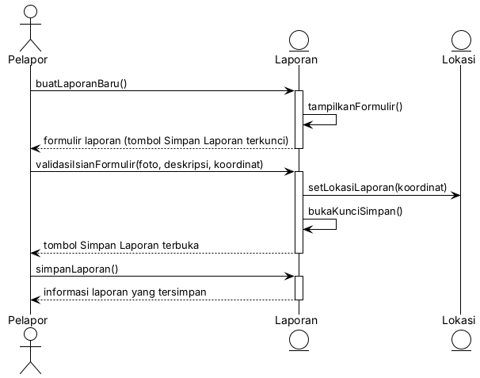
</p>
<p align="center">
<i>Gambar 3.1.2.1. Sequence Diagram [UC01]</i>
</p>

- **Skenario Alternatif 1: Pengguna tidak mengisi seluruh formulir**

<p align="center">
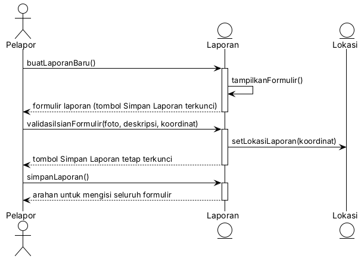
</p>
<p align="center">
<i>Gambar 3.1.2.2. Sequence Diagram [UC01] - [Pengguna tidak mengisi seluruh formulir]</i>
</p>

### 3.1.3 Diagram Kelas

<p align="center">
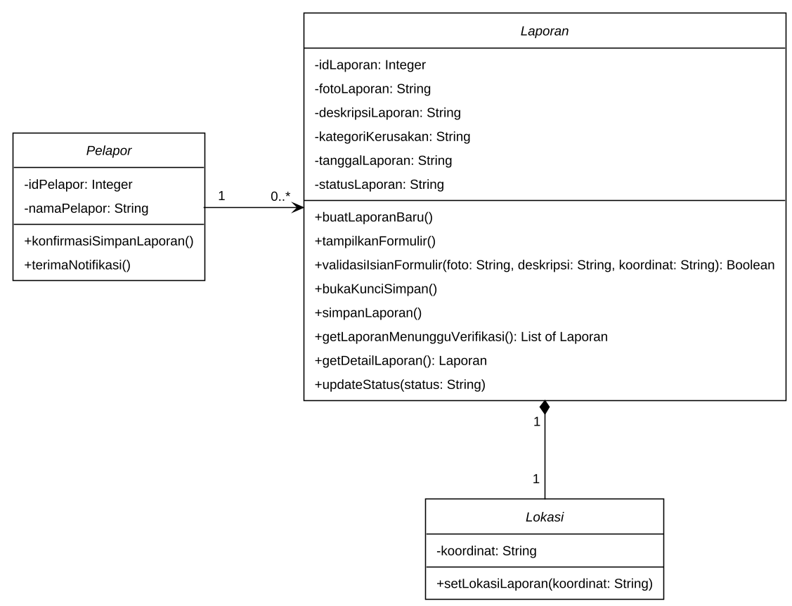
</p>
<p align="center">
<i>Gambar 3.1.3. Diagram Kelas Membuat Laporan Kerusakan Fasilitas</i>
</p>

## 3.2 Use Case Memverifikasi Laporan dan Menghitung Prioritas

**ID Use Case:** *UC02*  
**Nama Use Case:** *Memverifikasi Laporan dan Menghitung Prioritas*
### 3.2.1 Identifikasi Kelas

Tabel 3.2. Identifikasi Kelas Use Case [UC02]

| No | Nama Kelas Perancangan | Nama Kelas Analisis Terkait |
|:--- | :--- | :--- |
| 1 | *Pelapor* | *Pelapor* |
| 2 | *Admin* | *Admin* |
| 3 | *Laporan* | *Laporan* |
| 4 | *Verifikasi* | *Verifikasi* |
| 5 | *SkorPrioritas* | *SkorPrioritas* |
| 6 | *Notifikasi* | *Notifikasi* |


### 3.2.2 Sequence Diagram

- **Skenario Normal**

<p align="center">
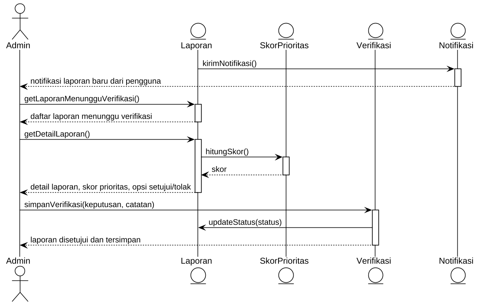
</p>
<p align="center">
<i>Gambar 3.2.2.1. Sequence Diagram [UC02]</i>
</p>

- **Skenario Alternatif 1: Admin menolak laporan**

<p align="center">
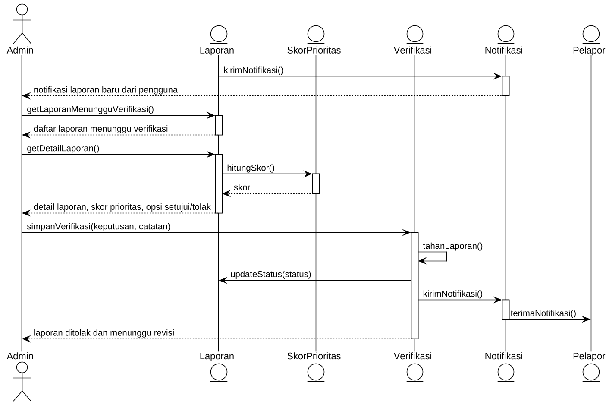
</p>
<p align="center">
<i>Gambar 3.2.2.2. Sequence Diagram [UC02] - [Admin menolak laporan]</i>
</p>

### 3.2.3 Diagram Kelas

<p align="center">
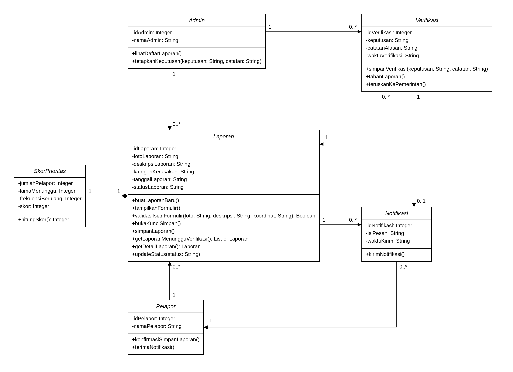
</p>
<p align="center">
<i>Gambar 3.2.3. Diagram Kelas Memverifikasi Laporan dan Menghitung Prioritas</i>
</p>

## 3.3 Use Case Menyaring dan Memantau Laporan Terverifikasi Berdasarkan Prioritas

**ID Use Case:** *UC03*  
**Nama Use Case:** *Menyaring dan Memantau Laporan Terverifikasi Berdasarkan Prioritas*

### 3.3.1 Identifikasi Kelas
Tabel 3.3. Identifikasi Kelas Use Case [UC03]

| No | Nama Kelas Perancangan | Nama Kelas Analisis Terkait |
|:--- | :--- | :--- |
| 1 | *PemerintahDaerah* | *PemerintahDaerah* |
| 2 | *Laporan* | *Laporan* |
| 3 | *Lokasi* | *Lokasi* |
| 4 | *SkorPrioritas* | *SkorPrioritas* |

### 3.3.2 Sequence Diagram

- **Skenario Normal**

<p align="center">

</p>
<p align="center">
<i>Gambar 3.3.2.1 Sequence Diagram [UC03]</i>
</p>

- **Skenario Alternatif 1 : Tidak ada laporan terverifikasi setelah diberikan filter**

<p align="center">

</p>
<p align="center">
<i>Gambar 3.3.2.2. Sequence Diagram [UC03] - [Tidak ada laporan terverifikasi setelah diberikan filter]</i>
</p>

- **Skenario Alternatif 2 : Tidak ada laporan terverifikasi**
<p align="center">
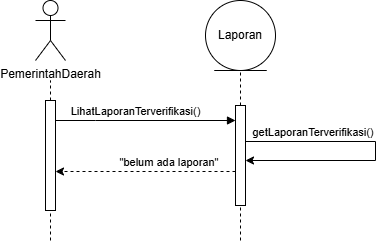
</p>
<p align="center">
<i>Gambar 3.3.2.3. Sequence Diagram [UC03] - [Tidak ada laporan terverifikasi]</i>
</p>


### 3.3.3 Diagram Kelas

<p align="center">
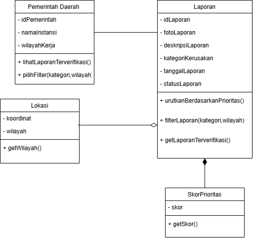
</p>
<p align="center">
<i>Gambar 3.3.3. Diagram Kelas [Use Case Menyaring dan Memantau Laporan Terverifikasi Berdasarkan Prioritas]</i>
</p>


## 3.4 Use Case Melihat Daftar dan Detail Laporan Publik

**ID Use Case:** *UC04*
**Nama Use Case:** *Melihat Daftar dan Detail Laporan Publik*

### 3.4.1 Identifikasi Kelas

Tabel 3.1. Identifikasi Kelas Use Case [UC04]

| No | Nama Kelas Perancangan | Nama Kelas Analisis Terkait |
|:--- | :--- | :--- |
| 1 | *Pelapor*  | *Pelapor*  |
| 2 | *Laporan* | *Laporan* |
| 2 | *Lokasi* | *Lokasi* |

### 3.4.2 Sequence Diagram

- **Skenario Normal**

<p align="center">
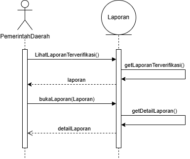
</p>
<p align="center">
<i>Gambar 3.4.2.1. Sequence Diagram [UC04]</i>
</p>

- **Skenario Alternatif 1: Laporan dipilih menggunakan filter**

<p align="center">
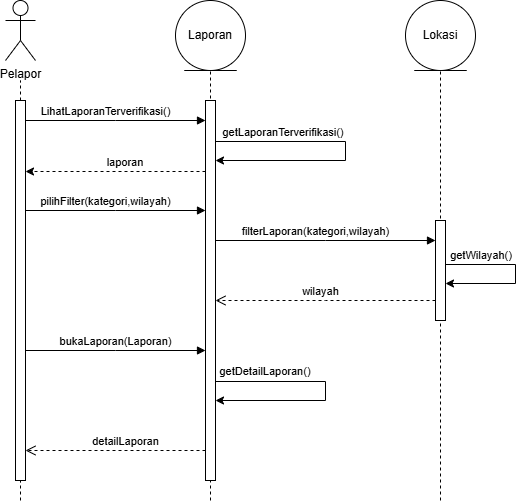
</p>
<p align="center">
<i>Gambar 3.4.2.2. Sequence Diagram [UC04] - [Laporan dipilih menggunakan filter]</i>
</p>


- **Skenario Alternatif 2: Tidak ada laporan yang muncul setelah menerapkan filter**

<p align="center">
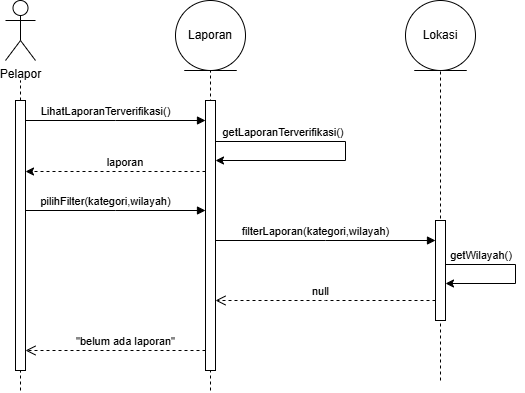
</p>
<p align="center">
<i>Gambar 3.4.2.3. Sequence Diagram [UC04] - [Tidak ada laporan yang muncul setelah menerapkan filter]</i>
</p>

- **Skenario Alternatif 3: Loading detail laporan terlalu lama**
<p align="center">
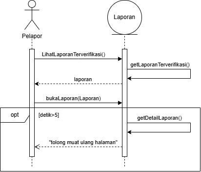
</p>
<p align="center">
<i>Gambar 3.4.2.4. Sequence Diagram [UC04] - [Loading detail laporan terlalu lama]</i>
</p>


### 3.4.3 Diagram Kelas

<p align="center">

</p>
<p align="center">
<i>Gambar 3.4.3. Diagram Kelas [Melihat Daftar dan Detail Laporan Publik]</i>
</p>


## 3.5 Use Case Memantau Status dan Riwayat Penanganan Laporan

**ID Use Case:** *UC05*
**Nama Use Case:** *Memantau Status dan Riwayat Penanganan Laporan*

### 3.5.1 Identifikasi Kelas

Tabel 3.1. Identifikasi Kelas Use Case [UC05]

| No | Nama Kelas Perancangan | Nama Kelas Analisis Terkait |
|:--- | :--- | :--- |
| 1 | *Pelapor*  | *Pelapor*  |
| 2 | *Laporan* | *Laporan* |
| 3 | *RiwayatStatus* | *RiwayatStatus* |

### 3.5.2 Sequence Diagram

- **Skenario Normal**

<p align="center">

</p>
<p align="center">
<i>Gambar 3.5.2.1. Sequence Diagram [UC05]</i>
</p>

- **Skenario Alternatif 1: Belum ada laporan yang dibuat**

<p align="center">

</p>
<p align="center">
<i>Gambar 3.5.2.2. Sequence Diagram [UC05] - [Belum ada laporan yang dibuat]</i>
</p>

- **Skenario Alternatif 2: Loading detail laporan terlalu lama**
<p align="center">
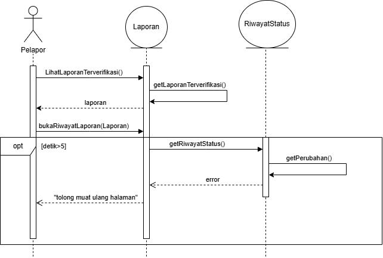
</p>
<p align="center">
<i>Gambar 3.5.2.3. Sequence Diagram [UC05] - [Loading detail laporan terlalu lama]</i>
</p>


### 3.5.3 Diagram Kelas

<p align="center">

</p>
<p align="center">
<i>Gambar 3.5.3. Diagram Kelas [Memantau Status dan Riwayat Penanganan Laporan]</i>
</p>

## 3.6 Use Case Meninjau Fasilitas dengan Kerusakan Berulang

**ID Use Case:** *UC06*  
**Nama Use Case:** *Meninjau Fasilitas dengan Kerusakan Berulang*

### 3.6.1 Identifikasi Kelas

Tabel 3.6. Identifikasi Kelas Use Case [UC06]

| No | Nama Kelas Perancangan | Nama Kelas Analisis Terkait |
|:--- | :--- | :--- |
| 1 | *Laporan* | *Laporan* |
| 2 | *Fasilitas* | *Fasilitas* |
| 3 | *Admin* | *Admin* |
| 4 | *Pemerintah Daerah* | *Pemerintah Daerah* |

### 3.6.2 Sequence Diagram

- **Skenario Normal**

<p align="center">
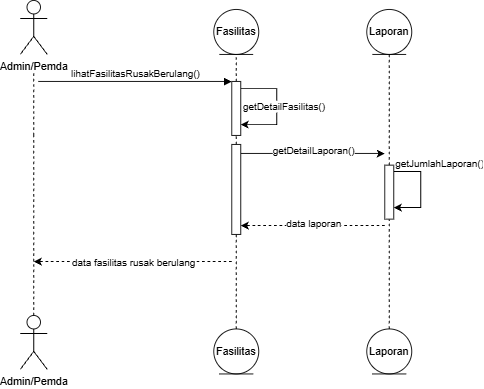
</p>
<p align="center">
<i>Gambar 3.6.2.1. Sequence Diagram [UC06]</i>
</p>

- **Skenario Alternatif 1: Tidak ada fasilitas yang muncul**

<p align="center">

</p>
<p align="center">
<i>Gambar 3.6.2.2. Sequence Diagram [UC06] - [Tidak ada fasilitas yang muncul]</i>
</p>

- **Skenario Alternatif 2: Loading dashboard terlalu lama**

<p align="center">

</p>
<p align="center">
<i>Gambar 3.6.2.3. Sequence Diagram [UC06] - [Loading dashboard terlalu lama]</i>
</p>

### 3.6.3 Diagram Kelas

<p align="center">

</p>
<p align="center">
<i>Gambar 3.6.3. Diagram Kelas Meninjau Fasilitas dengan Kerusakan Berulang
</i>
</p>

## 3.7 Use Case Mengonfirmasi dan Menggabungkan Laporan Duplikat

**ID Use Case:** *UC07*  
**Nama Use Case:** *Mengonfirmasi dan Menggabungkan Laporan Duplikat*

### 3.7.1 Identifikasi Kelas

Tabel 3.7. Identifikasi Kelas Use Case [UC07]

| No | Nama Kelas Perancangan | Nama Kelas Analisis Terkait |
|:--- | :--- | :--- |
| 1 | *Laporan* | *Laporan* |
| 2 | *Fasilitas* | *Fasilitas* |
| 3 | *Admin* | *Admin* |
| 4 | *SkorPrioritas* | *SkorPrioritas* |
| 5 | *KonfirmasiDuplikat* | *KonfirmasiDuplikat* |

### 3.7.2 Sequence Diagram

- **Skenario Normal**

<p align="center">
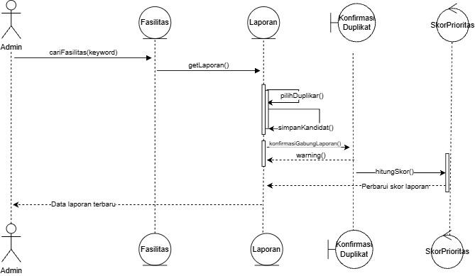
</p>
<p align="center">
<i>Gambar 3.7.2.1. Sequence Diagram [UC07]</i>
</p>

- **Skenario Alternatif 1: Admin salah memilih laporan duplikat**

<p align="center">

</p>
<p align="center">
<i>Gambar 3.7.2.2. Sequence Diagram [UC07] - [Admin salah memilih laporan duplikat]</i>
</p>

### 3.7.3 Diagram Kelas

<p align="center">

</p>
<p align="center">
<i>Gambar 3.7.3. Diagram Kelas Mengonfirmasi dan Menggabungkan Laporan Duplikat</i>
</p>

## 3.8 Use Case Melacak Riwayat Perubahan Status per Fasilitas

**ID Use Case:** *UC08*  
**Nama Use Case:** *Melacak Riwayat Perubahan Status per Fasilitas*

### 3.8.1 Identifikasi Kelas

Tabel 3.8. Identifikasi Kelas Use Case [UC08]

| No | Nama Kelas Perancangan | Nama Kelas Analisis Terkait |
|:--- | :--- | :--- |
| 1 | *Laporan* | *Laporan* |
| 2 | *Fasilitas* | *Fasilitas* |
| 3 | *RiwayatStatus* | *RiwayatStatus* |

### 3.8.2 Sequence Diagram

- **Skenario Normal**

<p align="center">
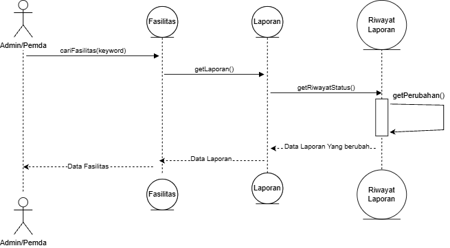
</p>
<p align="center">
<i>Gambar 3.8.2.1. Sequence Diagram [UC08]</i>
</p>

- **Skenario Alternatif 1: Admin/Pemerintah daerah mencari fasilitas yang tidak ada dalam list laporan yang berubah**

<p align="center">
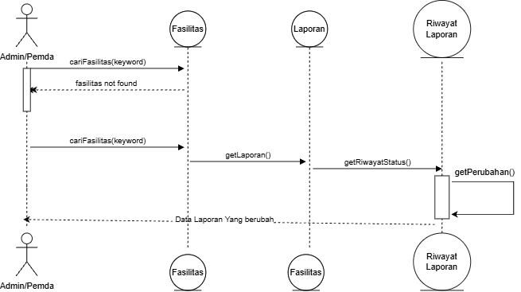
</p>
<p align="center">
<i>Gambar 3.8.2.2. Sequence Diagram [UC08] - [Admin/Pemerintah daerah mencari fasilitas yang tidak ada dalam list laporan yang berubah]</i>
</p>

### 3.8.3 Diagram Kelas

<p align="center">
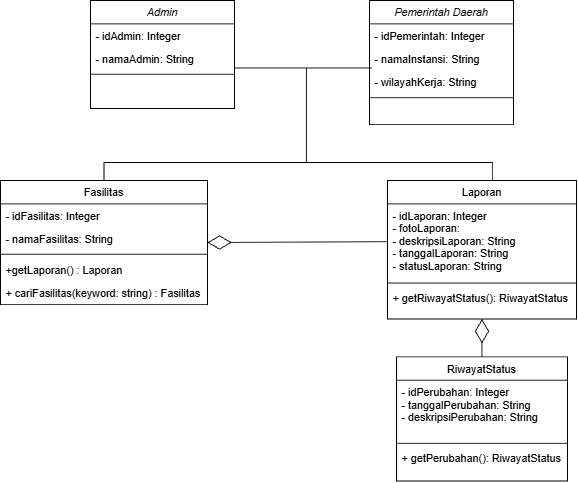
</p>
<p align="center">
<i>Gambar 3.8.3. Diagram Kelas Melacak Riwayat Perubahan Status per Fasilitas </i>
</p>

<br>

---

# BAB 4: Diagram Kelas Keseluruhan

## 4.1 Diagram Kelas


<p align="center">
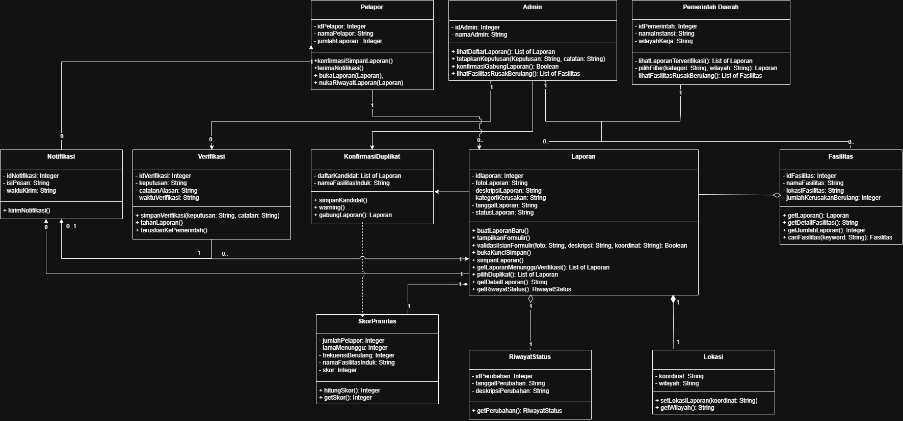
</p>
<p align="center">
<i>Gambar 4.1. Diagram Kelas Perancangan Keseluruhan SILEMBUR</i>
</p>

Tabel 4.1. Daftar Kelas Perancangan Keseluruhan

| ID Kelas | Nama Kelas | Atribut | Metode/Operasi |
| :--- | :--- | :--- | :--- |
| *C01* | *Pelapor* | *idPelapor: Integer, namaPelapor: String, jumlahLaporan: Integer* | *konfirmasiSimpanLaporan(laporan: Laporan), terimaNotifikasi(), bukaLaporan(Laporan), bukaRiwayatLaporan(Laporan)* |
| *C02* | *Admin* | *idAdmin: Integer, namaAdmin: String* | *lihatDaftarLaporan(): List of Laporan, tetapkanKeputusan(keputusan: String, catatan: String, laporan: Laporan), konfirmasiGabungLaporan(): Boolean, lihatFasilitasRusakBerulang(): List of Fasilitas* |
| *C03* | *PemerintahDaerah* | *idPemerintah: Integer, namaInstansi: String, wilayahKerja: String* | *lihatLaporanTerverifikasi(), pilihFilter(kategori, wilayah), lihatFasilitasRusakBerulang(): List of Fasilitas* |
| *C04* | *Laporan* | *idLaporan: Integer, fotoLaporan: String, deskripsiLaporan: String, kategoriKerusakan: String, tanggalLaporan: String, statusLaporan: String* | *buatLaporanBaru(), tampilkanFormulir(), validasiIsianFormulir(foto: String, deskripsi: String, koordinat: String): Boolean, bukaKunciSimpan(), simpanLaporan(), getLaporanMenungguVerifikasi(): List of Laporan, getDetailLaporan(): String, updateStatus(status), getLaporanTerverifikasi(), urutkanBerdasarkanPrioritas(listLaporan: List of Laporan), filterLaporan(kategori, wilayah), pilihDuplikat(): List of Laporan, getRiwayatStatus(): RiwayatStatus* |
| *C05* | *Lokasi* | *koordinat: String, wilayah: String* | *setLokasiLaporan(koordinat: String), getWilayah(): String* |
| *C06* | *Fasilitas* | *idFasilitas: Integer, namaFasilitas: String, lokasiFasilitas: String, jumlahKerusakanBerulang: Integer* | *getLaporan(): Laporan, cariFasilitas(keyword: String): Fasilitas, getDetailFasilitas(): String, getJumlahLaporan(): Integer* |
| *C07* | *Verifikasi* | *idVerifikasi: Integer, keputusan: String, catatanAlasan: String, waktuVerifikasi: String* | *simpanVerifikasi(keputusan: String, catatan: String), tahanLaporan(), teruskanKePemerintah()* |
| *C08* | *SkorPrioritas* | *jumlahPelapor: Integer, lamaMenunggu: Integer, frekuensiBerulang: Integer, namaFasilitasInduk: String, skor: Integer* | *hitungSkor(): Integer, getSkor(): Integer* |
| *C09* | *RiwayatStatus* | *idRiwayat: Integer, tanggalPerubahan: String, deskripsiPerubahan: String* | *getPerubahan(): RiwayatStatus* |
| *C10* | *Notifikasi* | *idNotifikasi: Integer, isiPesan: String, waktuKirim: String* | *kirimNotifikasi()* |
| *C11* | *KonfirmasiDuplikat* | *daftarKandidat: List of Laporan, namaFasilitasInduk: String* | *simpanKandidat(), warning(), gabungLaporan(): laporan* |

<br>

---

# BAB 5: Perancangan Rinci Kelas

Bagian ini diisi dengan daftar seluruh kelas dalam tabel berikut:

Tabel 5.1. Daftar Kelas Perancangan dan Kelas Analisis Terkait

| No | Nama Kelas Perancangan | Nama Kelas Analisis Terkait |
| :--- | :--- | :--- |
| 1 | *[Nama kelas perancangan]* | *[Nama kelas analisis pada SKPL atau -]* |
| 2 | *[Nama kelas perancangan]* | *[Nama kelas analisis pada SKPL atau -]* |
| ... | *...* | *...* |

Untuk **setiap kelas**, identifikasi operasi berdasarkan tanggung jawab kelas beserta *visibility*-nya, serta atribut beserta *visibility* dan tipenya. Buat subbab tersendiri untuk setiap kelas.

## 5.1 Kelas Pelapor

**Nama Kelas:** *Pelapor*  
**ID Kelas:** *C01*

Tabel 5.1.1. Operasi Kelas Pelapor

| Nama Operasi | Visibility (private, public) | Keterangan |
| :--- | :--- | :--- |
| *konfirmasiSimpanLaporan(laporan: Laporan)* | *Public* | *Mengonfirmasi dan menyimpan laporan baru ke dalam sistem* |
| *terimaNotifikasi()* | *Public* | *Menerima pemberitahuan status verifikasi laporan* |
| *bukaLaporan(laporan: Laporan)* | *Public* | *Membuka dan menampilkan detail laporan pelapor* |
| *bukaRiwayatLaporan(laporan: Laporan)* | *Public* | *Membuka riwayat perubahan status penanganan laporan* |

Tabel 5.1.2. Atribut Kelas Pelapor

| Nama Atribut | Visibility (private, public) | Tipe |
| :--- | :--- | :--- |
| *idPelapor* | *Private* | *Integer* |
| *namaPelapor* | *Private* | *String* |
| *jumlahLaporan* | *Private* | *Integer* |

### 5.1.1 Algoritma/Query

**Nama Kelas:** *Pelapor*  
**Nama Operasi:** *konfirmasiSimpanLaporan(laporan: Laporan)*  
**ID Algoritma:** *Algo-001*

```text
procedure konfirmasiSimpanLaporan(input/output laporan: Laporan)
{ I.S perubahan laporan belum tersimpan di database }
{ F.S laporan tersimpan di dalam database}

KAMUS LOKAL

ALGORTIMA
    if (laporan.validasiIsianFormulir(laporan.fotoLaporan, laporan.deskripsiLaporan, lokasi.koordinat)) then
        laporan.simpanLaporan()
        self.jumlahLaporan <- self.jumlahLaporan + 1
    else
        { jika formulir tidak tervalidasi, jangan lakukan apapun }
```

Tabel 5.1.3. Query Operasi konfirmasiSimpanLaporan()

| No Query | Query | Keterangan |
| :--- | :--- | :--- |
| *Q-001* | *INSERT INTO laporan (foto_laporan, deskripsi_laporan, tanggal_laporan, status_laporan, id_pelapor) VALUES (?, ?, NOW(), 'Menunggu Verifikasi', ?);* | *Menyimpan entri laporan baru yang telah dikonfirmasi pelapor ke basis data* |

## 5.2 Kelas Admin

**Nama Kelas:** *Admin*  
**ID Kelas:** *C02*

Tabel 5.2.1. Operasi Kelas Admin

| Nama Operasi | Visibility (private, public) | Keterangan |
| :--- | :--- | :--- |
| *lihatDaftarLaporan()* | *Public* | *Mengambil daftar seluruh laporan yang perlu ditinjau* |
| *tetapkanKeputusan(keputusan: String, catatan: String, laporan: Laporan)* | *Public* | *Menentukan keputusan verifikasi (setujui, tolak, atau revisi)* |
| *konfirmasiGabungLaporan()* | *Public* | *Mengonfirmasi penggabungan laporan yang teridentifikasi duplikat* |
| *lihatFasilitasRusakBerulang()* | *Public* | *Menampilkan daftar fasilitas yang mengalami kerusakan berulang* |

Tabel 5.2.2. Atribut Kelas Admin

| Nama Atribut | Visibility (private, public) | Tipe |
| :--- | :--- | :--- |
| *idAdmin* | *Private* | *Integer* |
| *namaAdmin* | *Private* | *String* |

### 5.2.1 Algoritma/Query

**Nama Kelas:** *Admin*  
**Nama Operasi:** *tetapkanKeputusan(keputusan: String, catatan: String, laporan: Laporan)*  
**ID Algoritma:** *Algo-002*

```text
Procedure tetapkanKeputusan(keputusan: String, catatan: String, laporan: Laporan)

KAMUS LOKAL

ALGORITMA
    if (keputusan = "Disetujui") then
        laporan.updateStatus("Disetejui")
        verifikasi <- createVerifikasi(laporan.idLaporan, keputusan, catatan)
        verifikasi.teruskanKePemerintah()
    else if (keputusan = "Ditolak")
        laporan.updateStatus("Ditolak")
        verifikasi <- createVerifikasi(laporan.idLaporan, keputusan, catatan)
```


Tabel 5.2.3. Query Operasi tetapkanKeputusan(keputusan: String, catatan: String, laporan: Laporan)

| No Query | Query | Keterangan |
| :--- | :--- | :--- |
| *Q-002* | *UPDATE laporan SET status_laporan = ? WHERE id_laporan = ?;* | *Memperbarui status laporan di basis data sesuai keputusan verifikasi admin* |
| *Q-003* | *INSERT INTO verifikasi (id_laporan, id_admin, keputusan, catatan_alasan, waktu_verifikasi) VALUES (?, ?, ?, ?, NOW());* | *Mencatat log hasil verifikasi admin ke basis data* |

## 5.3 Kelas PemerintahDaerah

**Nama Kelas:** *PemerintahDaerah*  
**ID Kelas:** *C03*

Tabel 5.3.1. Operasi Kelas PemerintahDaerah

| Nama Operasi | Visibility (private, public) | Keterangan |
| :--- | :--- | :--- |
| *lihatLaporanTerverifikasi()* | *Public* | *Menampilkan daftar laporan terverifikasi untuk ditindaklanjuti* |
| *pilihFilter(kategori: String, wilayah: String)* | *Public* | *Menyaring laporan berdasarkan kategori kerusakan dan wilayah kerja* |
| *lihatFasilitasRusakBerulang()* | *Public* | *Menampilkan daftar fasilitas publik dengan kerusakan berulang* |

Tabel 5.3.2. Atribut Kelas PemerintahDaerah

| Nama Atribut | Visibility (private, public) | Tipe |
| :--- | :--- | :--- |
| *idPemerintah* | *Private* | *Integer* |
| *namaInstansi* | *Private* | *String* |
| *wilayahKerja* | *Private* | *String* |

### 5.3.1 Algoritma/Query

**Nama Kelas:** *PemerintahDaerah*  
**Nama Operasi:** *pilihFilter(kategori: String, wilayah: String)*  
**ID Algoritma:** *Algo-003*

```text
function pilihFilter(kategori: String, wilayah: String) -> List of Laporan

KAMUS LOKAL
    daftarHasil, daftarLaporan: List of Laporan
    i : Integer

ALGORITMA
    daftarLaporan <- Laporan.getLaporanTerverifikasi()
    daftarHasil <- createListLaporan()

    traversal i [0..daftarLaporan.length-1]
        if (kategori = "" OR laporan.kategoriKerusakan = kategori) AND 
           (wilayah = "" OR laporan.lokasi.wilayah = wilayah) then
            appendLastElm(daftarHasil, daftarLaporan[i])

    daftarHasil.urutkanBerdasarkanPrioritas(listLaporan: List of Laporan)
    -> daftarHasil
```


Tabel 5.3.3. Query Operasi pilihFilter(kategori: String, wilayah: String)

| No Query | Query | Keterangan |
| :--- | :--- | :--- |
| *Q-004* | *SELECT l.*, s.skor FROM laporan l JOIN lokasi loc ON l.id_laporan = loc.id_laporan JOIN skor_prioritas s ON l.id_laporan = s.id_laporan WHERE l.status_laporan = 'Terverifikasi' AND (? = '' OR l.kategori_kerusakan = ?) AND (? = '' OR loc.wilayah = ?) ORDER BY s.skor DESC;* | *Mengambil daftar laporan terverifikasi berdasarkan kriteria filter yang terurut dari prioritas tertinggi* |

## 5.4 Kelas Laporan

**Nama Kelas:** *Laporan*  
**ID Kelas:** *C04*

Tabel 5.4.1. Operasi Kelas Laporan

| Nama Operasi | Visibility (private, public) | Keterangan |
| :--- | :--- | :--- |
| *buatLaporanBaru()* | *Public* | *Menginisialisasi formulir pembuatan laporan baru* |
| *tampilkanFormulir()* | *Public* | *Menampilkan antarmuka pengisian laporan* |
| *validasiIsianFormulir(foto: String, deskripsi: String, koordinat: String)* | *Public* | *Memeriksa kelengkapan data isian formulir* |
| *bukaKunciSimpan()* | *Public* | *Membuka akses tombol simpan setelah formulir valid* |
| *simpanLaporan()* | *Public* | *Menyimpan data laporan ke dalam basis data* |
| *getLaporanMenungguVerifikasi()* | *Public* | *Mengambil daftar laporan yang berstatus menunggu verifikasi* |
| *getDetailLaporan()* | *Public* | *Mengambil data rincian dari satu laporan* |
| *updateStatus(status: String)* | *Public* | *Memperbarui status penanganan laporan* |
| *getLaporanTerverifikasi()* | *Public* | *Mengambil daftar laporan yang sudah terverifikasi* |
| *urutkanBerdasarkanPrioritas(listLaporan: List of Laporan)* | *Public* | *Mengurutkan daftar laporan berdasarkan skor prioritas* |
| *filterLaporan(kategori: String, wilayah: String)* | *Public* | *Menyaring data laporan sesuai parameter* |
| *pilihDuplikat()* | *Public* | *Mengidentifikasi kandidat laporan yang berpotensi duplikat* |
| *getRiwayatStatus()* | *Public* | *Mengambil data riwayat perubahan status laporan* |

Tabel 5.4.2. Atribut Kelas Laporan

| Nama Atribut | Visibility (private, public) | Tipe |
| :--- | :--- | :--- |
| *idLaporan* | *Private* | *Integer* |
| *fotoLaporan* | *Private* | *String* |
| *deskripsiLaporan* | *Private* | *String* |
| *kategoriKerusakan* | *Private* | *String* |
| *tanggalLaporan* | *Private* | *String* |
| *statusLaporan* | *Private* | *String* |

### 5.4.1 Algoritma/Query

**Nama Kelas:** *Laporan*  
**Nama Operasi:** *validasiIsianFormulir(foto: String, deskripsi: String, koordinat: String)*  
**ID Algoritma:** *Algo-004*

```text
Function validasiIsianFormulir(foto: String, deskripsi: String, koordinat: String) -> Boolean

KAMUS LOKAL

ALGORITMA
    IF foto != "" AND deskripsi != "" AND koordinat != "" THEN
        self.bukaKunciSimpan()
        -> True
    ELSE
        -> False
```

### 5.4.2 Algoritma/Query

**Nama Kelas:** *Laporan*  
**Nama Operasi:** *urutkanBerdasarkanPrioritas(listLaporan: List of Laporan)*  
**ID Algoritma:** *Algo-005*

```text
Procedure urutkanBerdasarkanPrioritas(input/output listLaporan: List of Laporan)

KAMUS LOKAL
    i: Integer
    temp: Laporan

ALGORITMA
    travevrsal i [0...listLaporan.length - 1]
        traversal j [0...listLaporan.length - i - 2]
            if (listLaporan[j].skorPrioritas.skor < listLaporan[j+1].skorPrioritas.skor) then
                temp = listLaporan[j]
                listLaporan[j] = listLaporan[j+1]
                listLaporan[j+1] = temp+
```

## 5.5 Kelas Lokasi

**Nama Kelas:** *Lokasi*  
**ID Kelas:** *C05*

Tabel 5.5.1. Operasi Kelas Lokasi

| Nama Operasi | Visibility (private, public) | Keterangan |
| :--- | :--- | :--- |
| *setLokasiLaporan(koordinat: String)* | *Public* | *Menentukan koordinat geografis lokasi kerusakan* |
| *getWilayah()* | *Public* | *Mengambil nama wilayah berdasarkan koordinat* |

Tabel 5.5.2. Atribut Kelas Lokasi

| Nama Atribut | Visibility (private, public) | Tipe |
| :--- | :--- | :--- |
| *koordinat* | *Private* | *String* |
| *wilayah* | *Private* | *String* |

### 5.5.1 Algoritma/Query

**Nama Kelas:** *Lokasi*  
**Nama Operasi:** *setLokasiLaporan(koordinat: String)*  
**ID Algoritma:** *Algo-006*

```text
Procedure setLokasiLaporan(input koordinat: string)

KAMUS LOKAL

ALGORITMA
    self.koordinat <- koordinat
    self.wilayah <- GoogleMapsAdapter.getWilayahFromCoordinates(koordinat)
```


Tabel 5.5.3. Query Operasi setLokasiLaporan(koordinat: String)

| No Query | Query | Keterangan |
| :--- | :--- | :--- |
| *Q-005* | *INSERT INTO lokasi (id_laporan, koordinat, wilayah) VALUES (?, ?, ?);* | *Menyimpan informasi posisi geografis laporan ke dalam basis data* |

<br>

---

# BAB 6: Perancangan Antarmuka

## 6.1 Rancangan Antarmuka [ID Layar 1]

Masukkan versi awal prototipe antarmuka, dimana untuk setiap antarmuka/layar, tuliskan spesifikasi rinci objek yang ditampilkan dan reaksi sistem terhadap interaksi pengguna.

**Antarmuka:** *[ID layar]*  
**Nama Layar:** *[Nama layar]*

<p align="center">

</p>
<p align="center">
<i>Gambar 6.1. Rancangan Antarmuka [ID Layar] - [Nama Layar]</i>
</p>

Tabel 6.1. Spesifikasi Objek Antarmuka [ID Layar]

| Id_Objek | Jenis | Konten | Keterangan |
| :--- | :--- | :--- | :--- |
| *[ID objek]* | *[Jenis objek, misalnya Button, RTF Box, dll]* | *[String yang tampil pada layar]* | *[Reaksi sistem, layar tujuan, tautan, atau ID algoritma yang dijalankan]* |
| *[ID objek]* | *[Jenis objek]* | *[Konten yang ditampilkan]* | *[Reaksi sistem atau nama file terkait beserta deskripsi ringkasnya]* |
| *...* | *...* | *...* | *...* |


## 6.8 Rancangan Antarmuka [ID Layar 8]


**Antarmuka:** *I-08*  
**Nama Layar:** *Daftar Laporan Terverifikasi*

<p align="center">
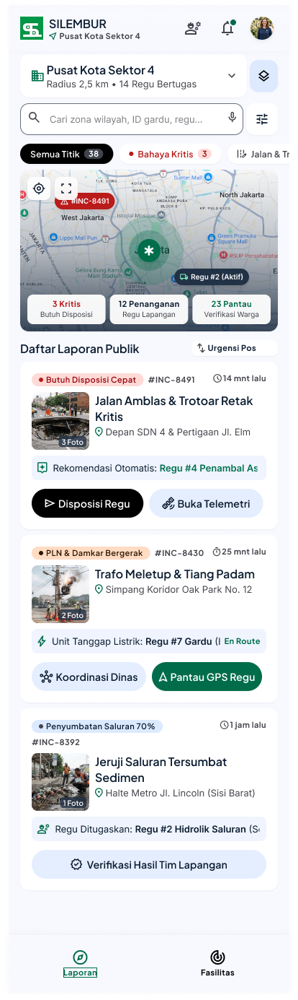
</p>
<p align="center">
<i>Gambar 6.8. Rancangan Antarmuka [I-08] - Daftar Laporan Terverifikasi</i>
</p>

Tabel 6.8. Spesifikasi Objek Antarmuka [ID Layar]

| Id_Objek | Jenis | Konten | Keterangan |
| :--- | :--- | :--- | :--- |
| *O-0801* | *Dropdown sektor/wilayah* | *Wilayah* | *Menunjukkan wilayah-wilayah yang ada, getWilayah()* |
| *O-0802* | *Search input dan filter* | *Search bar dan filter* | *Menunjukkan laporan yang sesuai dengan filter, getLaporanTerverifikasi() pilihFilter()* |
| *O-0803* | *Interactive map* | *Peta wilayah* | *Menunjukkan lokasi-lokasi objek penting di peta* |
| *O-0804* | *Card laporan* | *Detail Laporan dan footer tombol aksi* | *Tombol aksi sesuai jenis laporan* |
| *O-0805* | *Navigasi fasilitas* | *Fasilitas* | *Menuju I-09* |

## 6.9 Rancangan Antarmuka [ID Layar 9]


**Antarmuka:** *I-09*  
**Nama Layar:** *Daftar Fasilitas*

<p align="center">
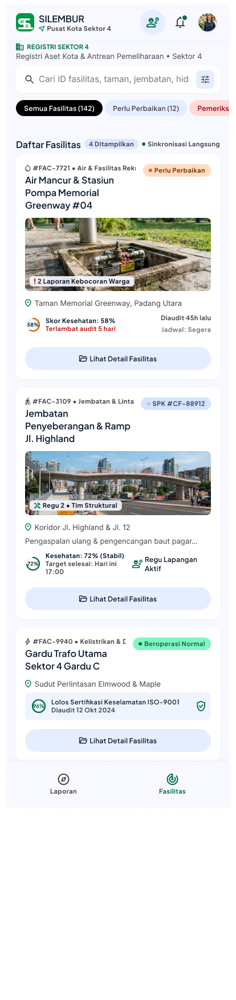
</p>
<p align="center">
<i>Gambar 6.9. Rancangan Antarmuka [I-09] - Daftar Fasilitas</i>
</p>

Tabel 6.9. Spesifikasi Objek Antarmuka [I-09]

| Id_Objek | Jenis | Konten | Keterangan |
| :--- | :--- | :--- | :--- |
| *O-0901* | *Search input dan filter* | *Search bar dan filter* | *Menunjukkan fasilitas yang sesuai dengan filter, cariFasilitas()* |
| *O-0902* | *Card fasilitas* | *Informasi umum fasilitas dan tombol aksi Lihat Detail* | *Tombol aksi menuju ke I-10* |
| *O-0903* | *Navigasi laporan* | *Laporan* | *Menuju I-08* |

## 6.10 Rancangan Antarmuka [ID Layar 10]


**Antarmuka:** *I-10*  
**Nama Layar:** *Detail Fasilitas*

<p align="center">
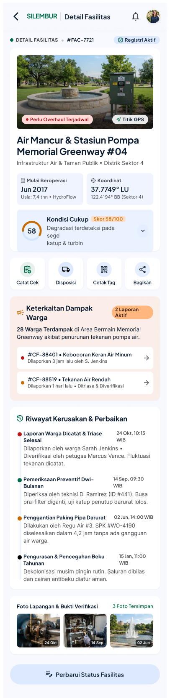
</p>
<p align="center">
<i>Gambar 6.10. Rancangan Antarmuka [I-10] - Detail Fasilitas</i>
</p>

Tabel 6.10. Spesifikasi Objek Antarmuka [I-10]

| Id_Objek | Jenis | Konten | Keterangan |
| :--- | :--- | :--- | :--- |
| *O-1001* | *Card detail* | *Lokasi, tingkat kerusakan, nama fasilitas* | *Menunjukkan detail fasilitas, getDetailFasilitas()* |
| *O-1002* | *Card laporan menunjuk fasilitas* | *Informasi laporan yang menunjuk fasilitas* | *Tombol aksi menuju ke I-08, getLaporan() getJumlahLaporan()* |
| *O-1004* | *Card riwayat dan foto* | *Riwayat fasilitas dan perbaikan serta foto beserta timestamp* | *getRiwayatLaporan()* |
| *O-1005* | *Button perbarui status* | *Perbarui status fasilitas* | *Merubah riwayat status, getPerubahan()* |


## 6.11 Rancangan Antarmuka Keseluruhan

Tabel 6.11. Rancangan Antarmuka Keseluruhan

| No | Tampilan Antarmuka |
| :--- | :--- |
| *[I-01]* |  |
| *[I-02]* | *[Sisipkan gambar antarmuka I-02]* |
| *[I-08]* |  |
| *[I-09]* |  || *[I-10]* |  |

<br>

---

# BAB 7: Matriks Kerunutan

Tabel 7.1. Matriks Kerunutan Kelas terhadap Use Case

| Kelas | Use Case Terkait |
| :--- | :--- |
| *C01-Pelapor* | *UC01-Membuat Laporan Kerusakan Fasilitas*<br>*UC04-Melihat Daftar dan Detail Laporan Publik*<br>*UC05-Memantau Status dan Riwayat Penanganan Laporan* |
| *C02-Admin* | *UC02-Memverifikasi Laporan dan Menghitung Prioritas*<br>*UC06-Meninjau Fasilitas dengan Kerusakan Berulang*<br>*UC07-Mengonfirmasi dan Menggabungkan Laporan Duplikat*<br>*UC08-Melacak Riwayat Perubahan Status per Fasilitas* |
| *C03-Pemerintah Daerah* | *UC03-Menyaring dan Memantau Laporan Terverifikasi Berdasarkan Prioritas*<br>*UC06-Meninjau Fasilitas dengan Kerusakan Berulang*<br>*UC08-Melacak Riwayat Perubahan Status per Fasilitas* |
| *C04-Laporan* | *UC01-Membuat Laporan Kerusakan Fasilitas*<br>*UC02-Memverifikasi Laporan dan Menghitung Prioritas*<br>*UC03-Menyaring dan Memantau Laporan Terverifikasi Berdasarkan Prioritas*<br>*UC04-Melihat Daftar dan Detail Laporan Publik*<br>*UC05-Memantau Status dan Riwayat Penanganan Laporan*<br>*UC06-Meninjau Fasilitas dengan Kerusakan Berulang*<br>*UC07-Mengonfirmasi dan Menggabungkan Laporan Duplikat*<br>*UC08-Melacak Riwayat Perubahan Status per Fasilitas* |
| *C05-Lokasi* | *UC01-Membuat Laporan Kerusakan Fasilitas* |
| *C06-Fasilitas* | *UC06-Meninjau Fasilitas dengan Kerusakan Berulang*<br>*UC07-Mengonfirmasi dan Menggabungkan Laporan Duplikat*<br>*UC08-Melacak Riwayat Perubahan Status per Fasilitas* |
| *C07-Verifikasi* | *UC02-Memverifikasi Laporan dan Menghitung Prioritas* |
| *C08-SkorPrioritas* | *UC02-Memverifikasi Laporan dan Menghitung Prioritas*<br>*UC03-Menyaring dan Memantau Laporan Terverifikasi Berdasarkan Prioritas*<br>*UC07-Mengonfirmasi dan Menggabungkan Laporan Duplikat* |
| *C09-RiwayatStatus* | *UC05-Memantau Status dan Riwayat Penanganan Laporan*<br>*UC08-Melacak Riwayat Perubahan Status per Fasilitas* |
| *C10-Notifikasi* | *UC02-Memverifikasi Laporan dan Menghitung Prioritas* |
| *C11-KonfirmasiDuplikat* | *UC07-Mengonfirmasi dan Menggabungkan Laporan Duplikat* |

# Lampiran

Figma: https://www.figma.com/design/ewLyeeZbIkVAsxEOJItaNX/Untitled?node-id=0-1&t=ysapFCmwkCZC1Qwe-1
