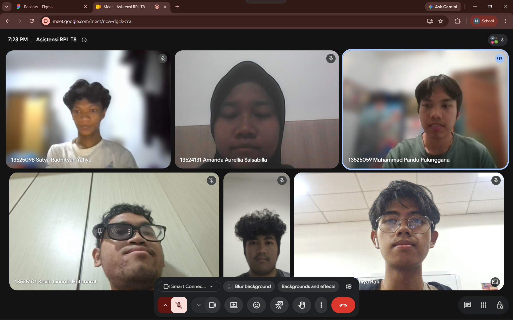

# Form Asistensi

## Tugas Besar IF2150 - Rekayasa Perangkat Lunak

| Informasi | Keterangan |
| --- | --- |
| **Hari** | *Jumat* |
| **Tanggal** | *27/10/2026* |
| **Kelas** | *K02* |
| **Nomor Kelompok** | *G03*  |
| **Nama Kelompok** | *LockedIn*  |
| **Nama Perangkat Lunak** | *Silembur*  |
| **Dokumen** | *K02_G03_RG*  |

### Anggota Kelompok

| NIM | Nama |
| --- | --- |
| *13525059* | *Muhammad Pandu Pulunggana* |
| *13525128* | *Mochamad Fachri Alfaridzi* |
| *13525101* | *Kevin Lincoln Hutabarat* |
| *13525035* | *Muhammad Dhiya Rafi* |
| *13525098* | *Satya Radhityan Yahya* |

### Catatan

| Catatan |
| --- |
| 1. Perbaikan yang ada di M7 (Logo dan Gambar) dituliskan detail perubahan di tabel perubahan. |
| 2. Perbedaan kelas perancangan dan kelas analisis terkait adalah ada di perbedaan namanya saja. kelas perancangan adalah nama kelas yang baru, sedangkan kelas analisis terkait adalah nama kelas dalam SKPL. |
| 3. Algoritma yang ada di 5.1.1 tulis algoritma yang penting saja, fungsi-fungsi helper tidak perlu untuk ditulis. Tidak semua kelas harus dibuat pseudocodenya. |
| 4. Pseudocode lebih ke bahasa manusia (notasi algoritma), kalau skeleton code sudah mulai ngoding tapi belum implementasi riilnya, tetapi disaranin memakai pseudocode agar lebih general agar lebih umum. |
| 5. Dalam pembentukan UI, pakai AI untuk membuat rencana dan gambaran umum dari UInya. Harapannya saat di figmanya bisa eksplor sendiri. |

## Dokumentasi

<!--  -->

  

  <i>Gambar 1. Dokumentasi kegiatan asistensi.</i>

